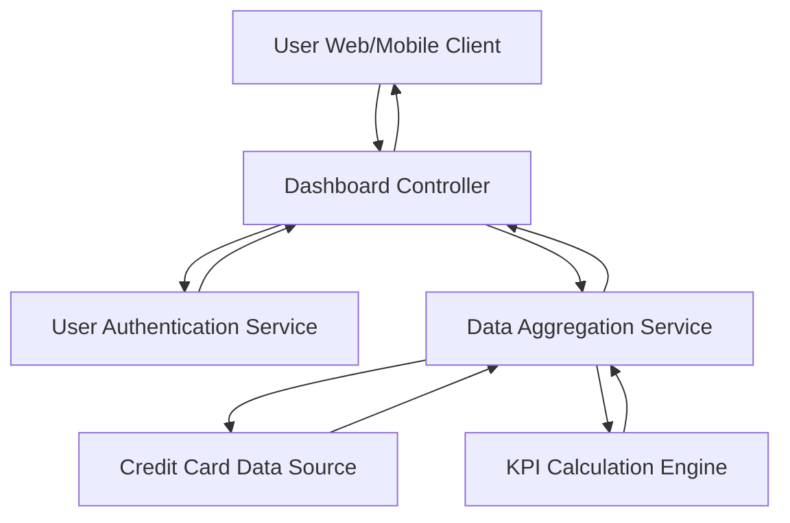

#### 1. High-Level Design

- **Summary:** This epic creates a consolidated dashboard displaying critical KPIs for the user's credit card portfolio including monthly spend, total credit limit, available credit, and outstanding amounts across all cards. It provides real-time or near real-time visibility into credit utilization and financial health with responsive design across desktop, tablet, and mobile devices, loading within 2 seconds.

- **Component Flow:**

- **Integration Points:**
  - **Upstream:** User Authentication Service (for secure user access and session management)
  - **Upstream:** Credit Card Data Source/Database (for real-time card data)
  - **Internal:** Data Aggregation Service (for multi-card KPI consolidation)
  - **Internal:** KPI Calculation Engine (for computing monthly spend, available credit, outstanding amounts)

- **Key Assumptions:**
  - Credit card data is updated in real-time or near real-time in the data source to support current KPI calculations.
  - User authentication tokens/sessions have sufficient validity and refresh mechanisms to maintain dashboard access without frequent re-authentication.

- **NFR Highlights:** Dashboard must be responsive across desktop, tablet, and mobile devices; KPI data refresh in real-time or near real-time; support concurrent viewing by multiple users; dashboard load time under 2 seconds.

- **Data Flow:** User accesses dashboard via Web/Mobile Client → Dashboard Controller authenticates user via User Authentication Service → Upon successful authentication, Dashboard Controller requests KPI data from Data Aggregation Service → Data Aggregation Service queries Credit Card Data Source for all user's card data → Raw card data passed to KPI Calculation Engine → KPI Calculation Engine computes monthly spend, total credit limit, available credit, and outstanding amounts across all cards → Aggregated KPIs returned to Dashboard Controller → Dashboard Controller formats responsive layout for device type → Dashboard rendered to User Client (within 2 seconds) → Real-time/near real-time updates pushed to maintain current KPI values.

#### 2. Validation Report

- **Requirements Coverage:** The design fully addresses the epic scope including dashboard interface design, monthly spend calculation and display, total credit limit aggregation, available credit computation, outstanding amount tracking, responsive layout implementation, and multi-card KPI consolidation. The architecture satisfies all NFRs through responsive design patterns, real-time data integration, dedicated aggregation service for multi-user concurrency, and optimized component interactions to achieve sub-2-second load times. The separation of concerns between authentication, aggregation, calculation, and presentation ensures scalability and maintainability.