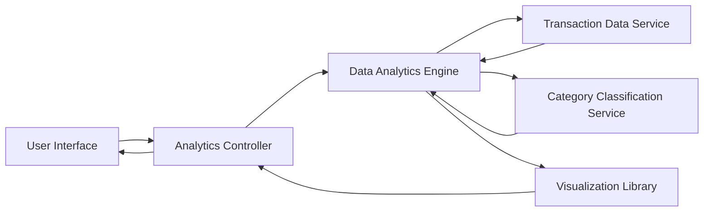

#### 1. High-Level Design

- **Summary:** This epic provides comprehensive spending analytics with interactive visualizations to help users understand spending patterns across nine predefined categories (Food & Dining, Fuel, Shopping, Travel, Entertainment, Utilities, Healthcare, Education, Miscellaneous). It delivers monthly trend analysis, card-wise breakdowns, and time-based analysis with at least 12 months of historical data support.

- **Component Flow:**

- **Integration Points:**
  - **Upstream:** Transaction Data Service (for transaction history and spending data)
  - **Internal:** Data Analytics Engine (for calculations and pattern analysis)
  - **Internal:** Category Classification Service (for categorizing transactions into 9 predefined categories)
  - **Frontend:** Visualization Library/Framework (for rendering interactive charts and graphs)

- **Key Assumptions:**
  - Transactions are pre-categorized or can be classified into the nine predefined categories with sufficient accuracy by the Category Classification Service.
  - Historical transaction data for at least 12 months is available and accessible through the Transaction Data Service with acceptable query performance.

- **NFR Highlights:** Visualizations must be interactive and responsive; chart rendering within 1 second; support 12+ months historical data; analytics accurate to 2 decimal places; support concurrent analytics queries.

- **Data Flow:** User requests spending analytics → Analytics Controller receives request → Data Analytics Engine queries Transaction Data Service for historical transaction data (12+ months) → Category Classification Service categorizes transactions into 9 predefined categories → Data Analytics Engine performs aggregations (monthly trends, category-wise totals, card-wise breakdowns) with 2-decimal precision → Processed data sent to Visualization Library → Interactive charts/graphs rendered (within 1 second) → Analytics Controller delivers visualizations to User Interface → User interacts with responsive, time-based analytics views.

#### 2. Validation Report

- **Requirements Coverage:** The design comprehensively addresses all scope elements including category-wise spending visualization, monthly spend trend analysis, interactive charts, nine category tracking, spending pattern identification, card-wise spend breakdown, and time-based analysis. The architecture satisfies NFRs through dedicated analytics engine for performance, visualization library for 1-second rendering, transaction data service for 12-month history, and proper precision handling. The component separation ensures scalability for concurrent queries.