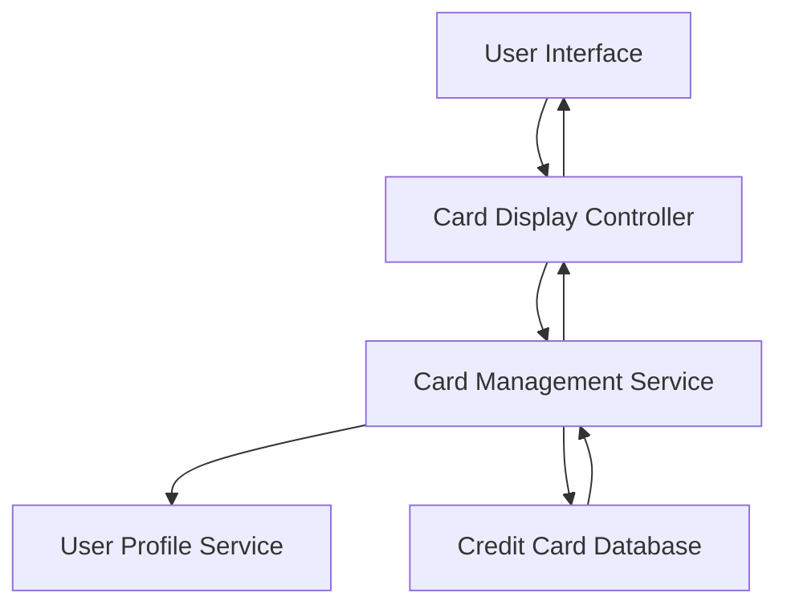

#### 1. High-Level Design

- **Summary:** This epic delivers a unified interface for users to manage and view multiple credit cards (10-15 cards per user). It consolidates card-specific details including card type, limits, balances, and individual spend analysis, eliminating the need for multiple banking app logins and providing holistic portfolio oversight.

- **Component Flow:**

- **Integration Points:**
  - **Upstream:** User Profile Service (for user authentication and profile data)
  - **Downstream:** Credit Card Database/Data Repository (for card information retrieval)
  - **Internal:** Card Information Management System (for card data processing and organization)

- **Key Assumptions:**
  - Card data is stored in a structured format with standardized fields (card type, limit, balance, etc.) in the credit card database.
  - User authentication and session management are handled by the User Profile Service with secure token-based access.

- **NFR Highlights:** System must support 10-15 cards per user with optimized data retrieval performance; data security and privacy compliance for sensitive card information; interface must maintain usability as card count increases.

- **Data Flow:** User authenticates via User Profile Service → Card Display Controller requests card list for authenticated user → Card Management Service queries Credit Card Database for all cards associated with user → Database returns card details (type, limits, balances, spend data) → Card Management Service aggregates and formats data → Card Display Controller renders multi-card interface → User views consolidated card portfolio with individual card details and can select specific cards for detailed views.

#### 2. Validation Report

- **Requirements Coverage:** The design fully covers the epic's stated scope including multiple credit card display interface, card-wise information presentation, card listing and organization, individual card detail views, card-wise spend analysis, and card identification. The architecture supports the NFRs for 10-15 cards per user, optimized performance, usability, and data security through proper service separation and database integration.