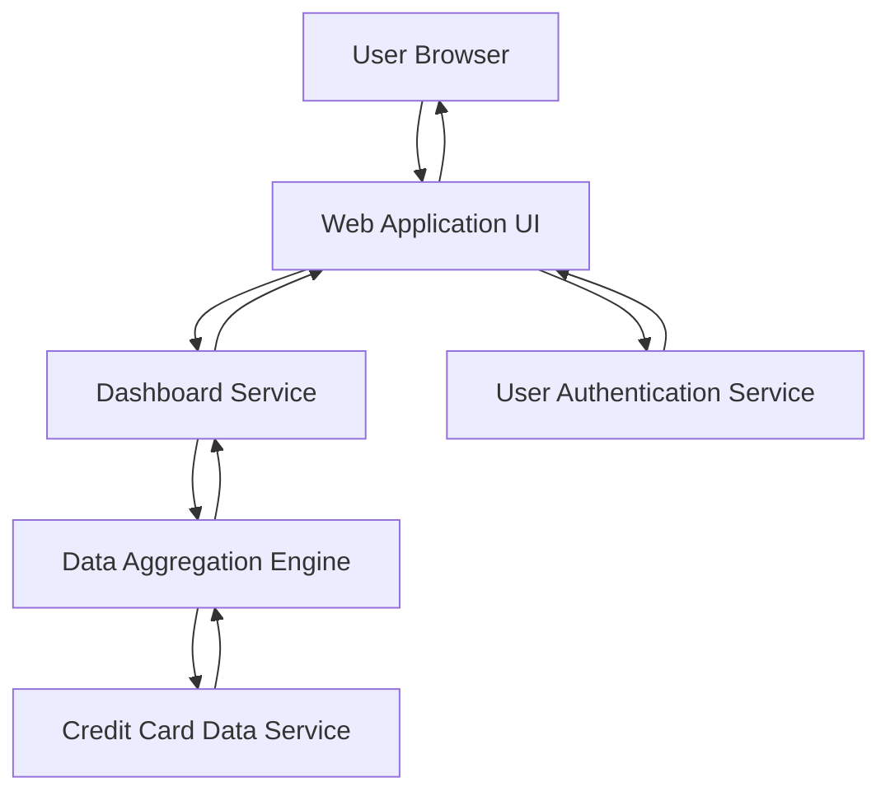

#### 1. High-Level Design

**Summary:** This epic delivers a consolidated dashboard that aggregates and displays key performance indicators (KPIs) across all user credit cards, including monthly spending, total credit limits, available credit, and outstanding amounts. The dashboard provides real-time financial health visibility through a responsive, modern interface accessible across devices.

**Component Flow:**

**Integration Points:**
- **Upstream:** Credit Card Data Service (retrieves card information, balances, and transaction data); User Authentication Service (validates user identity and session)
- **Downstream:** Dashboard UI components consume aggregated KPI data for visualization

**Key Assumptions:**
- Credit Card Data Service provides RESTful APIs with JSON payloads for real-time data retrieval
- KPI calculations (available credit, outstanding amounts) are performed server-side by the Data Aggregation Engine

**NFR Highlights:** Dashboard must be responsive across desktop, tablet, and mobile devices; Page load time under 2 seconds; Real-time data refresh support for KPI metrics

#### 2. Validation Report

**Requirements Coverage:** The design fully covers the epic's stated scope by providing a dashboard architecture that supports KPI display, monthly spend tracking, credit limit aggregation, available credit calculation, outstanding amount monitoring, multiple card views, and responsive UI design. The component flow ensures real-time data retrieval and aggregation while meeting the specified NFRs for responsiveness and performance.