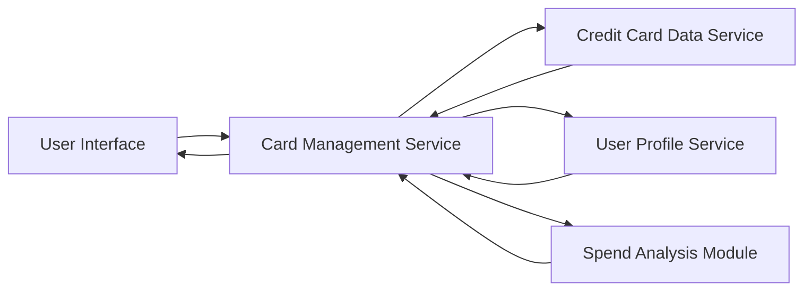

#### 1. High-Level Design

**Summary:** This epic enables users to manage and monitor multiple credit cards from a unified interface. Users can view consolidated card listings, access detailed information for individual cards, and perform card-specific spend analysis. The system tracks card limits, balances, and usage patterns across all registered cards.

**Component Flow:**

**Integration Points:**
- **Upstream:** Credit Card Data Service (provides card information, balances, and transaction data); User Profile Service (links cards to user accounts and manages user-card relationships)
- **Downstream:** UI components for card listing, detail views, and spend analysis visualizations

**Key Assumptions:**
- Card numbers are stored in encrypted format and displayed with masking (e.g., last 4 digits visible)
- Card-wise spend analysis aggregates transaction data on-demand with caching for performance optimization

**NFR Highlights:** Support minimum 10 credit cards per user; Card data retrieval latency under 500ms; Secure storage and display of card information with masked card numbers

#### 2. Validation Report

**Requirements Coverage:** The design addresses all functional requirements including multiple card display, individual card details, card-wise spend analysis, card information management, and card selection/filtering. The architecture ensures secure card data handling with masking and meets the NFRs for scalability (10+ cards per user) and performance (sub-500ms latency).