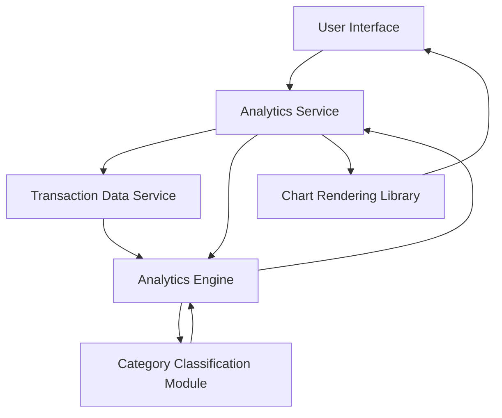

#### 1. High-Level Design

**Summary:** This epic delivers comprehensive spending analytics through interactive visualizations and transaction tracking across nine spending categories (Food & Dining, Fuel, Shopping, Travel, Entertainment, Utilities, Healthcare, Education, Miscellaneous). Users can analyze monthly spend trends, view category-wise breakdowns, and explore transaction history to understand financial behavior patterns.

**Component Flow:**

**Integration Points:**
- **Upstream:** Transaction Data Service (retrieves transaction history and raw transaction data); Analytics Engine (processes, categorizes, and aggregates spending data)
- **Downstream:** Chart Rendering Library (generates interactive visualizations); UI components for displaying analytics and transaction lists

**Key Assumptions:**
- Transactions are pre-categorized by the Analytics Engine using rule-based or ML-based classification; historical data for 12+ months is readily available from Transaction Data Service
- Chart rendering is client-side using a JavaScript library (e.g., Chart.js, D3.js) with data fetched via API

**NFR Highlights:** Analytics visualizations must render within 1 second; Support historical data analysis for minimum 12 months; Handle minimum 1000 transactions per user efficiently

#### 2. Validation Report

**Requirements Coverage:** The design comprehensively covers all requirements including category-wise spending visualization, monthly spend trends analysis, transaction listing and filtering, interactive charts and graphs, spending pattern identification across nine categories, and transaction history view. The architecture supports the specified NFRs for performance (1-second rendering), data retention (12 months), and scalability (1000+ transactions per user).