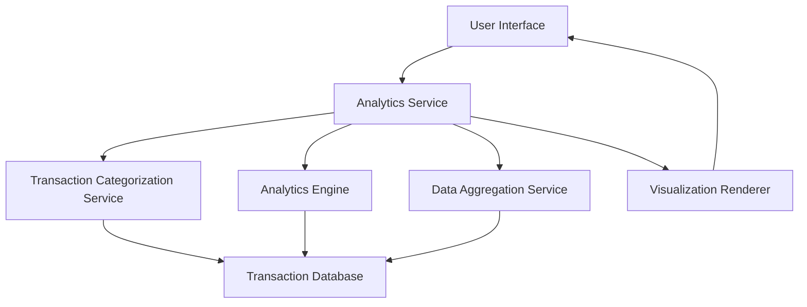

#### 1. High-Level Design

- **Summary:** This epic provides interactive visualizations and analytics capabilities to help users understand spending behavior across different categories and time periods. Users can view monthly spend trends, analyze category-wise spending patterns across nine predefined categories (Food & Dining, Fuel, Shopping, Travel, Entertainment, Utilities, Healthcare, Education, Miscellaneous), and gain actionable insights for budget optimization and financial planning.

- **Component Flow:**

- **Integration Points:**
  - **Upstream:** Transaction Database (source of raw transaction data for analysis)
  - **Downstream:** Transaction Categorization Service (for automatic expense classification into predefined categories), Analytics Engine (for trend calculation and pattern detection), Data Aggregation Service (for monthly summaries and historical data processing)

- **Key Assumptions:**
  - Transactions are automatically categorized using rule-based or ML-based classification with 95%+ accuracy.
  - Historical data is aggregated and stored monthly to optimize query performance for trend analysis.

- **NFR Highlights:** Visualizations must render within 1.5 seconds; support interactive filtering and drill-down capabilities; handle at least 12 months of historical transaction data for trend analysis.

- **Data Flow:** User accesses analytics dashboard → Analytics Service requests categorized transaction data from Transaction Categorization Service → Service retrieves and classifies transactions from Transaction Database into nine categories → Data Aggregation Service computes monthly summaries and historical trends → Analytics Engine performs pattern detection and trend calculations → Processed data sent to Visualization Renderer → Interactive charts and graphs rendered in UI within 1.5 seconds → User applies filters or drill-down actions → Analytics Service re-queries aggregated data and updates visualizations dynamically → Insights displayed showing spending patterns, category breakdowns, and monthly trends over 12-month period.

#### 2. Validation Report

- **Requirements Coverage:** The design fully addresses the epic's scope including category-wise spending visualization, monthly spend trends, interactive charts and graphs, spending pattern analysis, and category breakdown for all nine specified categories (Food & Dining, Fuel, Shopping, Travel, Entertainment, Utilities, Healthcare, Education, Miscellaneous). The 1.5-second rendering NFR is achievable through pre-aggregated monthly data and optimized query patterns. Interactive filtering and drill-down capabilities are supported via dynamic query execution. The system handles 12+ months of historical transaction data through the Data Aggregation Service. Integration dependencies with Transaction Categorization Service, Analytics Engine, and Data Aggregation Service are clearly defined. Out-of-scope items (predictive analytics, budget setting and alerts, expense export functionality, third-party financial tool integration) are explicitly excluded from this design.