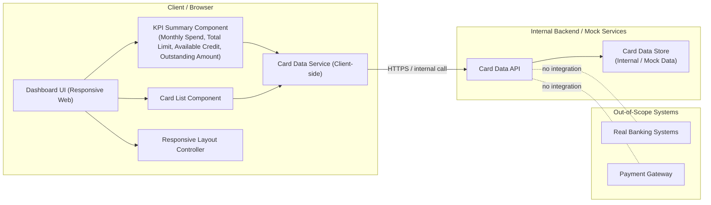

# High-Level Design (HLD)

## 1. Epic Overview

**Project Key:** QE  
**Epic Summary:** UATTESTING$-Consolidated Multi-Card Dashboard KPIs  

**Epic Description (verbatim from Jira):**  
Design and deliver a modern, responsive dashboard that provides credit card users with a consolidated view of all their cards and key financial KPIs. Users will be able to see monthly spend, total credit limit across cards, available credit, and outstanding amounts in one unified interface. The focus is on clear, intuitive presentation of these metrics for users managing one or multiple credit cards.

**User Value:**  
Enables users to quickly understand their overall credit exposure and spending status across multiple cards, improving visibility into monthly spending and outstanding balances and supporting better financial decisions.

**Scope (High Level):**  
- Consolidated multi-card dashboard layout  
- Display of multiple credit cards and their core attributes  
- Monthly spend KPI across cards  
- Total credit limit KPI across cards  
- Available credit KPI  
- Overall outstanding amount KPI  
- Responsive UI behavior across devices

**NFRs (from epic, verbatim):**  
- Dashboard must be responsive across common device sizes.  
- Visualizations and KPIs should load within acceptable time for typical dashboard usage.  
- Design should follow basic security best practices for displaying non-sensitive financial summaries without exposing real banking credentials.

**Dependencies/Integrations (from epic, verbatim):**  
- Internal data source or mock services for card metadata and balances.  
- Front-end charting or UI libraries for KPI visualization.  
- No direct integration with real banking systems.

**Out of Scope (from epic, verbatim):**  
- Real Bank Integration  
- Card Payments  
- Fund Transfers  
- Loans  
- Payment Gateway Integration  
- Any functionality that initiates or processes real financial transactions

> Note: No additional functional or non-functional requirements beyond what is explicitly stated in the epic have been assumed. All interpretations below are high-level design assumptions and not confirmed implementation details.

---

## 2. Requirements

### 2.1 Functional Requirements (Derived from Epic Text)

These are **interpretations** of the epic description and scope. They must be validated with stakeholders.

1. **FR-1: Multi-card dashboard overview**  
   The system should present a dashboard view that consolidates information across all of a users credit cards.

2. **FR-2: Display multiple cards and core attributes**  
   The dashboard should list each credit card with its core attributes (exact set of attributes is **not specified** in the epic and remains an open design item).

3. **FR-3: Monthly spend KPI (all cards)**  
   The dashboard should display a monthly spend KPI aggregated across all cards. The precise definition of monthly spend (e.g., calendar month vs. statement period, cleared vs. pending transactions) is **not specified** and requires clarification.

4. **FR-4: Total credit limit KPI (all cards)**  
   The dashboard should display the total credit limit summed across all cards.

5. **FR-5: Available credit KPI (all cards)**  
   The dashboard should display an available credit KPI across all cards. The treatment of pending transactions and credit holds is **unspecified**.

6. **FR-6: Overall outstanding amount KPI (all cards)**  
   The dashboard should show the overall outstanding amount aggregated across all cards. The exact definition (e.g., including interest, fees, pending transactions) is **not specified**.

7. **FR-7: Responsive UI behavior**  
   The dashboard UI should adapt to common device sizes (e.g., desktop, tablet, mobile). Specific breakpoints and supported browsers are **not defined**.

8. **FR-8: Use internal data source or mock services**  
   Card metadata and balances should be read from internal data sources or mock services, not real bank integrations.

9. **FR-9: Use charting/UI libraries for KPIs**  
   KPI visualizations should use front-end charting or UI libraries. Specific library choice is **not defined**.

10. **FR-10: No transaction initiation**  
    The dashboard must **not** allow real financial transactions such as payments, transfers, or loans.

### 2.2 Non-Functional Requirements (Epic NFRs)

1. **NFR-1 (Responsiveness):** Dashboard must be responsive across common device sizes.  
2. **NFR-2 (Performance):** Visualizations and KPIs should load within acceptable time for typical dashboard usage. The exact performance targets (e.g., response time in seconds) are **not specified**.  
3. **NFR-3 (Security best practices):** Design should follow basic security best practices for displaying non-sensitive financial summaries without exposing real banking credentials.

> No further NFRs (e.g., availability SLOs, scalability targets, accessibility, logging/audit) are specified in the epic and therefore are **not assumed**.

---

## 3. Architecture Overview

> This section proposes a **conceptual** architecture consistent with the epic. It does **not** assert that any component currently exists or is implemented.

### 3.1 Conceptual Architecture

At a high level, the solution can be organized into the following layers:

1. **Presentation Layer (Web/UI):**  
   - Responsive web application that renders the consolidated dashboard.  
   - Uses a charting/UI library to present KPIs and card lists.

2. **Client-Side Aggregation / View Model Layer:**  
   - Responsible for retrieving card data from internal APIs/mock services.  
   - Aggregates card-level data into KPIs (monthly spend, total limit, available credit, outstanding amount).  
   - Manages state for user session and dashboard filters (if any are introduced later; currently not specified).

3. **Backend/API Layer (Internal or Mock Services):**  
   - Provides endpoints that expose card metadata and balances.  
   - May simulate data if real banking integration is not present.  
   - Enforces security best practices for non-sensitive financial summary data.

4. **Data Layer (Internal Data or Mock Data Stores):**  
   - Holds card metadata and balance information.  
   - Could be a simple mock data store (e.g., static JSON, in-memory data) or an internal system, depending on project decisions not described in the epic.

### 3.2 Logical Components

- **Dashboard UI Component** 
- **Card List Component** 
- **KPI Summary Component** (monthly spend, total limit, available credit, outstanding amount) 
- **Responsive Layout Controller** (handles breakpoints and layout changes) 
- **Card Data Service (Client-side)** 
- **Card Data API (Server-side, internal/mock)** 
- **Card Data Store (Internal or Mock)**

> All components above are proposed design elements; their existence and exact responsibilities must be validated.

---

## 4. Mermaid Architecture Diagram

> The diagram depicts conceptual data flows and boundaries. No physical deployment or technology stack details are implied beyond what the epic states.

---

## 5. Component Design (Conceptual)

> The following designs are **high-level** and based solely on the epic text.

### 5.1 Dashboard UI Component

**Responsibilities:**  
- Render the consolidated dashboard view.  
- Organize layout zones for card list and KPI summary.  
- Invoke client-side services to load card data and KPIs.

**Key Design Points / Assumptions:**  
- Built as a responsive web page/view.  
- Uses standard web technologies (e.g., HTML/CSS/JavaScript or equivalent framework);
  specific frameworks are **not specified**.

### 5.2 Card List Component

**Responsibilities:**  
- Show each credit card with core attributes such as (examples only, **not specified**): card nickname, masked card number, issuer, credit limit, outstanding amount per card.  

**Open Questions / Gaps:**  
- Exact list of core attributes is not defined in the epic.  
- Sorting, filtering, or grouping behaviour for cards is not described.

### 5.3 KPI Summary Component

**Responsibilities:**  
- Aggregate card-level data into dashboard KPIs: monthly spend, total credit limit, available credit, outstanding amount.  
- Use charting/UI libraries for visualization.

**Open Questions / Gaps:**  
- KPI definitions (e.g., time window for monthly spend, handling of pending transactions) are not specified.  
- Visualization type (cards, charts, gauges, etc.) is not defined.

### 5.4 Responsive Layout Controller

**Responsibilities:**  
- Adapt layout for different screen sizes (desktop, tablet, mobile).  
- Ensure dashboard remains usable on common devices.

**Open Questions / Gaps:**  
- Specific breakpoint widths and orientation rules are not specified.  
- Target browser list and minimal version support are not defined.

### 5.5 Card Data Service (Client-side)

**Responsibilities:**  
- Call internal/mock APIs to fetch card metadata and balances.  
- Aggregate data for KPI summary and card list components.  
- Handle basic error and loading states.

**Open Questions / Gaps:**  
- Specific API contract and error model are not described.  
- Authentication and authorization model for accessing data is not described.

### 5.6 Card Data API (Server-side)

**Responsibilities:**  
- Expose card metadata and balances via HTTP/HTTPS endpoints.  
- For mock configurations, serve static or simulated data.  
- Apply basic security practices for non-sensitive summaries.

**Open Questions / Gaps:**  
- Technology stack for the API is not specified.  
- Data freshness and update policy are not defined.  
- Multi-tenancy and user context handling is not described.

### 5.7 Card Data Store (Internal / Mock)

**Responsibilities:**  
- Store card metadata and balance information.  
- Support retrieval operations required by the Card Data API.

**Open Questions / Gaps:**  
- Data model and schema are not defined.  
- Source of truth for card data in internal systems is not described.  
- Volume and retention requirements are not specified.

---

## 6. Data Flow (Conceptual)

> Based solely on the epic; no real-time integration or transactional flow is assumed.

1. **User opens dashboard UI** on their device.  
2. **Dashboard UI initializes** and triggers data load through the **Card Data Service (client-side)**.  
3. **Card Data Service** issues read requests to the **Card Data API** over HTTPS or equivalent secure protocol.  
4. **Card Data API** retrieves card metadata and balances from the **Card Data Store (internal/mock)**.  
5. **Card Data API** returns aggregated card data to the **Card Data Service**.  
6. **Card Data Service** computes or organizes data into:  
   - Monthly spend across cards.  
   - Total credit limit across cards.  
   - Available credit across cards.  
   - Overall outstanding amount across cards.  
7. **Dashboard UI** renders:  
   - Card List Component with per-card data.  
   - KPI Summary Component with computed KPIs and visualizations.  
8. **User views** the responsive dashboard on their device; no transactional actions are supported.

> The epic does not specify any write operations (e.g., updating card data), so this design assumes **read-only** behaviour.

---

## 7. APIs and Integrations (Conceptual)

> The epic explicitly mentions internal data sources/mock services and no direct integration with real banking systems. The following is a **hypothetical** API outline consistent with that constraint.

### 7.1 Internal Card Data API (Mock or Real Internal)

**Potential Endpoints (for illustration; not confirmed):**  
- `GET /cards`  retrieve list of cards for a user.  
- `GET /cards/{id}`  retrieve details and balances for a single card.  

**Notes:**  
- The epic does not provide any endpoint definitions or URIs; these are examples only.  
- Authentication/authorization method is not specified.

### 7.2 Integrations

- **Internal/Mock Data Source Integration:**  
  The Card Data API integrates with internal systems or mock data sources to obtain card metadata and balances.

- **Charting/UI Library Integration:**  
  The dashboard UI integrates with a front-end charting/UI library to visualize KPIs.

- **Out-of-Scope Integrations:**  
  There is **no integration** with real banking systems or payment gateways, as explicitly stated in the epic.

---

## 8. Security Considerations

> Based entirely on NFR-3 (basic security best practices for non-sensitive summaries).

- **No real banking credentials displayed:**  
  The dashboard must avoid rendering real account credentials or sensitive authentication information.

- **Secure transport recommended:**  
  Use HTTPS for communication between client and internal APIs to prevent leakage of financial summaries. (This is an assumption; the epic does not state protocol requirements.)

- **Basic access control (assumed but not specified):**  
  It is reasonable to assume users should only see their own card data, but the epic does **not** specify the identity or authorization model; this represents a design gap.

- **Data minimization:**  
  Limit displayed fields to those necessary for summary-level insights, aligned with non-sensitive financial summaries, but the exact data classification is not provided.

> No encryption-at-rest, audit logging, or regulatory compliance requirements (e.g., PCI DSS) are mentioned and thus are **not assumed**.

---

## 9. Scalability and Performance

> The only explicit performance-related statement is that KPIs should load within an acceptable time; no quantitative targets are provided.

### 9.1 Scalability

- Horizontal or vertical scaling strategies for the backend are **not described** in the epic. Any approach (e.g., stateless APIs) would be a design assumption.  
- Expected user volumes, peak load, and data volume are **not specified**.

### 9.2 Performance

- **NFR-2** requires acceptable load times for visualizations and KPIs, but acceptable is undefined.  
- Caching strategies (client-side or server-side) are not mentioned and remain an optional design consideration.

> As a result, this HLD cannot claim that any performance targets are currently met; it only outlines that performance consideration exists and needs refinement.

---

## 10. Availability and Reliability

> The epic does not specify availability (uptime) or reliability targets.

- No SLA/SLO (e.g., 99.9% uptime) is provided.  
- Failure handling behaviour (e.g., partial data display when some cards cannot be loaded) is not described.  
- Disaster recovery, backup, or multi-region deployment are not mentioned.

> Therefore, no claims about availability or reliability can be made; these remain open NFRs if needed.

---

## 11. Assumptions

All items below are **assumptions** because they are not explicitly provided in the epic:

1. The dashboard is a web-based user interface accessed via browser.  
2. Users authenticate via some mechanism before accessing card data, though the method is not defined.  
3. Card data is read-only in this context; the dashboard does not modify card attributes or balances.  
4. Internal or mock data sources hold sufficient information to compute the KPIs described.  
5. HTTPS is used for client-server communication.  
6. A charting/UI library is available in the front-end stack.

These assumptions must be validated; if invalid, the design must be updated accordingly.

---

## 12. Dependencies

**Explicitly stated in epic:**  
1. Internal data source or mock services for card metadata and balances.  
2. Front-end charting or UI libraries for KPI visualization.  
3. No direct integration with real banking systems.

**Implied but not confirmed:**  
4. Identity and access management for user-specific dashboards (not described).  
5. Hosting/platform for the web UI and internal APIs.

> Only items 13 are explicitly confirmed; items 45 are inferred dependencies and should be validated.

---

## 13. Risks

> Risks are derived from gaps and uncertainties in the epic.

1. **R-1: Ambiguous KPI definitions**  
   - *Description:* Monthly spend, available credit, and outstanding amount lack precise business definitions.  
   - *Impact:* Misinterpretation could lead to misleading financial information for users.  
   - *Mitigation:* Obtain formal definitions from business/finance stakeholders.

2. **R-2: Undefined core card attributes**  
   - *Description:* core attributes for each card are not specified.  
   - *Impact:* Incomplete or inconsistent card display, rework during UIspec alignment.  
   - *Mitigation:* Define and agree on a minimal card attribute set early.

3. **R-3: Unspecified performance targets**  
   - *Description:* acceptable time for loading KPIs is not quantified.  
   - *Impact:* Difficult to validate NFR-2 objectively; potential user dissatisfaction.  
   - *Mitigation:* Establish concrete performance benchmarks (e.g., P95 load time) with stakeholders.

4. **R-4: Security and access control ambiguities**  
   - *Description:* The epic references security best practices but does not describe authentication/authorization.  
   - *Impact:* Risk of designing a solution that inadvertently exposes data beyond intended users.  
   - *Mitigation:* Define user identity model, access control rules, and data classification.

5. **R-5: Dependency on internal or mock data sources**  
   - *Description:* Availability and quality of internal/mock data sources are unknown.  
   - *Impact:* Delays or limitations in testing and UAT; potential discrepancy between mock and real-world behaviour.  
   - *Mitigation:* Ensure mock data sources are provisioned early and align them with realistic scenarios.

6. **R-6: Lack of explicit availability/scale requirements**  
   - *Description:* Without explicit targets, the architecture may under- or over-provision.  
   - *Impact:* Cost inefficiencies or service degradation under unexpected load.  
   - *Mitigation:* Capture expected usage patterns and define appropriate availability/scalability NFRs.

---

## 14. Validation Report

> This section focuses on traceability, coverage, NFR validation targets, design gaps, and recommendations. It does **not** assert implementation status.

### 14.1 Requirements Traceability Matrix (Epic-Level)

| ID   | Requirement (from Sections 2.1 & 2.2)                                                                              | Source (Epic Text)                                 | Design Coverage (Section) |
|------|---------------------------------------------------------------------------------------------------------------------|-----------------------------------------------------|---------------------------|
| FR-1 | Multi-card dashboard overview                                                                                      | "consolidated view of all their cards"             | 3, 5.1, 5.2, 6            |
| FR-2 | Display multiple cards and core attributes                                                                         | "display of multiple credit cards and their core attributes" | 5.2, 6                  |
| FR-3 | Monthly spend KPI across cards                                                                                     | "monthly spend KPI across cards"                   | 5.3, 6                    |
| FR-4 | Total credit limit KPI across cards                                                                                | "total credit limit KPI across cards"              | 5.3, 6                    |
| FR-5 | Available credit KPI                                                                                               | "available credit KPI"                             | 5.3, 6                    |
| FR-6 | Overall outstanding amount KPI                                                                                     | "overall outstanding amount KPI"                   | 5.3, 6                    |
| FR-7 | Responsive UI behaviour                                                                                            | "responsive UI behavior across devices"            | 3.1, 5.1, 5.4             |
| FR-8 | Use internal data source or mock services                                                                          | "Internal data source or mock services"            | 3.1, 5.5, 5.6, 5.7        |
| FR-9 | Use front-end charting or UI libraries for KPI visualization                                                       | "front-end charting or UI libraries"               | 3.1, 5.1, 5.3             |
| FR-10| No real financial transaction initiation                                                                           | "Out of Scope: ... Any functionality ... transactions" | 3.2, 7.2, 6, 3.1         |
| NFR-1| Dashboard responsiveness across common device sizes                                                                | "Dashboard must be responsive"                     | 3.1, 5.4                  |
| NFR-2| KPIs should load within acceptable time                                                                            | "should load within acceptable time"               | 9                         |
| NFR-3| Basic security best practices; no exposure of real banking credentials                                             | "basic security best practices"                    | 8                         |

> "Design Coverage" indicates where in this HLD the requirement is conceptually addressed. It does **not** confirm implementation.

### 14.2 Coverage Status (Conceptual)

- **Covered at Conceptual Level:** FR-1 to FR-10, NFR-1 to NFR-3 are all addressed in the architecture and component design sections.  
- **Unspecified Details / Partial Coverage:** Several requirements lack detailed definitions, making coverage conceptual rather than concrete (e.g., FR-2 attribute list, FR-3FR-6 KPI formulas, NFR-2 performance thresholds).  
- **Out-of-Scope Requirements:** Explicit out-of-scope items are respected in the design (no bank integration, no payments, etc.).

### 14.3 NFR Validation Targets (To Be Defined)

Since the epic does not specify quantitative targets, the following represent **recommended** validation targets that must be ratified with stakeholders; they are not currently part of the epic requirements:

- **VT-1 (Responsiveness):** Define supported device categories (e.g., desktop >= 1200px, tablet 7681199px, mobile <= 767px) and ensure layout remains usable and legible across them.  
- **VT-2 (Performance):** Agree on specific metrics (e.g., P95 dashboard load time < 3s for typical user, with mock/internal data).  
- **VT-3 (Security):** Establish minimal controls (e.g., authenticated access only, no display of full card numbers, no credentials).

> These validation targets are suggestions to operationalize epic NFRs; they should be reviewed and updated by product/architecture owners.

### 14.4 Design Gaps

1. **G-1: Lack of detailed data model for cards and KPIs**  
   - No schema or field list is provided for card metadata or balance representation.  
2. **G-2: Missing formal KPI definitions**  
   - Monthly spend, total credit limit, available credit, and outstanding amount are described only at a high level.  
3. **G-3: No user identity or authorization model**  
   - The epic does not define how the system determines which cards belong to a user or restricts access.  
4. **G-4: Unspecified UI framework and charting library**  
   - Technology choices, theming, and accessibility standards are absent.  
5. **G-5: Absence of explicit performance, availability, and scalability criteria**  
   - NFRs exist but lack quantifiable targets.  
6. **G-6: No error handling or fallback behaviour definition**  
   - Epic does not describe how the dashboard behaves under partial failures or missing data.

### 14.5 Recommendations

1. **Clarify KPI Definitions with Business Stakeholders**  
   - Document precise formulas for monthly spend, available credit, and outstanding amounts, including treatment of pending transactions, fees, and interest.

2. **Define a Minimal Card Data Schema**  
   - Agree on core attributes for cards that support the dashboard use cases, avoiding unnecessary sensitivity (e.g., masking card numbers).

3. **Establish Identity and Access Control Requirements**  
   - Specify how users authenticate, how cards are associated with users, and any role-based constraints.

4. **Quantify NFRs for Performance, Availability, and Scalability**  
   - Turn high-level statements into measurable targets and integrate them into test plans.

5. **Select and Standardize UI and Charting Technologies**  
   - Choose front-end frameworks and visualization libraries, ensuring they support responsiveness and basic accessibility.

6. **Plan Validation Activities**  
   - Define test scenarios to validate:  
     - Correct aggregation of KPIs across multiple cards.  
     - Responsiveness across target devices.  
     - Non-exposure of sensitive data and absence of transactional features.

7. **Document Out-of-Scope Boundaries Explicitly in UI/UX**  
   - Ensure the UI does not give the impression that users can perform payments or transfers from the dashboard.

---

## 15. Summary

This High-Level Design document translates the epic **"UATTESTING$-Consolidated Multi-Card Dashboard KPIs"** into a conceptual architecture and component design that:

- Focuses on a responsive, consolidated dashboard for multi-card financial KPIs.  
- Uses internal or mock data sources and charting libraries for visualization.  
- Respects the explicit out-of-scope items: no real bank integrations or transaction processing.  
- Identifies key gaps in definitions (KPIs, data model, NFR quantification, security model) and outlines recommendations to close them.

All requirements, NFRs, dependencies, and out-of-scope items have been preserved verbatim from the epic where available, and any additional details are clearly marked as assumptions or conceptual proposals rather than confirmed implementation behaviour.
