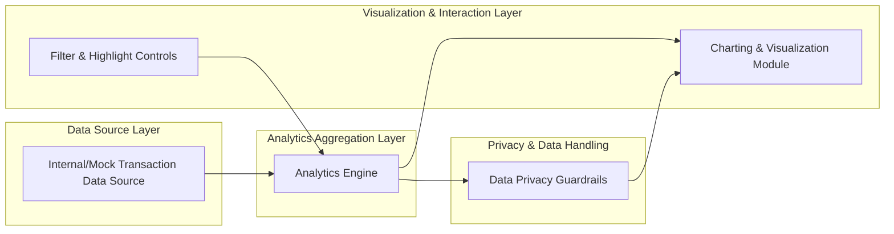

# High-Level Design (HLD)

## 1. Epic Overview

- **Project Key:** QE
- **Epic Summary:** UATTESTING$-Spend Analytics And Category-Wise Insights
- **Epic Label(s):** ["UATTESTING$"]

### 1.1 Epic Description (Source of Truth)

**Description:** Implement interactive analytics and visualizations focused on spend behavior across cards, with emphasis on monthly spend trends and card-wise and category-wise analysis. Users will be able to explore how their spending evolves over time, compare spend across individual cards, and understand distribution of spend across categories such as Food & Dining, Fuel, Shopping, Travel, Entertainment, Utilities, Healthcare, Education, and Miscellaneous.

**User Value:** Helps users identify spending patterns, understand where their money is going, and make informed decisions to control or optimize category-wise spending across multiple credit cards.

**Scope (High Level):**
- Monthly spend trend visualization across cards
- Card-wise spend analysis charts
- Category-wise spending analytics
- Interactive visual components to filter or highlight spend dimensions
- Basic transaction-level aggregation powering the analytics

**NFRs (from epic):**
- Analytics visualizations should render quickly for typical data volumes.
- Charts should remain usable and legible on responsive layouts.
- Handling of transaction data should respect privacy by avoiding storage of sensitive card or bank identifiers.

**Dependencies / Integrations (from epic):**
- Front-end charting and analytics libraries for trends and category breakdowns.
- Internal or mock transaction data source providing categorized spend information.
- No dependency on live payment gateways or banking APIs.

**Out of Scope (from epic):**
- Real Bank Integration
- Card Payments
- Fund Transfers
- Loans
- Payment Gateway Integration
- Advanced financial advisory or automated budgeting beyond basic analytics

All content above is taken directly from the epic description and has not been expanded beyond reformatting.

---

## 2. Requirements

### 2.1 Functional Requirements (Derived, non-implemented)
The following are **interpretations** of the epic text into structured requirements. They are **not confirmed implementation**; they must be validated with stakeholders.

**FR-1: Monthly Spend Trend Visualization**
- The system should provide visualizations of monthly spend trends across all user credit cards.
- The visualization should allow users to see how their overall spending evolves over time.

**FR-2: Card-wise Spend Analysis**
- The system should provide charts that show spend per individual card.
- Users should be able to compare spend between different cards.

**FR-3: Category-wise Spending Analytics**
- The system should provide analytics showing the distribution of spend across categories including, at minimum: Food & Dining, Fuel, Shopping, Travel, Entertainment, Utilities, Healthcare, Education, and Miscellaneous.

**FR-4: Interactive Filtering and Highlighting**
- The system should offer interactive visual components that allow users to filter or highlight spend dimensions (e.g., time range, card, category).

**FR-5: Transaction-Level Aggregation Engine**
- The system should aggregate transaction-level data to compute the metrics that power trend, card-wise, and category-wise analytics.

### 2.2 Non-Functional Requirements (NFRs)
The following are **directly taken from the epic** and restated:

**NFR-1: Performance (Rendering Speed)**
- Analytics visualizations should render quickly for typical data volumes.
- "Typical data volumes" are **not defined in the epic** and must be clarified (e.g., number of transactions, time range).

**NFR-2: Usability & Responsiveness**
- Charts should remain usable and legible on responsive layouts.
- Specific breakpoints and supported devices are **not defined** and must be clarified.

**NFR-3: Privacy & Data Protection**
- Handling of transaction data should respect privacy by avoiding storage of sensitive card or bank identifiers.
- "Sensitive identifiers" are not enumerated; assumption (to be validated): card PAN, CVV, full account numbers, and authentication credentials are considered sensitive.

### 2.3 Explicit Out-of-Scope Items
Restated directly from the epic:
- Real bank integration
- Card payments
- Fund transfers
- Loans
- Payment gateway integration
- Advanced financial advisory or automated budgeting beyond basic analytics

No additional out-of-scope items are inferred.

---

## 3. Architecture Overview

### 3.1 Conceptual Architecture
Based **solely** on the epic text, an indicative (not-yet-validated) conceptual architecture for spend analytics and category-wise insights can be described in generic terms:

- **Data Source Layer (Internal/Mock):** Provides categorized transaction data across multiple cards. The epic explicitly mentions "internal or mock transaction data source providing categorized spend information" and "no dependency on live payment gateways or banking APIs".
- **Analytics Aggregation Layer:** Performs transaction-level aggregation needed to power monthly trend, card-wise, and category-wise analytics.
- **Visualization & Interaction Layer (Front-end):** Uses front-end charting and analytics libraries to render interactive charts for the user.
- **Privacy & Filtering Controls:** Ensure that sensitive card or bank identifiers are not stored or exposed while still enabling analytics.

The exact technologies, deployment model (cloud vs on-prem), and frameworks are **not specified** in the epic and therefore are **not documented as facts** here.

### 3.2 High-Level Components (Unverified Design Proposal)
The following components are **proposed** to organize the design but are not confirmed by any requirement beyond the epic text:

1. **Transaction Data Provider**
   - Interfaces with an internal or mock transaction dataset.
   - Supplies categorized transactions (card, category, amount, date) to the analytics engine.

2. **Analytics Engine**
   - Performs aggregations to compute:
     - Monthly total spend across all cards
     - Per-card spend totals and trends
     - Category-wise distribution for selected periods and cards

3. **Visualization Service / UI Module**
   - Uses charting libraries to render:
     - Monthly trend charts
     - Card comparison charts
     - Category distribution charts
   - Provides interactive controls for filters and highlighting.

4. **Privacy & Data Handling Guardrails**
   - Enforces rules to avoid storing sensitive card or bank identifiers.

Since the epic does not define specific components or services, all component names and boundaries above are **assumptions for design discussion**, not commitments.

---

## 4. Mermaid Architecture Diagram

The diagram below reflects a **generic, unverified design** structured around the epic description.

This diagram expresses relationships implied by the epic but does **not** assert implementation.

---

## 5. Component Design (Indicative)

The following design details are **hypothetical** and used only to structure thinking around the epic text. They must be validated and refined before implementation.

### 5.1 Transaction Data Provider (Internal/Mock)

**Responsibilities (inferred from epic):**
- Provide transaction records with at least:
  - Transaction date/time
  - Card identifier (non-sensitive representation, e.g., masked or surrogate key)
  - Category (e.g., Food & Dining, Fuel, Shopping, Travel, Entertainment, Utilities, Healthcare, Education, Miscellaneous)
  - Amount
- Ensure data is already categorized or can be mapped into the required categories.

**Interfaces:**
- The epic references "internal or mock transaction data source" but does not specify API signatures, protocols, or formats. Therefore, no concrete API contract is documented here.

### 5.2 Analytics Engine

**Responsibilities (derived from scope):**
- Aggregate transaction data by:
  - Month (for monthly spend trends across cards)
  - Card (for card-wise spend analysis)
  - Category (for category-wise analytics)
- Provide aggregated outputs to visualization modules.

**Key aggregation outputs (indicative):**
- Monthly total spend across all cards
- Spend per card per month
- Spend per category per selected period

There is no explicit requirement in the epic about real-time updates, scheduling, or batch vs. streaming computation; any such detail would be speculative and is therefore omitted.

### 5.3 Visualization & Interaction Layer

**Responsibilities (directly referenced):**
- Render interactive analytics and visualizations focused on spend behavior across cards.
- Provide visual emphasis on:
  - Monthly spend trends
  - Card-wise analysis
  - Category-wise breakdowns
- Offer interactive features like filter or highlight of spend dimensions.

**Chart Types (indicative, not mandated):**
- Trend charts for monthly spend
- Bar or comparative charts for card-wise analysis
- Pie or bar charts for category distribution

The epic mentions "front-end charting and analytics libraries" but does not name specific libraries, thus none are documented as requirements.

### 5.4 Privacy & Data Handling Guardrails

**Responsibilities (directly referenced in NFR):**
- Avoid storage of sensitive card or bank identifiers in analytics systems.

**Open questions / assumptions:**
- Which data elements are considered sensitive?
- Are masked card numbers allowed?
- Is tokenization or pseudonymization required?

These must be clarified with security and compliance stakeholders.

---

## 6. Data Flow (High-Level)

The data flow below is **derived solely from the epic description** and leaves implementation details open.

1. **Transaction Data Acquisition**
   - Internal or mock transaction data source provides categorized spend records.

2. **Aggregation Processing**
   - Analytics engine aggregates transactions to compute monthly, card-wise, and category-wise metrics.

3. **Privacy Enforcement**
   - Before data is exposed to visualization, privacy rules strip or avoid storing any sensitive card or bank identifiers.

4. **Visualization & Interaction**
   - Front-end charting modules retrieve aggregated data.
   - Users interact via filters and highlights to explore spend behavior.

Since transport mechanisms (APIs, batch files, etc.) and storage technologies are not specified, they are intentionally left undescribed beyond this generic flow.

---

## 7. APIs and Integrations

The epic explicitly mentions:
- Use of **front-end charting and analytics libraries**.
- Use of an **internal or mock transaction data source**.
- **No dependency on live payment gateways or banking APIs**.

However, it does **not** specify:
- Any concrete API endpoints
- Request/response schemas
- Protocols (REST, GraphQL, gRPC, etc.)
- Authentication or authorization mechanisms

Therefore:
- No specific API contracts are documented.
- Integrations are described only at a conceptual level.

### 7.1 Internal/Mock Transaction Data Source Integration

**Conceptual interaction:**
- The analytics engine consumes categorized transaction data from an internal or mock source.

All additional details (e.g., data schema, method names) would be speculative and are omitted.

---

## 8. Security & Privacy Considerations

Based directly on the epic NFR:

**SEC-1: Avoid Storage of Sensitive Identifiers**
- Analytics components must avoid storing sensitive card or bank identifiers.

**Unspecified Aspects (Gaps):**
- There is no definition of what qualifies as "sensitive card or bank identifiers".
- There is no guidance on data retention periods, encryption, or audit logging.
- There is no reference to any regulatory frameworks (e.g., PCI-DSS, GDPR).

These items represent **requirements gaps** and must be clarified before detailed design.

---

## 9. Scalability & Performance

The epic only states:

- "Analytics visualizations should render quickly for typical data volumes."

There are **no quantitative targets** such as:
- Maximum latency for chart rendering
- Maximum number of transactions or cards
- Expected concurrency (number of users)

Thus, for this HLD:
- Performance and scalability are recognized as concerns but cannot be characterized with numeric SLAs.
- Any specific strategy (caching, pre-aggregation, etc.) would be speculative and is not documented as a committed design.

---

## 10. Availability & Reliability

The epic does **not** mention:
- Uptime or availability targets
- Error handling requirements
- Degradation behavior for partial data

Therefore:
- No formal availability or reliability requirements are recorded.
- Any assumptions (e.g., "99.9% availability") would be invented and are deliberately excluded.

---

## 11. Assumptions

The following assumptions are introduced **only to structure design discussion** and are **not sourced from the epic**. They must be validated or rejected:

1. Transaction records include at least: date, non-sensitive card identifier, category, and amount.
2. Card and category are sufficient dimensions to deliver the analytics described; subcategories or merchants are not required unless later specified.
3. Masked or surrogate card identifiers may be allowed as long as they are not considered sensitive.
4. A single internal or mock data source is available and populated with test data suitable for UAT.

None of these assumptions should be treated as confirmed requirements.

---

## 12. Dependencies

### 12.1 Explicit Dependencies (Directly from Epic)

- **Front-end charting and analytics libraries** for trends and category breakdowns.
- **Internal or mock transaction data source** providing categorized spend information.
- **No dependency** on live payment gateways or banking APIs.

### 12.2 Implicit / Design-Level Dependencies (Unverified)

The following dependences are likely but **not explicitly stated**:
- Application framework for front-end/UI (e.g., web framework).
- Data storage layer for transactions and aggregates.

These are noted as potential dependencies, not confirmed commitments.

---

## 13. Risks

The following risks are **inferred** from the gaps/vagueness in the epic and need validation:

**R-1: Undefined Performance Targets**
- Without clear definition of "typical data volumes" and performance goals, the system may underperform or be over-engineered.

**R-2: Privacy Ambiguity**
- Lack of explicit list of "sensitive card or bank identifiers" can lead to inconsistent privacy controls.

**R-3: Category Taxonomy Changes**
- The epic lists specific categories but does not define governance for adding/removing categories, which can affect analytics consistency.

**R-4: Responsiveness Requirements Not Quantified**
- "Usable and legible" on responsive layouts is qualitative; different stakeholders may interpret it differently, causing rework.

No operational or regulatory risks are stated in the epic; any such risks listed above are inferred and should be reviewed.

---

## 14. Validation Report

The following validation report is focused on **traceability and gaps**. It does not claim that requirements are already satisfied.

### 14.1 Requirements Traceability Matrix (Epic -> Derived Requirements)

| Epic Element | Derived ID | Description | Status |
|--------------|-----------|-------------|--------|
| "Monthly spend trend visualization across cards" | FR-1 | Monthly spend trend visualization | **Design only; implementation not verified** |
| "card-wise spend analysis charts" | FR-2 | Card-wise spend analysis | **Design only; implementation not verified** |
| "category-wise spending analytics" | FR-3 | Category-wise analytics | **Design only; implementation not verified** |
| "interactive visual components to filter or highlight spend dimensions" | FR-4 | Interactive filtering & highlighting | **Design only; implementation not verified** |
| "basic transaction-level aggregation powering the analytics" | FR-5 | Transaction-level aggregation engine | **Design only; implementation not verified** |
| "Analytics visualizations should render quickly for typical data volumes" | NFR-1 | Performance (render speed) | **Target identified; thresholds not defined** |
| "charts should remain usable and legible on responsive layouts" | NFR-2 | Usability & responsiveness | **Target identified; criteria not defined** |
| "handling of transaction data should respect privacy by avoiding storage of sensitive card or bank identifiers" | NFR-3 | Privacy & data protection | **Target identified; scope of sensitive data unclear** |
| "Front-end charting and analytics libraries" | DEP-1 | Charting libraries dependency | **Recognized; specific library not selected** |
| "internal or mock transaction data source providing categorized spend information" | DEP-2 | Transaction data source dependency | **Recognized; API/schema not defined** |
| "no dependency on live payment gateways or banking APIs" | DEP-3 | Excluded dependencies | **Constraint recorded** |
| "Real Bank Integration" (Out of Scope) | OOS-1 | No real bank integration | **Constraint recorded** |
| "Card Payments" (Out of Scope) | OOS-2 | Card payments excluded | **Constraint recorded** |
| "Fund Transfers" (Out of Scope) | OOS-3 | Fund transfers excluded | **Constraint recorded** |
| "Loans" (Out of Scope) | OOS-4 | Loans excluded | **Constraint recorded** |
| "Payment Gateway Integration" (Out of Scope) | OOS-5 | Payment gateway integration excluded | **Constraint recorded** |
| "advanced financial advisory or automated budgeting beyond basic analytics" (Out of Scope) | OOS-6 | Advanced advisory/budgeting excluded | **Constraint recorded** |

### 14.2 Coverage Status

- **Functional Coverage:** All items in the epic "Scope (High Level)" are represented with at least one derived functional requirement (FR-1 to FR-5).
- **NFR Coverage:** All stated NFRs are represented (NFR-1 to NFR-3), but with incomplete quantitative definition.
- **Dependencies & Out-of-Scope:** All elements in the epic under "Dependencies/Integrations" and "Out of Scope" are captured as DEP and OOS items.

This coverage is **conceptual** and does not verify that implementation currently meets these items.

### 14.3 NFR Validation Targets (To Be Defined)

Since the epic does not provide concrete targets, the following are **placeholders for future definition** rather than commitments:

- **NFR-1 Performance Target Placeholder:**
  - Example to be agreed: maximum time for initial chart load given a defined volume of transactions.

- **NFR-2 Responsiveness Target Placeholder:**
  - Example to be agreed: supported device types and minimum rendering quality (e.g., readability metrics).

- **NFR-3 Privacy Target Placeholder:**
  - Example to be agreed: list of fields prohibited from storage and rules for masking or tokenization.

None of the above are specified in the epic, so they remain **open items**.

### 14.4 Identified Design Gaps

1. **Unspecified Data Model**
   - The epic does not define transaction schema, card identifiers, or category modeling.

2. **Missing API Contracts**
   - No details on how front-end components obtain aggregated data.

3. **Undefined Performance Benchmarks**
   - "Render quickly" is not operationalized.

4. **Privacy Control Details**
   - No explicit rules on handling pseudonymized data, logs, backups.

5. **Responsiveness Criteria**
   - No breakpoints or supported devices list.

These gaps prevent detailed design or implementation planning without further clarification.

### 14.5 Recommendations

All recommendations below are **actions to clarify and refine design**, not statements that any behavior is already implemented.

1. **Define Transaction Schema & Category Taxonomy**
   - Collaborate with stakeholders to define a canonical transaction data model and confirm the category list and governance for changes.

2. **Specify Performance & Volume Targets**
   - Agree on typical data volumes (e.g., maximum number of transactions per user per year) and chart rendering latency targets to guide architecture choices.

3. **Establish Privacy & Compliance Rules**
   - Engage security/compliance to define what counts as sensitive card/bank identifiers, masking/tokenization rules, and retention policies.

4. **Document API Contracts Between Analytics Engine and UI**
   - Define API endpoints, request/response models, and error handling for delivering aggregated analytics to the front-end.

5. **Clarify Responsiveness Requirements**
   - Define supported platforms (desktop, tablet, mobile), breakpoints, and minimal display requirements for charts.

6. **Confirm Scope Boundaries in UAT**
   - Ensure UAT scenarios do not include out-of-scope features (real bank integration, payments, transfers, loans, payment gateways, advanced advisory/budgeting).

---

## 15. Summary

This High-Level Design document is derived strictly from the epic:

- **Project Key:** QE
- **Epic Summary:** UATTESTING$-Spend Analytics And Category-Wise Insights

It structures the epic description into requirements, architecture, data flow, dependencies, risks, and validation considerations **without asserting that any specific design or implementation is already in place**. All unverified elements are clearly marked as assumptions, inferred risks, or placeholders requiring further stakeholder validation.
