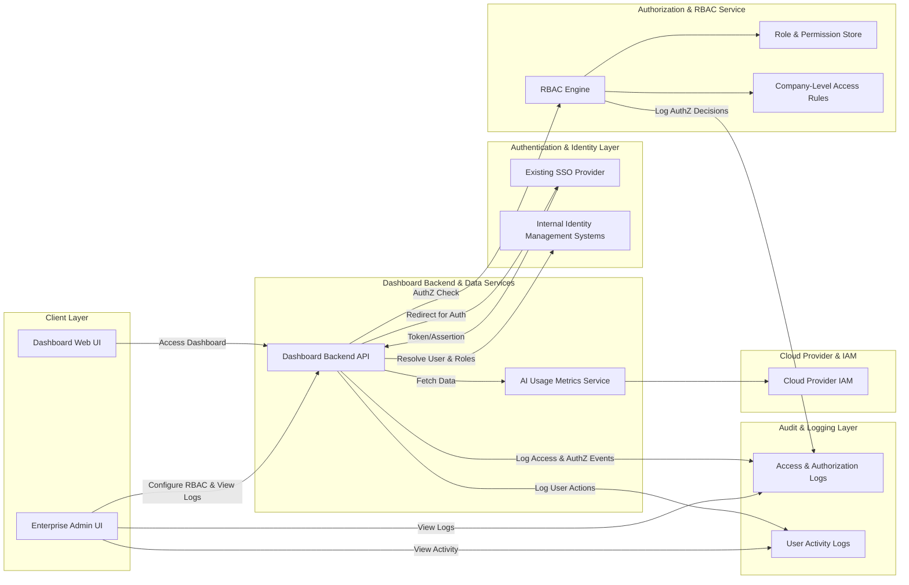

# High-Level Design (HLD)

## 1. Epic Overview

**Project Key:** QE  
**Epic Summary:** UATTESTING3-Role-Based Access Control, Security & User Administration  
**Epic Type:** Epic

### 1.1 Business Context

**Description (verbatim from epic):**  
Deliver robust role-based access control, secure authentication, and user administration capabilities so Enterprise Admins can configure permissions, manage access, and maintain compliance and data privacy across all portfolio companies.

**User Value (from epic description):**  
Ensures sensitive portfolio data is protected while still being accessible to the right stakeholders, reducing security and compliance risk and enabling confident adoption of the dashboard across the firm.

### 1.2 High-Level Scope (from epic)

Scope (High Level):
- Role-based access control configuration by Enterprise Admins  
- Assignment and revocation of user permissions by company  
- Restriction of dashboard access to authorized users only  
- SSO-based authentication integration for all users  
- Audit logging of access attempts and authorization failures  
- User lockout handling and recovery process via Enterprise Admin  
- Access visibility for admins including access logs and activity

### 1.3 Explicit Out of Scope (from epic)

Out of Scope:  
- Design or implementation of new SSO providers outside existing solutions  
- Granular per-field data masking beyond defined company-level access rules  
- Custom compliance reporting beyond standard audit logs  
- Non-English language-specific access workflows for initial release

All out-of-scope items above are preserved as-is; no additional scope is inferred.

## 2. Requirements Overview

> Note: Requirements are derived strictly from the epic text. No additional functional requirements are assumed beyond what is stated.

### 2.1 Functional Requirements (FRs)

FR-1: Enterprise Admins must be able to configure role-based access control (RBAC).  
FR-2: Enterprise Admins must be able to assign user permissions by portfolio company.  
FR-3: Enterprise Admins must be able to revoke user permissions by portfolio company.  
FR-4: Dashboard access must be restricted to authorized users only.  
FR-5: The system must support SSO-based authentication integration for all users, using existing SSO provider(s).  
FR-6: The system must log access attempts (successful and failed).  
FR-7: The system must log authorization failures.  
FR-8: The system must support user lockout handling.  
FR-9: Enterprise Admins must be able to perform user lockout recovery.  
FR-10: Enterprise Admins must have access visibility, including access logs and user activity.

### 2.2 Non-Functional Requirements (NFRs) (verbatim from epic)

NFR-1: All access control operations must respect encryption in transit and at rest using industry-standard protocols such as TLS 1.2+ and AES-256.  
NFR-2: Role-based access control and audit logging are mandatory across all data views.  
NFR-3: System must handle up to 1,000 concurrent users without degradation.  
NFR-4: Uptime of 99.5% must be maintained including access and authentication flows.  
NFR-5: Access flows must meet WCAG 2.1 AA accessibility standards for keyboard-only and screen reader users.

### 2.3 Dependencies & Integrations (verbatim from epic)

D-1: Existing SSO provider for user authentication flows.  
D-2: Internal identity management systems where applicable.  
D-3: Portfolio company governance policies regarding data access.  
D-4: Cloud provider IAM and permissions for data access to AI usage metrics.

### 2.4 Assumptions (explicit; not stated in epic)

The following are **assumptions** required to create a coherent high-level design; they are **not** confirmed requirements:

A-1: The existing SSO provider supports standard protocols (e.g., SAML 2.0, OIDC/OAuth2).  
A-2: Enterprise Admins are a distinct user role managed within the identity management system (or via an internal admin role registry).  
A-3: Portfolio companies are already modeled as entities in the dashboard platform (e.g., `Company` or `PortfolioCompany` domain object).  
A-4: Audit logs and access logs will be stored in a central logging service (e.g., cloud-native log storage) with retention configured by operations/compliance teams.  
A-5: Lockout policies (thresholds, duration) are defined by security/compliance teams and applied consistently across all users.  
A-6: The AI usage metrics referenced in the dependency list are already exposed via existing services; RBAC will enforce access to the corresponding dashboards/views.

Assumptions must be validated with stakeholders; this HLD does not claim they are implemented.

## 3. Architecture Overview

### 3.1 Conceptual Architecture

At a high level, the solution consists of:

- **Client Layer (Dashboard UI)**  
  - Web-based dashboard accessed by firm users (Enterprise Admins, company-level users, etc.).  
  - Provides user administration, access configuration screens, and protected data views.

- **Authentication & Identity Layer**  
  - Integrates with **Existing SSO Provider** (D-1) for primary authentication.  
  - Uses **Internal Identity Management Systems** (D-2) for user and role metadata where applicable.

- **Authorization & RBAC Service**  
  - Central service responsible for evaluating user permissions against company-level access rules.  
  - Supports configuration of roles, permission sets, and company-level assignments by Enterprise Admins.  
  - Exposes APIs for UI and backend services to perform authorization checks.

- **Dashboard Backend / Data Access Layer**  
  - Services that provide dashboard data, including AI usage metrics (linked to D-4).  
  - Enforce authorization via RBAC service and IAM configurations before returning data.

- **Audit & Logging Layer**  
  - Captures authentication events, access attempts, authorization decisions, and lockout events.  
  - Provides query/view interfaces or exports for Enterprise Admins to review access logs and activity.

- **Operations & Reliability Layer**  
  - Infrastructure, monitoring, and alerting to achieve uptime and concurrency NFRs.  
  - Includes cloud provider IAM configuration aligned to RBAC decisions.

### 3.2 High-Level Data & Control Flows (Narrative)

1. A user navigates to the dashboard and is redirected to the existing SSO provider for authentication.  
2. Upon successful SSO login, an identity token/assertion is returned to the dashboard backend, which establishes a session.  
3. The backend resolves the user identity and roles, potentially via internal identity management systems (D-2).  
4. When the user attempts to access a dashboard view (e.g., AI usage metrics for a specific company), the backend calls the RBAC service to evaluate access rights.  
5. RBAC service checks user roles, company-level permission assignments, and governance rules (D-3) to produce an allow/deny decision.  
6. All access attempts and authorization outcomes are logged in the audit/logging layer.  
7. If repeated authorization failures or policy rules trigger lockout conditions, the user is locked out and the event is logged. Enterprise Admins can initiate recovery actions through admin UI.  
8. Enterprise Admins use dedicated UI to configure RBAC rules, manage assignments, view logs, and monitor activity. These operations also respect NFRs (encryption, audit logging, etc.).

## 4. Mermaid Architecture Diagram

## 5. Component Design

### 5.1 Dashboard Web UI

**Responsibilities (inferred from epic, not additional requirements):**
- Provide authentication entry point and handle SSO redirects.  
- Display only data views allowed for the current user (authorization enforced by backend).  
- Surface access error messages when authorization is denied or when user is locked out.

**Key Interfaces:**
- Calls Dashboard Backend API for data retrieval and authorization-dependent views.  
- Receives authentication state (session, token) from backend.

### 5.2 Enterprise Admin UI

**Responsibilities:**
- Manage role-based access control configuration (FR-1).  
- Manage assignment and revocation of user permissions by company (FR-2, FR-3).  
- Provide access visibility, including access logs and activity views (FR-10).  
- Support user lockout recovery operations (FR-9).

**Key Interfaces:**
- Admin endpoints on Dashboard Backend API for RBAC configuration.  
- Query interfaces to Audit & Logging for logs and activity data.

### 5.3 Existing SSO Provider Integration

**Responsibilities (aligned with D-1):**
- Perform user authentication for all dashboard users (FR-5).  
- Provide identity tokens/assertions to Dashboard Backend.  
- Potentially provide group/role claims where supported.

**Key Interfaces:**
- SSO protocol endpoints (e.g., SAML, OIDC).  
- Backend SSO callback endpoints to handle login responses.

**Assumption:** Protocol details and claim formats are determined by the existing SSO provider; they are not specified in the epic and must be confirmed.

### 5.4 Internal Identity Management Systems

**Responsibilities (aligned with D-2):**
- Maintain core user identity records and possibly role/group membership.  
- Provide APIs for user lookup and synchronization.

**Key Interfaces:**
- User identity lookup APIs.  
- Group/role membership APIs (if available).

### 5.5 RBAC Service & Engine

**Responsibilities:**
- Evaluate authorization decisions based on roles, company-level assignments, and governance rules (FR-1, FR-2, FR-3, FR-4; D-3).  
- Provide consistent RBAC enforcement for all data views (NFR-2).  
- Provide configuration APIs for Enterprise Admins to define roles, permissions, and company assignments.  
- Emit events/logs for each authorization check and outcome (FR-6, FR-7).

**Key Data Structures (conceptual, not implementation-specific):**
- `User` (id, identity reference, roles, company assignments).  
- `Role` (id, name, description, permissions).  
- `Permission` (id, name, associated resources/views).  
- `CompanyAccessRule` (company id, allowed roles/permissions, governance constraints).  

### 5.6 Dashboard Backend API

**Responsibilities:**
- Coordinate authentication flows with SSO provider.  
- Resolve user identity and roles via SSO and identity management systems.  
- Call RBAC service for authorization checks before serving data.  
- Expose endpoints for Enterprise Admin UI to manage RBAC and user lockout recovery.  
- Interact with data services (e.g., AI usage metrics) and enforce IAM.  
- Write access and activity logs to Audit & Logging services.

### 5.7 Audit & Logging

**Responsibilities:**
- Persist access attempts and authorization failures (FR-6, FR-7).  
- Persist user activity relevant to access visibility (FR-10).  
- Record lockout events and recovery actions (FR-8, FR-9).  
- Provide query mechanisms for Enterprise Admins.

### 5.8 Cloud Provider IAM & AI Usage Metrics

**Responsibilities (aligned with D-4):**
- Control access to underlying data sources for AI usage metrics.  
- Reflect RBAC decisions at infrastructure level where possible.

## 6. Data Flow Design (High-Level)

### 6.1 Authentication Flow

1. User navigates to dashboard.  
2. Backend detects unauthenticated session and redirects to SSO provider.  
3. SSO provider authenticates user and returns assertion/token to backend.  
4. Backend validates token, establishes user session, and retrieves identity attributes (possibly from identity management systems).  
5. Backend logs authentication event in Audit & Logging.

### 6.2 Authorization (RBAC) Flow

1. User initiates a request to view a dashboard resource for a specific company.  
2. Backend identifies user, target resource, and company context.  
3. Backend calls RBAC service with user id, roles, company, and resource.  
4. RBAC service evaluates role and company-level rules and returns an allow/deny decision.  
5. Backend logs the authorization request and outcome.  
6. If allowed, backend retrieves data (e.g., AI usage metrics) and returns it to the user; otherwise, access is denied and error/notice is presented.

### 6.3 User Administration Flow (Enterprise Admin)

1. Enterprise Admin authenticates via SSO and accesses Admin UI.  
2. Admin UI retrieves current RBAC configuration from RBAC service via backend.  
3. Admin modifies roles, permissions, and company assignments.  
4. Changes are validated and persisted by RBAC service.  
5. Backend logs configuration changes and associated admin activity.

### 6.4 Lockout and Recovery Flow

1. Lockout policy triggers (e.g., multiple failed authorization or authentication events) – details are **assumed** and must be defined by policy owners.  
2. Backend or identity layer marks user as locked out and logs event.  
3. Locked-out user attempts access and is denied with appropriate messaging.  
4. Enterprise Admin uses Admin UI to review lockout logs and initiate recovery (e.g., unlock user).  
5. Recovery action is logged for audit purposes.

### 6.5 Access Logging and Visibility Flow

1. All access requests (resource, user, company context, decision) are logged.  
2. Enterprise Admin navigates to access visibility screens.  
3. Backend queries Audit & Logging for relevant events.  
4. Admin UI presents filtered logs and summarized activity.

## 7. APIs & Integrations (High-Level)

> Note: No specific API shapes, endpoints, or protocols are given in the epic. The following interfaces are conceptual and must be detailed in subsequent design stages.

### 7.1 SSO Integration Interfaces (D-1)

- Redirect endpoint for initiating authentication.  
- Callback endpoint for SSO responses (SAML, OIDC, etc.).  
- Token/Assertion validation logic.  

**Assumption:** Exact endpoints and claim mapping depend on the existing SSO provider configuration.

### 7.2 Identity Management Interfaces (D-2)

- `GET /identity/users/{id}` – Lookup user identity (conceptual).  
- `GET /identity/users/{id}/roles` – Retrieve user roles/groups (conceptual).  

**Assumption:** Actual APIs and schemas are determined by the internal identity system.

### 7.3 RBAC Service Interfaces

Conceptual examples (not actual contract):
- `POST /rbac/evaluate` – Evaluate authorization for a user, resource, and company.  
- `GET /rbac/config` – Retrieve current RBAC configuration.  
- `POST /rbac/config/roles` – Create/update roles.  
- `POST /rbac/config/company-access` – Configure company-level access rules.  

These interfaces need detailed specification in subsequent, lower-level design work.

### 7.4 Audit & Logging Interfaces

- Logging APIs or event streams from backend/RBAC to logging service.  
- Query APIs for retrieving logs for display in Admin UI.

**Assumption:** Logging backend (e.g., cloud logging, SIEM) and query mechanisms are selected outside the scope of this epic.

### 7.5 Cloud Provider IAM & Data Service Interfaces (D-4)

- IAM policies controlling service-to-service and data source access.  
- Data APIs for AI usage metrics, protected by IAM and RBAC.

## 8. Security Design

> Security requirements are taken directly from the epic NFRs. No additional controls are claimed as implemented.

### 8.1 Encryption

- All access control operations (RBAC configuration, evaluation, logging) must use encryption in transit (e.g., TLS 1.2+).  
- Data at rest related to access control (RBAC config, logs, user metadata) must be encrypted using industry-standard protocols such as AES-256.

**Gap:** Specific key management solutions, certificate authorities, and rotation policies are not defined in the epic and must be specified separately.

### 8.2 Authentication & Session Security

- SSO provider is the primary authentication mechanism for all users.  
- Session management must ensure tokens are validated and securely stored.  

**Gap:** Session timeouts, refresh mechanisms, and device-level security are not defined; must be aligned with firm security policy.

### 8.3 Authorization & Least Privilege

- RBAC must enforce least privilege by restricting dashboard access to authorized users only (FR-4).  
- RBAC coverage must span all data views (NFR-2).

**Gap:** Detailed role definitions, permission matrices, and company-specific rules are not provided; they require further elaboration with stakeholders.

### 8.4 Audit & Compliance

- Audit logging of access attempts and authorization failures is mandatory (FR-6, FR-7).  
- Logs are used to support compliance and investigations.  

**Gap:** Log retention periods, redaction rules, and monitoring responsibilities are not defined.

### 8.5 Lockout & Recovery

- Lockout handling must prevent continued unauthorized access attempts (FR-8).  
- Recovery via Enterprise Admin must be auditable and controlled (FR-9).

**Gap:** Lockout thresholds, escalation paths, and multi-factor requirements for recovery are not specified.

## 9. Scalability & Performance

### 9.1 Concurrency

- Requirement: System must handle up to **1,000 concurrent users** without degradation (NFR-3).

**Design Implications (conceptual):**
- Backend and RBAC service must be horizontally scalable.  
- Logging and identity systems must handle corresponding event and query volume.  

**Gap:** No explicit performance targets (latency, throughput) per operation are provided; these must be derived from user experience needs.

### 9.2 Uptime & Reliability

- Requirement: **99.5% uptime** must be maintained, including access and authentication flows (NFR-4).

**Design Implications (conceptual):**
- Redundant instances for backend, RBAC, and logging where necessary.  
- Health checks, monitoring, and alerting for critical services.  

**Gap:** Specific deployment topology, failover mechanisms, and DR strategy are not defined in the epic.

## 10. Accessibility & Usability

- Requirement: Access flows must meet **WCAG 2.1 AA** accessibility standards for keyboard-only and screen reader users (NFR-5).

**Design Implications (conceptual):**
- Login flows and admin/user access screens must be operable via keyboard only.  
- UI elements must be properly labeled for screen readers.  
- Error/lockout messaging must be accessible.

**Gap:** Detailed UX specifications, accessibility testing plans, and assistive technology support are not provided.

## 11. Assumptions, Dependencies, and Risks

### 11.1 Assumptions (from Section 2.4)

- A-1 through A-6 as listed earlier apply to this design.

### 11.2 Dependencies (from epic)

- D-1: Existing SSO provider.  
- D-2: Internal identity management systems.  
- D-3: Portfolio company governance policies.  
- D-4: Cloud provider IAM and permissions for AI usage metrics.

### 11.3 Key Risks (derived from dependencies and gaps)

R-1: **SSO limitations** – Existing SSO may not support required claims or protocols; RBAC integration could be constrained.  
R-2: **Identity metadata quality** – Incomplete or outdated identity/role information in internal systems may lead to incorrect access decisions.  
R-3: **Governance misalignment** – Portfolio company governance policies may be inconsistent or ambiguous, making company-level access rules hard to codify.  
R-4: **IAM configuration complexity** – Aligning RBAC decisions with cloud IAM for AI usage metrics may be complex and error-prone.  
R-5: **Performance under load** – Without explicit performance design and testing, the 1,000 concurrent user requirement may not be reliably achieved.  
R-6: **Accessibility compliance** – Failing to meet WCAG 2.1 AA due to insufficient UX design and testing could block adoption or compliance.

Risks listed here are inferred from the epic content but do not add new requirements.

## 12. Validation Report

### 12.1 Requirements Traceability Matrix

| ID   | Source Text Fragment | Design Coverage Summary |
|------|----------------------|-------------------------|
| FR-1 | "Role-based access control configuration by Enterprise Admins" | Covered by RBAC Service & Enterprise Admin UI design (Sections 5.2, 5.5). |
| FR-2 | "assignment ... of user permissions by company" | Covered by company-level access rules in RBAC (Sections 2.1, 5.5, 6.3). |
| FR-3 | "revocation of user permissions by company" | Same mechanisms as FR-2; admin flows allow revocation (Sections 5.2, 6.3). |
| FR-4 | "restriction of dashboard access to authorized users only" | Covered by authorization flow and RBAC enforcement (Sections 3, 6.2). |
| FR-5 | "SSO-based authentication integration for all users" | Covered by SSO integration architecture (Sections 3.1, 5.3, 7.1). |
| FR-6 | "audit logging of access attempts" | Covered by Audit & Logging design (Sections 5.7, 6.5). |
| FR-7 | "audit logging of ... authorization failures" | Covered alongside FR-6 (Sections 5.7, 6.5). |
| FR-8 | "user lockout handling" | Covered conceptually in lockout flow (Section 6.4) and security design (Section 8.5). |
| FR-9 | "recovery process via Enterprise Admin" | Covered by admin recovery operations (Sections 5.2, 6.4). |
| FR-10 | "access visibility for admins including access logs and activity" | Covered by access visibility flows and Admin UI integration with logs (Sections 5.2, 5.7, 6.5). |
| NFR-1 | "encryption in transit and at rest using ... TLS 1.2+ and AES-256" | Addressed conceptually in Security Design (Section 8.1); detailed crypto/KMS not specified. |
| NFR-2 | "role-based access control and audit logging are mandatory across all data views" | Addressed by RBAC service and logging integration (Sections 3.1, 5.5, 5.7). |
| NFR-3 | "handle up to 1,000 concurrent users without degradation" | Addressed conceptually in Scalability & Performance (Section 9.1); no detailed capacity plan included. |
| NFR-4 | "uptime of 99.5% ... including access and authentication flows" | Addressed conceptually in reliability design (Section 9.2); concrete SLO/SLI implementation not included. |
| NFR-5 | "meet WCAG 2.1 AA" | Addressed conceptually in Accessibility & Usability (Section 10). |
| D-1  | "Existing SSO provider" | Explicitly integrated in architecture (Sections 3.1, 5.3, 7.1). |
| D-2  | "internal identity management systems" | Explicitly integrated (Sections 3.1, 5.4, 7.2). |
| D-3  | "portfolio company governance policies" | Referenced in RBAC rules (Sections 3.1, 5.5, 11.2). |
| D-4  | "cloud provider IAM ... AI usage metrics" | Covered conceptually in Backend and IAM integration (Sections 3.1, 5.8, 7.5). |
| OOS-1 | "new SSO providers" | Explicitly marked out of scope (Section 1.3). |
| OOS-2 | "granular per-field data masking" | Explicitly marked out of scope (Section 1.3). |
| OOS-3 | "custom compliance reporting beyond standard audit logs" | Explicitly marked out of scope (Section 1.3). |
| OOS-4 | "non-English language-specific access workflows" | Explicitly marked out of scope (Section 1.3). |

### 12.2 Coverage Status

- **Functional Requirements (FR-1 to FR-10):** All are **addressed conceptually** in the design. Implementation details (e.g., specific APIs, data models, lockout policies) are **not** defined and must be elaborated in lower-level designs.  
- **Non-Functional Requirements (NFR-1 to NFR-5):** All are **acknowledged and mapped** to design areas, but **no claim** is made that they are achieved; actual achievement depends on implementation choices, infrastructure, and testing.

### 12.3 NFR Validation Targets

This HLD does **not** assert that NFRs are met; it only identifies where validation should occur:

- NFR-1 (Encryption): Validate via security architecture review and technical tests (TLS configuration, storage encryption, key management).  
- NFR-2 (RBAC & Logging coverage): Validate via architecture review and testing that all data views call RBAC and emit logs.  
- NFR-3 (Concurrency): Validate via performance/load testing for 1,000 concurrent users under realistic scenarios.  
- NFR-4 (Uptime): Validate via SRE/ops practices, monitoring, and incident records demonstrating 99.5% or better availability.  
- NFR-5 (Accessibility): Validate via UX/accessibility audits and testing against WCAG 2.1 AA criteria.

### 12.4 Design Gaps (Explicit)

- G-1: Detailed role and permission taxonomy is not defined (which roles exist, what they can do).  
- G-2: Company-level access rule syntax and governance mapping are not specified.  
- G-3: Concrete API contracts for RBAC, logging, and identity integrations are not provided.  
- G-4: Lockout policies (thresholds, durations, recovery safeguards) are not described.  
- G-5: Infrastructure topology, scaling strategy, and failover mechanisms for achieving concurrency and uptime NFRs are not detailed.  
- G-6: Detailed accessibility design (component-level patterns, color contrast, focus management) is not included.  
- G-7: Compliance-specific requirements (e.g., regulations, audit retention periods) are not stated.

These gaps represent work that must be completed in subsequent design and refinement phases.

### 12.5 Recommendations

1. **Requirements Elaboration:** Run a focused workshop with security, compliance, and Enterprise Admin stakeholders to define roles, permissions, company-level rules, and lockout policies (addressing G-1, G-2, G-4).  
2. **Integration Discovery:** Conduct a technical discovery of existing SSO and identity management systems to document supported protocols, claim sets, and APIs (D-1, D-2).  
3. **API Specification:** Produce a low-level design (LLD) describing RBAC, logging, and identity integration APIs, including data models and error handling (addressing G-3).  
4. **Performance & Reliability Planning:** Collaborate with platform/ops teams to design capacity plans, scaling strategies, and monitoring/alerting aligned to NFR-3 and NFR-4 (addressing G-5).  
5. **Accessibility Design & Testing:** Engage UX/accessibility specialists to design flows and components that meet WCAG 2.1 AA and establish an accessibility test plan (addressing G-6, NFR-5).  
6. **Compliance Alignment:** Involve compliance/privacy officers to define log retention, data handling rules, and any regulatory obligations affecting access control and audit logging (addressing G-7).

This HLD intentionally avoids claiming NFRs or requirements are already implemented or satisfied; it only describes how the system *could* be designed to meet them, pending detailed design and implementation.
