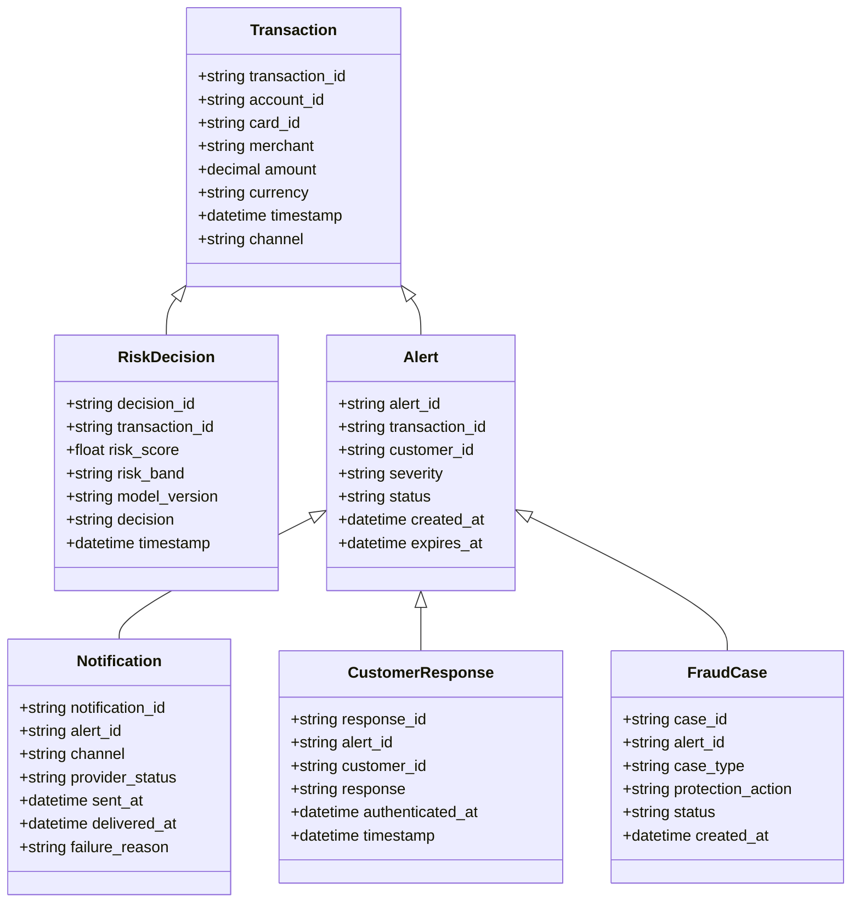
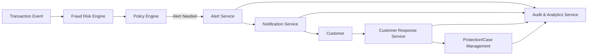

# Credit Card Fraud Alert System – High-Level Design (HLD)

## Domain Model (UML/ERD)

**Entities & Relationships:**

- **Transaction** (`transaction_id`, `account_id`, `card_id`, `merchant`, `amount`, `currency`, `timestamp`, `channel`)
- **RiskDecision** (`decision_id`, `transaction_id`, `risk_score`, `risk_band`, `model_version`, `decision`, `timestamp`)
- **Alert** (`alert_id`, `transaction_id`, `customer_id`, `severity`, `status`, `created_at`, `expires_at`)
- **Notification** (`notification_id`, `alert_id`, `channel`, `provider_status`, `sent_at`, `delivered_at`, `failure_reason`)
- **CustomerResponse** (`response_id`, `alert_id`, `customer_id`, `response`, `authenticated_at`, `timestamp`)
- **FraudCase** (`case_id`, `alert_id`, `case_type`, `protection_action`, `status`, `created_at`)

**Relationships:**
- Transaction 1 — 1 RiskDecision
- Transaction 1 — * Alert
- Alert 1 — * Notification
- Alert 1 — * CustomerResponse
- Alert 1 — 1 FraudCase (when escalated)

---

## High-Level Design Document

### Architecture Overview

**Major Components:**
- **Transaction Ingestion Service**: Receives transaction events from authorization system.
- **Fraud Risk Engine**: Consumes transaction context, calculates risk score/decision.
- **Policy Engine**: Applies business rules, determines required action (approve, alert, step-up, hold, decline).
- **Alert Service**: Creates alert record, manages alert state, and orchestrates notifications.
- **Notification Service**: Delivers alerts via push, SMS, email, or in-app channels. Handles fallbacks and status.
- **Customer Response Service**: Authenticates customer, records confirm/report actions.
- **Protection/Case Management**: Initiates card/account blocking, replacement, investigation, or dispute.
- **Audit & Analytics Service**: Captures events, maintains audit trail, provides operational metrics and dashboards.

**Architecture Diagram:**

### Integration Points
- **Transaction/Authorization Platform**: Publishes transaction events.
- **Fraud-Risk Engine**: Integrated for risk evaluation.
- **Identity/Authentication Service**: For secure customer actions.
- **Notification Providers**: Push/SMS/email/in-app delivery.
- **Case Management System**: Handles escalated fraud cases and protection workflows.
- **Analytics & Monitoring**: For metrics, logs, traces, and compliance reporting.

### Security & Compliance Features
- **Input Validation**: Strict schema validation for transaction and user input.
- **Output Filtering**: No sensitive data in notifications or logs (e.g., no full card numbers).
- **Encryption**: AES-256 at rest; TLS 1.3 for all data in transit.
- **Access Control**: RBAC for all internal operations; ABAC for advanced scenarios (e.g., region, risk level).
- **Audit Logging**: All alert, response, and protection actions logged; audit trail is immutable and tamper-evident.
- **Secrets Management**: Use enterprise vault for keys, credentials, tokens (not stored in code or config files).
- **Data Retention**: Apply approved retention/deletion policy for customer and fraud data.
- **Consent Management**: Honor notification preferences except for security-critical alerts.
- **Data Lineage**: All data flows traceable for regulatory audits.
- **Compliance Reporting**: Automated reports for regulators, security, and privacy teams.

### Error Handling & Resilience
- **Retries**: On notification failures and transient service errors (with exponential backoff).
- **Fallbacks**: Use secondary notification channel if primary fails.
- **Idempotency**: Prevent duplicate alerts/cases from event replay.
- **Logging**: All failures, retries, and edge cases are logged for observability.
- **Circuit Breaker Pattern**: For downstream dependencies (risk engine, notification provider, etc.).

### Compliance Checklist
- [x] No full card numbers in alerts/logs
- [x] Strong authentication before sensitive actions
- [x] All sensitive data encrypted (AES-256, TLS 1.3)
- [x] RBAC for fraud/operations access
- [x] Immutability of audit logs
- [x] Data retention and deletion policies applied
- [x] Consent and notification preferences respected (except for security policy overrides)
- [x] Data lineage and traceability
- [x] Automated compliance reporting
- [x] Edge-case handling: fallback, retry, grouping, fail-safe

---

## Validation Report

### Requirements Coverage
- [x] Transaction ingestion
- [x] Risk scoring and alert threshold
- [x] Multi-channel notification with fallback
- [x] Transaction details in alert
- [x] Confirm/report actions
- [x] Protection workflow for reported fraud
- [x] Audit trail and analytics
- [x] Idempotency and fallback handling
- [x] Customer notification preferences
- [x] Operations visibility

### Compliance & Security
- [x] Input validation and output filtering
- [x] AES-256 at rest, TLS 1.3 in transit
- [x] RBAC/ABAC
- [x] Audit logging and immutable records
- [x] Secrets management
- [x] Data retention and deletion
- [x] Consent management
- [x] Data lineage and compliance reporting

### Error Handling
- [x] Retries, logging, fallback, circuit breaker patterns
- [x] Edge-case management (duplicate events, notification failure, offline users, risk engine failure)

---

# End of HLD for ccFraudAlert2910New
