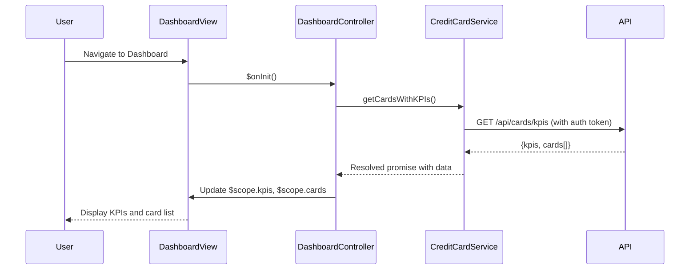

# Low-Level Design: Dashboard KPIs and Credit Card Overview

**Epic ID:** ASFSDGSGSG-Dashboard_KPIs_and_Credit_Card_Overview

---

## a. Architecture Mapping

- **User Interface (Dashboard View)** → AngularJS Template (HTML5 + Bootstrap) with data-binding
- **Dashboard Controller** → AngularJS Controller managing view state and KPI display logic
- **Credit Card Service** → AngularJS Service (Factory) for fetching card data via REST API
- **KPI Calculation Engine** → Server-side REST endpoint; client receives computed KPIs
- **Authentication Service** → AngularJS Service (Factory) with HTTP interceptor for token-based auth

**Recommended Folder Structure:**
```
app/
├── modules/
│   └── dashboard/
│       ├── dashboard.module.js
│       ├── dashboard.controller.js
│       ├── dashboard.html
│       └── dashboard.css
├── services/
│   ├── creditCard.service.js
│   └── auth.service.js
└── app.js
```

---

## b. Component Specifications

| Component Name | Artifact Type | Responsibility | Key Dependencies |
|----------------|---------------|----------------|------------------|
| DashboardModule | Module | Registers dashboard feature module | angular, ui.router |
| DashboardController | Controller | Manages KPI display, card list, refresh logic | CreditCardService, $scope |
| CreditCardService | Factory | Fetches card data and KPIs from REST API | $http, $q, AuthService |
| AuthService | Factory | Manages user authentication and token injection | $http, $window (localStorage) |
| DashboardView | Template | Renders KPI cards, multi-card list, responsive layout | Bootstrap grid, ng-repeat |

---

## c. Data Model

**CreditCard Object:**
```javascript
{
  cardId: String,
  cardNumber: String (masked),
  cardHolderName: String,
  cardType: String,
  creditLimit: Number,
  availableCredit: Number,
  outstandingAmount: Number,
  lastUpdated: Date
}
```

**DashboardKPI Object:**
```javascript
{
  monthlySpend: Number,
  totalCreditLimit: Number,
  totalAvailableCredit: Number,
  totalOutstanding: Number,
  cardCount: Number
}
```

---

## d. Data Flow

User loads dashboard → DashboardView renders → DashboardController initializes → calls CreditCardService.getCardsWithKPIs() → Service sends authenticated GET request to /api/cards/kpis → API returns aggregated KPIs and card list → Service resolves promise with data → Controller updates $scope.kpis and $scope.cards → View updates via two-way binding, displaying KPIs and card list in responsive Bootstrap grid.

---

## e. Primary Sequence Diagram



---

## f. Implementation Notes

- Use AngularJS 1.x module pattern with dependency injection for all services and controllers.
- Implement CreditCardService as a Factory returning promise-based methods using $http and $q.
- Apply Bootstrap responsive grid (col-xs/sm/md/lg) for KPI cards to ensure mobile-first layout.
- Use HTTP interceptor in AuthService to inject bearer token into all outgoing API requests.
- Implement manual refresh via ng-click bound to DashboardController.refreshKPIs() method.

---

## g. Error Handling

HTTP interceptor captures API errors; display user-friendly toast notifications via AngularJS service for network failures or 401/403 responses.

---

## h. Security Notes

Requires token-based authentication via existing SSO; auth token stored in localStorage and injected via HTTP interceptor.