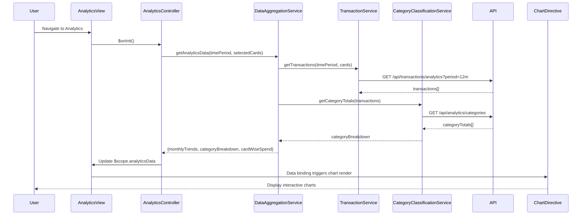

# Low-Level Design: Spending Analytics and Insights

**Epic ID:** ASFSDGSGSG-Spending_Analytics_and_Insights

---

## a. Architecture Mapping

- **User Interface (Analytics View)** → AngularJS Template with chart containers and responsive grid layout
- **Analytics Controller** → AngularJS Controller managing chart data, time period selection, and card filtering
- **Data Aggregation Service** → AngularJS Service (Factory) orchestrating data fetch and aggregation for charts
- **Transaction Data Service** → AngularJS Service (Factory) fetching raw transaction data from REST API
- **Category Classification Engine** → Server-side REST endpoint; client receives pre-classified category totals
- **Visualization Library** → Chart.js integrated via AngularJS Directive wrapper
- **Chart Renderer** → Custom AngularJS Directive rendering Chart.js instances with reactive data binding

**Recommended Folder Structure:**
```
app/
├── modules/
│   └── analytics/
│       ├── analytics.module.js
│       ├── analytics.controller.js
│       ├── analytics.html
│       └── analytics.css
├── services/
│   ├── dataAggregation.service.js
│   ├── transaction.service.js
│   └── categoryClassification.service.js
├── directives/
│   ├── lineChart.directive.js
│   ├── pieChart.directive.js
│   └── barChart.directive.js
└── app.js
```

---

## b. Component Specifications

| Component Name | Artifact Type | Responsibility | Key Dependencies |
|----------------|---------------|----------------|------------------|
| AnalyticsModule | Module | Registers analytics feature module | angular, ui.router, chart.js |
| AnalyticsController | Controller | Manages chart data, time period selection, card filter state | DataAggregationService, $scope |
| DataAggregationService | Factory | Orchestrates data fetch and aggregates spending by category/card/month | TransactionService, CategoryClassificationService, $q |
| TransactionService | Factory | Fetches transaction data for analytics from REST API | $http, $q, AuthService |
| CategoryClassificationService | Factory | Retrieves pre-classified category totals from API | $http, $q |
| LineChartDirective | Directive | Renders monthly spend trend line chart using Chart.js | chart.js |
| PieChartDirective | Directive | Renders category-wise spending pie chart using Chart.js | chart.js |
| BarChartDirective | Directive | Renders card-wise spend bar chart using Chart.js | chart.js |
| AnalyticsView | Template | Displays charts in responsive grid with time period and card filters | Bootstrap grid, custom chart directives |

---

## c. Data Model

**MonthlySpendTrend Object:**
```javascript
{
  month: String,
  totalSpend: Number
}
```

**CategorySpend Object:**
```javascript
{
  category: String,
  amount: Number,
  percentage: Number
}
```

**CardSpend Object:**
```javascript
{
  cardId: String,
  cardName: String,
  totalSpend: Number
}
```

**AnalyticsData Object:**
```javascript
{
  monthlyTrends: MonthlySpendTrend[],
  categoryBreakdown: CategorySpend[],
  cardWiseSpend: CardSpend[],
  timePeriod: String,
  selectedCards: String[]
}
```

---

## d. Data Flow

User navigates to Analytics view → AnalyticsView renders with default 12-month period → AnalyticsController initializes → calls DataAggregationService.getAnalyticsData(timePeriod, selectedCards) → Service fetches transaction data via TransactionService.getTransactions() and category totals via CategoryClassificationService.getCategoryTotals() → Service aggregates data into monthlyTrends, categoryBreakdown, cardWiseSpend → returns aggregated data → Controller updates $scope.analyticsData → Chart directives watch data changes → re-render Chart.js instances → User sees monthly trend line chart, category pie chart, and card-wise bar chart.

---

## e. Primary Sequence Diagram



---

## f. Implementation Notes

- Use AngularJS Factory pattern for DataAggregationService with $q.all() to parallelize API calls for transactions and category data.
- Implement custom AngularJS Directives (lineChart, pieChart, barChart) wrapping Chart.js; use $watch on data binding to trigger chart updates.
- Apply responsive Bootstrap grid (col-md-6, col-xs-12) to display multiple charts side-by-side on desktop, stacked on mobile.
- Use Chart.js responsive: true and maintainAspectRatio: false options for mobile-friendly charts.
- Implement time period filter (1M, 3M, 6M, 12M) via ng-click updating controller state and re-fetching data.

---

## g. Error Handling

Interceptor-based error handling for API failures; display user notification on chart render errors or empty data sets.

---

## h. Security Notes

Standard input validation and secure API calls assumed; auth token injected via HTTP interceptor.