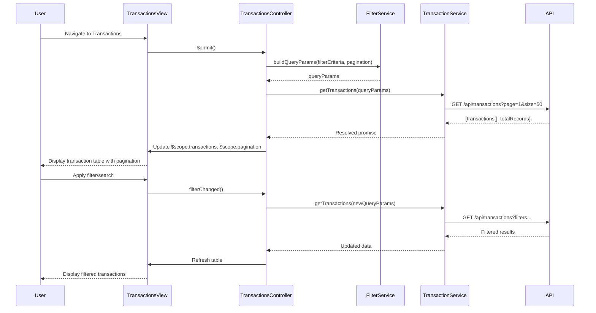

# Low-Level Design: Transaction Management and Viewing

**Epic ID:** ASFSDGSGSG-Transaction_Management_and_Viewing

---

## a. Architecture Mapping

- **User Interface (Transaction List View)** → AngularJS Template with ng-repeat, filters, and pagination controls
- **Transaction Controller** → AngularJS Controller managing transaction list, search, filter, and pagination state
- **Search and Filter Service** → AngularJS Service (Factory) handling client-side filtering logic and API query construction
- **Transaction Repository** → Server-side REST endpoint; client consumes paginated transaction data
- **Credit Card Service** → AngularJS Service (Factory) for card metadata retrieval
- **Pagination Handler** → AngularJS Directive or built-in limitTo + custom pagination logic

**Recommended Folder Structure:**
```
app/
├── modules/
│   └── transactions/
│       ├── transactions.module.js
│       ├── transactions.controller.js
│       ├── transactions.html
│       └── transactions.css
├── services/
│   ├── transaction.service.js
│   ├── creditCard.service.js
│   └── filter.service.js
├── directives/
│   └── pagination.directive.js
└── app.js
```

---

## b. Component Specifications

| Component Name | Artifact Type | Responsibility | Key Dependencies |
|----------------|---------------|----------------|------------------|
| TransactionsModule | Module | Registers transaction feature module | angular, ui.router |
| TransactionsController | Controller | Manages transaction list, search, filter, pagination state | TransactionService, FilterService, $scope |
| TransactionService | Factory | Fetches paginated transactions from REST API | $http, $q, AuthService |
| FilterService | Factory | Constructs query params for search/filter operations | - |
| CreditCardService | Factory | Retrieves card metadata for multi-card filtering | $http, $q |
| PaginationDirective | Directive | Renders pagination controls and emits page change events | - |
| TransactionsView | Template | Displays transaction table with search, filter, and pagination | Bootstrap table, ng-repeat, custom filters |

---

## c. Data Model

**Transaction Object:**
```javascript
{
  transactionId: String,
  cardId: String,
  date: Date,
  merchant: String,
  category: String,
  amount: Number,
  currency: String,
  status: String,
  description: String
}
```

**PaginationState Object:**
```javascript
{
  currentPage: Number,
  pageSize: Number,
  totalRecords: Number,
  totalPages: Number
}
```

**FilterCriteria Object:**
```javascript
{
  cardId: String,
  dateFrom: Date,
  dateTo: Date,
  category: String,
  searchTerm: String
}
```

---

## d. Data Flow

User navigates to Transactions view → TransactionsView renders → TransactionsController initializes with default pagination (page 1, size 50) → calls TransactionService.getTransactions(filterCriteria, paginationState) → Service constructs query params via FilterService → sends GET /api/transactions?page=1&size=50 → API returns {transactions[], totalRecords} → Controller updates $scope.transactions and $scope.pagination → View renders table with ng-repeat → User applies filter/search → Controller updates filterCriteria → re-fetches data → View updates.

---

## e. Primary Sequence Diagram



---

## f. Implementation Notes

- Use AngularJS Factory pattern for TransactionService with promise-based pagination support via $http.
- Implement FilterService to construct query strings from filter criteria objects; support date range, category, and text search.
- Apply AngularJS custom filters (e.g., currency, date) in template for consistent formatting.
- Use ng-repeat with track by transactionId for efficient DOM rendering of large transaction lists.
- Implement debounce on search input using $timeout to limit API calls during typing.

---

## g. Error Handling

Interceptor-based error handling with try/catch in service methods; display toast notifications for API failures or empty result sets.

---

## h. Security Notes

Standard input validation and secure API calls assumed; auth token injected via HTTP interceptor.