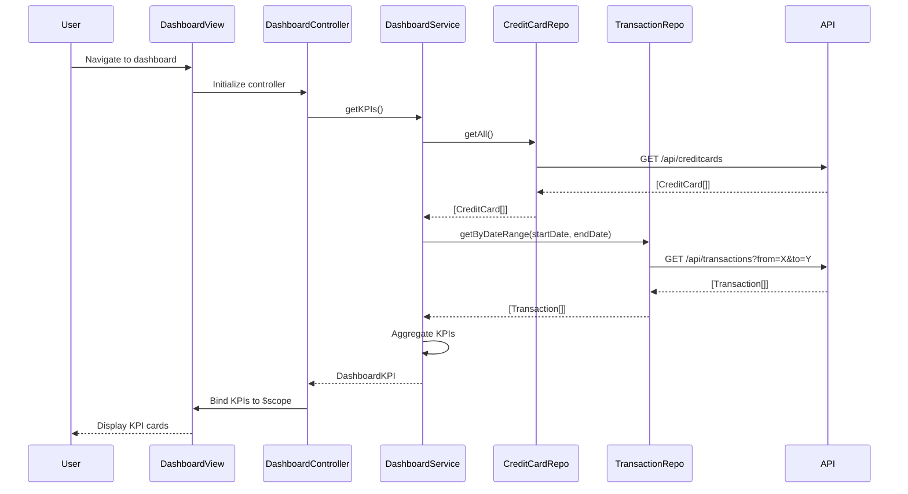

# Low-Level Design: Dashboard KPIs and Credit Card Overview

**Epic ID:** PERFTEST3-Dashboard_KPIs_and_Credit_Card_Overview

---

## a. Architecture Mapping

| HLD Component | AngularJS Artifact | Purpose |
|---------------|-------------------|----------|
| User Interface Dashboard | Module: `dashboardModule` | Root module for dashboard feature |
| User Interface Dashboard | Controller: `DashboardController` | Manages dashboard state and KPI display logic |
| Dashboard Service | Service: `DashboardService` | Orchestrates data retrieval and aggregation for KPIs |
| Credit Card Data Repository | Factory: `CreditCardRepository` | Handles credit card data API calls |
| Transaction Processing System | Factory: `TransactionRepository` | Handles transaction data API calls |
| User Authentication Service | Service: `AuthService` (existing) | Provides authentication state and tokens |

**Recommended Folder Structure:**
```
app/
├── modules/
│   └── dashboard/
│       ├── dashboard.module.js
│       ├── dashboard.controller.js
│       ├── dashboard.service.js
│       ├── dashboard.html
│       └── dashboard.css
├── shared/
│   ├── services/
│   │   └── auth.service.js
│   └── factories/
│       ├── creditcard.repository.js
│       └── transaction.repository.js
```

---

## b. Component Specifications

| Component Name | Artifact Type | Responsibility | Key Dependencies |
|----------------|---------------|----------------|------------------|
| `dashboardModule` | Module | Registers dashboard feature components | `ngRoute`, `ui.bootstrap` |
| `DashboardController` | Controller | Fetches and displays KPIs; handles refresh logic | `DashboardService`, `$scope` |
| `DashboardService` | Service | Aggregates data from repositories; calculates KPIs | `CreditCardRepository`, `TransactionRepository` |
| `CreditCardRepository` | Factory | REST calls to `/api/creditcards` endpoint | `$http`, `AuthService` |
| `TransactionRepository` | Factory | REST calls to `/api/transactions` endpoint | `$http`, `AuthService` |
| `AuthService` | Service | Provides auth token for API requests | `$http`, `$window` (localStorage) |

---

## c. Data Model

**CreditCard Model:**
```javascript
{
  cardId: String,
  cardNumber: String,
  cardHolderName: String,
  creditLimit: Number,
  availableCredit: Number,
  outstandingAmount: Number,
  cardType: String,
  expiryDate: String
}
```

**Transaction Model:**
```javascript
{
  transactionId: String,
  cardId: String,
  amount: Number,
  transactionDate: Date,
  description: String,
  category: String,
  merchantName: String
}
```

**DashboardKPI Model:**
```javascript
{
  monthlySpend: Number,
  totalCreditLimit: Number,
  totalAvailableCredit: Number,
  totalOutstanding: Number,
  cardCount: Number
}
```

---

## d. Data Flow

User navigates to dashboard route → `DashboardController` initializes and calls `DashboardService.getKPIs()` → Service concurrently fetches credit card data via `CreditCardRepository.getAll()` and current month transactions via `TransactionRepository.getByDateRange()` → Repositories make authenticated REST API calls using `AuthService` token → Service aggregates responses to compute monthly spend (sum of transaction amounts), total credit limit (sum of all card limits), available credit (sum of available credit), and outstanding amount (sum of outstanding balances) → Controller receives aggregated KPI object and binds to `$scope` → View renders KPI cards with Bootstrap styling and auto-refreshes every 5 minutes via `$interval`.

---

## e. Primary Sequence Diagram



---

## f. Implementation Notes

- Use AngularJS 1.x module pattern with IIFE to avoid global scope pollution; register all components via `angular.module('dashboardModule', [])`.
- Leverage dependency injection for all services, factories, and controllers; use array notation for minification safety.
- Implement REST API calls using `$http` service with promise-based `.then()` and `.catch()` for async handling.
- Use `$interval` service for auto-refresh every 5 minutes; ensure interval is canceled on `$scope.$on('$destroy')` to prevent memory leaks.
- Apply Bootstrap grid system (e.g., `col-md-3` for KPI cards) for responsive layout; use CSS3 media queries for mobile optimization.

---

## g. Error Handling

HTTP interceptor captures API errors; user-friendly notifications displayed via Bootstrap alerts; fallback to cached data if available.

---

## h. Security Notes

Requires token-based authentication via existing SSO; all API calls include Authorization header with bearer token from AuthService.