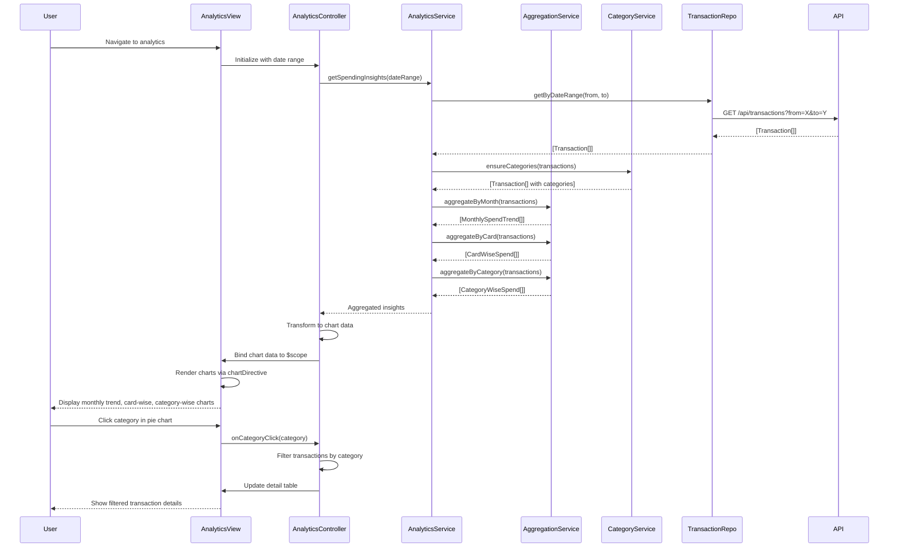

# Low-Level Design: Spending Analytics and Insights

**Epic ID:** PERFTEST3-Spending_Analytics_and_Insights

---

## a. Architecture Mapping

| HLD Component | AngularJS Artifact | Purpose |
|---------------|-------------------|----------|
| Analytics UI Layer | Module: `analyticsModule` | Root module for analytics feature |
| Analytics UI Layer | Controller: `AnalyticsController` | Manages chart data and user interactions |
| Analytics Service | Service: `AnalyticsService` | Orchestrates data aggregation and trend computation |
| Data Aggregation Service | Service: `AggregationService` | Performs client-side data aggregation and caching |
| Category Classification Engine | Service: `CategoryService` | Provides category mapping and classification logic |
| Transaction Processing System | Factory: `TransactionRepository` | Handles transaction data API calls |
| Visualization Library | Directive: `chartDirective` (wraps Chart.js) | Renders interactive charts |

**Recommended Folder Structure:**
```
app/
├── modules/
│   └── analytics/
│       ├── analytics.module.js
│       ├── analytics.controller.js
│       ├── analytics.service.js
│       ├── aggregation.service.js
│       ├── category.service.js
│       ├── chart.directive.js
│       ├── analytics.html
│       └── analytics.css
├── shared/
│   └── factories/
│       └── transaction.repository.js
```

---

## b. Component Specifications

| Component Name | Artifact Type | Responsibility | Key Dependencies |
|----------------|---------------|----------------|------------------|
| `analyticsModule` | Module | Registers analytics feature components | `ngRoute`, `chart.js` |
| `AnalyticsController` | Controller | Manages chart data, filter state, and drill-down logic | `AnalyticsService`, `$scope`, `$filter` |
| `AnalyticsService` | Service | Coordinates aggregation and trend computation | `AggregationService`, `CategoryService`, `TransactionRepository` |
| `AggregationService` | Service | Aggregates transactions by month, card, category; caches results | None |
| `CategoryService` | Service | Maps transactions to predefined categories; provides category list | None |
| `TransactionRepository` | Factory | REST calls to `/api/transactions` for raw data | `$http`, `AuthService` |
| `chartDirective` | Directive | Wraps Chart.js for rendering bar, line, and pie charts | `Chart.js` library |

---

## c. Data Model

**Transaction Model:**
```javascript
{
  transactionId: String,
  cardId: String,
  amount: Number,
  transactionDate: Date,
  category: String,
  merchantName: String
}
```

**MonthlySpendTrend Model:**
```javascript
{
  month: String,
  totalSpend: Number,
  transactionCount: Number
}
```

**CardWiseSpend Model:**
```javascript
{
  cardId: String,
  cardNumber: String,
  totalSpend: Number
}
```

**CategoryWiseSpend Model:**
```javascript
{
  category: String,
  totalSpend: Number,
  percentage: Number
}
```

**Categories (Enum):**
```javascript
['Food & Dining', 'Fuel', 'Shopping', 'Travel', 'Entertainment', 'Utilities', 'Healthcare', 'Education', 'Miscellaneous']
```

---

## d. Data Flow

User navigates to analytics view → `AnalyticsController` initializes with default date range (last 6 months) → Controller calls `AnalyticsService.getSpendingInsights(dateRange)` → Service fetches raw transactions via `TransactionRepository.getByDateRange()` → Repository makes authenticated GET request to `/api/transactions?from=X&to=Y` → Service passes transactions to `AggregationService.aggregateByMonth()`, `.aggregateByCard()`, and `.aggregateByCategory()` → `CategoryService` ensures each transaction has valid category mapping → Aggregation service computes monthly totals, card-wise totals, and category-wise breakdowns, caching results in memory → Service returns aggregated data objects to controller → Controller transforms data into chart-compatible formats (labels, datasets) → Controller binds chart data to `$scope.monthlyTrendData`, `$scope.cardWiseData`, `$scope.categoryData` → View renders three charts using `chartDirective` (line chart for monthly trends, bar chart for card-wise, pie chart for category-wise) → User interacts with chart (e.g., clicks category slice) → Directive emits drill-down event → Controller filters transactions by selected category and updates detail table.

---

## e. Primary Sequence Diagram



---

## f. Implementation Notes

- Use AngularJS 1.x module pattern; integrate Chart.js library via `angular-chart.js` wrapper or custom directive wrapping Chart.js.
- Implement `AggregationService` using ES6 `Map` and `reduce()` for efficient grouping and summing of transaction amounts.
- Cache aggregated results in service using `$cacheFactory` with TTL of 5 minutes to avoid redundant computation on view re-entry.
- Use AngularJS `$filter` service for date formatting and currency display in chart tooltips and labels.
- Implement responsive chart sizing using Chart.js `maintainAspectRatio: false` and CSS `max-width: 100%` for mobile compatibility.

---

## g. Error Handling

Interceptor-based error handling for API failures; try/catch in aggregation logic; user notified via Bootstrap alert if chart rendering fails.

---

## h. Security Notes

Requires token-based auth via existing SSO; all transaction API calls include Authorization header with bearer token.