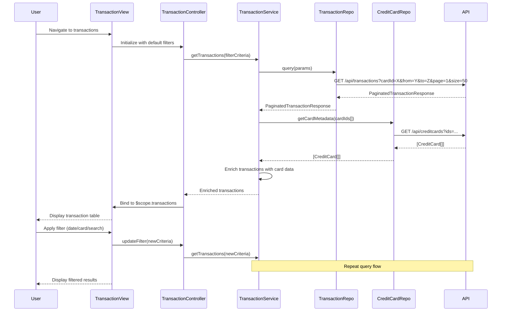

# Low-Level Design: Transaction Management and Tracking

**Epic ID:** PERFTEST3-Transaction_Management_and_Tracking

---

## a. Architecture Mapping

| HLD Component | AngularJS Artifact | Purpose |
|---------------|-------------------|----------|
| User Interface Transaction View | Module: `transactionModule` | Root module for transaction feature |
| User Interface Transaction View | Controller: `TransactionController` | Manages transaction list, filters, and pagination |
| Transaction Management Service | Service: `TransactionService` | Orchestrates transaction retrieval and filtering logic |
| Transaction Processing System | Factory: `TransactionRepository` | Handles transaction API calls |
| Credit Card Data Repository | Factory: `CreditCardRepository` | Provides card metadata for transaction mapping |
| Search and Filter Engine | Service: `FilterService` | Client-side filtering and search logic |
| User Authentication Service | Service: `AuthService` (existing) | Provides authentication tokens |

**Recommended Folder Structure:**
```
app/
├── modules/
│   └── transactions/
│       ├── transaction.module.js
│       ├── transaction.controller.js
│       ├── transaction.service.js
│       ├── filter.service.js
│       ├── transactions.html
│       └── transactions.css
├── shared/
│   ├── services/
│   │   └── auth.service.js
│   └── factories/
│       ├── transaction.repository.js
│       └── creditcard.repository.js
```

---

## b. Component Specifications

| Component Name | Artifact Type | Responsibility | Key Dependencies |
|----------------|---------------|----------------|------------------|
| `transactionModule` | Module | Registers transaction feature components | `ngRoute`, `ui.bootstrap` |
| `TransactionController` | Controller | Manages transaction list state, pagination, filters | `TransactionService`, `FilterService`, `$scope` |
| `TransactionService` | Service | Fetches transactions; applies server-side filters | `TransactionRepository`, `CreditCardRepository` |
| `FilterService` | Service | Provides client-side search and filter utilities | None |
| `TransactionRepository` | Factory | REST calls to `/api/transactions` with query params | `$http`, `AuthService` |
| `CreditCardRepository` | Factory | REST calls to `/api/creditcards` for card metadata | `$http`, `AuthService` |

---

## c. Data Model

**Transaction Model:**
```javascript
{
  transactionId: String,
  cardId: String,
  cardNumber: String,
  amount: Number,
  transactionDate: Date,
  description: String,
  category: String,
  merchantName: String,
  status: String
}
```

**FilterCriteria Model:**
```javascript
{
  cardId: String,
  startDate: Date,
  endDate: Date,
  category: String,
  searchText: String,
  page: Number,
  pageSize: Number
}
```

**PaginatedTransactionResponse Model:**
```javascript
{
  transactions: Array<Transaction>,
  totalCount: Number,
  currentPage: Number,
  pageSize: Number
}
```

---

## d. Data Flow

User navigates to transactions view → `TransactionController` initializes with default filter (all cards, last 30 days, page 1, 50 per page) → Controller calls `TransactionService.getTransactions(filterCriteria)` → Service builds query params and invokes `TransactionRepository.query(params)` → Repository makes authenticated GET request to `/api/transactions?cardId=X&from=Y&to=Z&page=1&size=50` → API returns paginated transaction list → Service enriches transactions with card metadata from `CreditCardRepository` → Controller receives data and binds to `$scope.transactions` → View renders transaction table with pagination controls → User applies filter (date range, card, search text) → Controller updates filter criteria and re-fetches → `FilterService` applies client-side search on description/merchant if needed → View updates with filtered results.

---

## e. Primary Sequence Diagram



---

## f. Implementation Notes

- Use AngularJS 1.x module pattern with IIFE; register `transactionModule` with dependencies on `ngRoute` and `ui.bootstrap` for pagination.
- Implement pagination using `ui-bootstrap` directive `<uib-pagination>`; bind to `$scope.currentPage` and `$scope.totalItems`.
- Use `$http` service with query parameter serialization for REST calls; handle promises with `.then()` and `.catch()`.
- Apply AngularJS filters (e.g., `| date:'short'`, `| currency`) in view for formatting transaction date and amount.
- Implement debounce on search input using `ng-model-options="{ debounce: 500 }"` to reduce API calls during typing.

---

## g. Error Handling

HTTP interceptor-based error handling with try/catch in service layer; user notifications via Bootstrap toasts for failed queries.

---

## h. Security Notes

Requires token-based auth via existing SSO; all API requests include Authorization header; transaction data encrypted at rest per API layer.