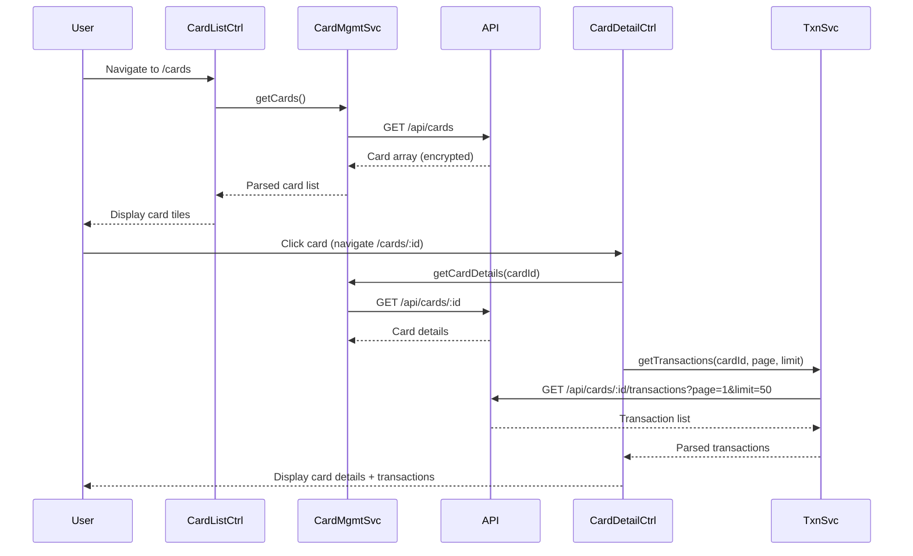

# Low-Level Design: Credit Card Management and Transactions

**Epic ID**: PerfTest6-Credit_Card_Management_and_Transactions

---

## a. Architecture Mapping

- **Module**: `creditCardApp.cardManagement` - Main module for card management features
- **Controller**: `CardListController` - Manages card list display and navigation
- **Controller**: `CardDetailController` - Handles individual card details and transaction view
- **Service**: `CardManagementService` - REST API calls for card CRUD operations
- **Service**: `TransactionService` - Fetches transaction data for selected cards
- **Service**: `AuthInterceptor` - Handles authentication token injection
- **Directive**: `cardTile` - Reusable card display component
- **Factory**: `CardModel` - Card data model and validation

**Folder Structure**:
```
/app
  /modules
    /card-management
      /controllers
      /services
      /directives
      /models
      /views
```

---

## b. Component Specifications

| Name | Artifact Type | Responsibility | Key Dependencies |
|------|---------------|----------------|------------------|
| creditCardApp.cardManagement | Module | Root module for card management features | ngRoute, ngResource |
| CardListController | Controller | Display card list, handle card selection | CardManagementService, $scope |
| CardDetailController | Controller | Show card details and transactions | TransactionService, CardManagementService, $routeParams |
| CardManagementService | Service | API calls for card CRUD (GET /cards, GET /cards/:id) | $http, API_BASE_URL |
| TransactionService | Service | Fetch paginated transactions (GET /cards/:id/transactions) | $http, API_BASE_URL |
| AuthInterceptor | Factory | Inject auth token, handle 401 errors | $q, $injector, AuthService |
| cardTile | Directive | Render individual card with masked number, limit, status | None |
| CardModel | Factory | Card object structure and validation methods | None |

---

## c. Data Model

**Card Object**:
```javascript
{
  id: String,
  cardNumber: String,        // masked (e.g., "**** **** **** 1234")
  issuer: String,            // e.g., "Visa", "MasterCard"
  creditLimit: Number,
  availableCredit: Number,
  outstandingAmount: Number,
  status: String,            // "active", "blocked", "expired"
  userId: String
}
```

**Transaction Object**:
```javascript
{
  id: String,
  cardId: String,
  date: Date,
  merchant: String,
  amount: Number,
  category: String,
  description: String
}
```

---

## d. Data Flow

User authenticates and navigates to card list view → CardListController invokes CardManagementService.getCards() → Service calls GET /api/cards with auth token → API returns encrypted card array → Controller binds cards to $scope, UI renders card tiles using cardTile directive → User clicks a card → CardDetailController loads via $routeParams.cardId → Controller calls TransactionService.getTransactions(cardId, page, limit) → Service fetches GET /api/cards/:id/transactions with pagination → API returns transaction list → Controller updates $scope, UI displays card details and paginated transaction history with filtering options.

---

## e. Primary Sequence Diagram



---

## f. Implementation Notes

- Use AngularJS Dependency Injection for all services and controllers; register via module.controller() and module.service()
- Implement AuthInterceptor as $httpProvider interceptor to inject bearer token in request headers and redirect on 401
- Use $http with promise chaining (.then/.catch) for all REST API calls; wrap in service methods for reusability
- Implement pagination in TransactionService using query params (page, limit); bind to ng-repeat with limitTo filter
- Use ES6 arrow functions and const/let in services; compile with Babel if needed for legacy browser support

---

## g. Error Handling

HTTP interceptor-based error handling with user notification via toastr or modal on API failures; try/catch in controllers for local errors.

---

## h. Security Notes

Requires token-based auth via existing SSO; AuthInterceptor injects token; all API calls over HTTPS with encrypted payloads.

---