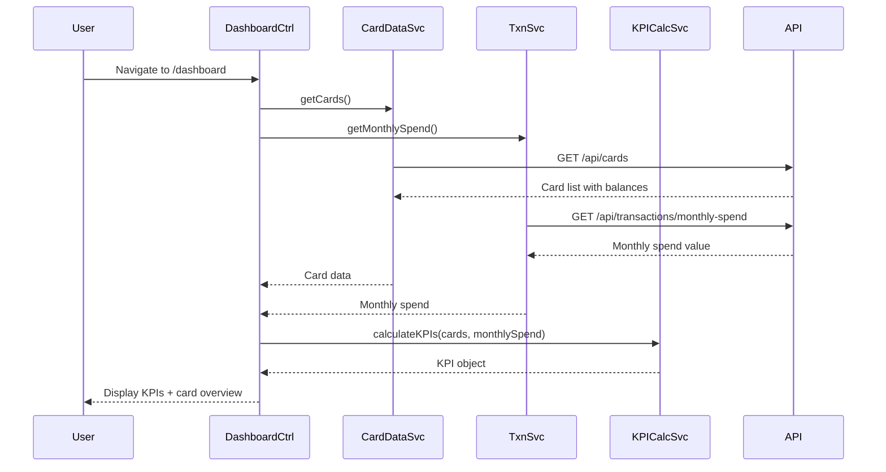

# Low-Level Design: Dashboard KPIs and Credit Card Overview

**Epic ID**: PerfTest6-Dashboard_KPIs_and_Credit_Card_Overview

---

## a. Architecture Mapping

- **Module**: `creditCardApp.dashboard` - Main module for dashboard features
- **Controller**: `DashboardController` - Manages KPI display and data binding
- **Service**: `CreditCardDataService` - Fetches card details and balances
- **Service**: `TransactionService` - Retrieves monthly spend data
- **Service**: `KPICalculationService` - Aggregates and calculates KPIs
- **Directive**: `kpiWidget` - Reusable KPI display component
- **Directive**: `cardOverview` - Multi-card summary component

**Folder Structure**:
```
/app
  /modules
    /dashboard
      /controllers
      /services
      /directives
      /views
```

---

## b. Component Specifications

| Name | Artifact Type | Responsibility | Key Dependencies |
|------|---------------|----------------|------------------|
| creditCardApp.dashboard | Module | Root module for dashboard features | ngRoute, ngAnimate |
| DashboardController | Controller | Fetch and bind KPI data to view | CreditCardDataService, TransactionService, KPICalculationService, $scope |
| CreditCardDataService | Service | API calls for card data (GET /cards, GET /cards/balances) | $http, API_BASE_URL |
| TransactionService | Service | Fetch monthly spend (GET /transactions/monthly-spend) | $http, API_BASE_URL |
| KPICalculationService | Service | Aggregate total credit limit, available credit, outstanding amount | None |
| kpiWidget | Directive | Render individual KPI with icon, value, label | None |
| cardOverview | Directive | Display multi-card summary in responsive grid | None |

---

## c. Data Model

**KPI Object**:
```javascript
{
  monthlySpend: Number,
  totalCreditLimit: Number,
  availableCredit: Number,
  outstandingAmount: Number,
  cardCount: Number
}
```

**CardSummary Object**:
```javascript
{
  id: String,
  cardNumber: String,        // masked
  issuer: String,
  creditLimit: Number,
  availableCredit: Number,
  outstandingAmount: Number
}
```

---

## d. Data Flow

User navigates to dashboard home → DashboardController initializes and calls CreditCardDataService.getCards() and TransactionService.getMonthlySpend() concurrently → Services invoke GET /api/cards and GET /api/transactions/monthly-spend → API Gateway routes to Credit Card Data Service and Transaction Service, which query database → Services return aggregated JSON data → KPICalculationService computes total credit limit (sum of all card limits), available credit (sum of available), and outstanding amount (sum of outstanding) → Controller binds KPI object to $scope → UI renders KPIs using kpiWidget directive and card overview using cardOverview directive in responsive Bootstrap grid → Real-time refresh via $interval or WebSocket updates $scope on data change.

---

## e. Primary Sequence Diagram



---

## f. Implementation Notes

- Use $q.all() to fetch card data and monthly spend in parallel for faster load time (target <2s for 10 cards)
- Implement KPICalculationService as pure functions using ES6 reduce() for aggregation (totalCreditLimit = cards.reduce((sum, c) => sum + c.creditLimit, 0))
- Use Bootstrap grid (col-md-3, col-sm-6, col-xs-12) in cardOverview directive for responsive layout across devices
- Bind KPI updates via $scope.$watch or $interval (polling every 30s) for real-time refresh; consider WebSocket for production
- Use ng-animate for smooth KPI value transitions on data change

---

## g. Error Handling

HTTP interceptor captures API errors; display user-friendly error message via toastr; retry logic with exponential backoff in services.

---

## h. Security Notes

Standard input validation and secure API calls assumed; token-based auth via existing SSO.

---