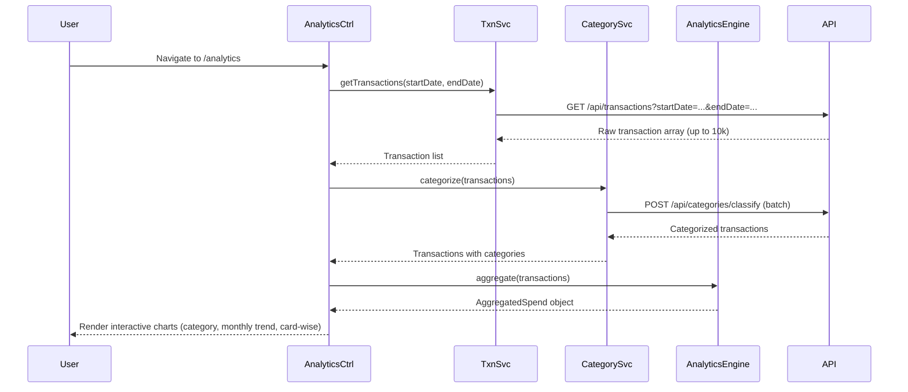

# Low-Level Design: Spending Analytics and Insights

**Epic ID**: PerfTest6-Spending_Analytics_and_Insights

---

## a. Architecture Mapping

- **Module**: `creditCardApp.analytics` - Main module for analytics features
- **Controller**: `AnalyticsController` - Manages analytics view and chart data binding
- **Service**: `TransactionService` - Fetches raw transaction data
- **Service**: `AnalyticsEngineService` - Aggregates and processes data for visualizations
- **Service**: `CategoryClassificationService` - Categorizes transactions into 9 categories
- **Directive**: `spendChart` - Renders interactive charts using Chart.js or D3.js
- **Factory**: `ChartConfigFactory` - Provides chart configuration objects

**Folder Structure**:
```
/app
  /modules
    /analytics
      /controllers
      /services
      /directives
      /factories
      /views
```

---

## b. Component Specifications

| Name | Artifact Type | Responsibility | Key Dependencies |
|------|---------------|----------------|------------------|
| creditCardApp.analytics | Module | Root module for analytics features | ngRoute, chart.js or angular-chart.js |
| AnalyticsController | Controller | Fetch transaction data, prepare chart datasets | TransactionService, AnalyticsEngineService, $scope, $filter |
| TransactionService | Service | API calls for raw transactions (GET /transactions?startDate&endDate) | $http, API_BASE_URL |
| AnalyticsEngineService | Service | Aggregate data by category, month, card; cache results | $q, localStorageService |
| CategoryClassificationService | Service | Categorize transactions into 9 categories (GET /categories/classify) | $http, API_BASE_URL |
| spendChart | Directive | Render interactive bar/line/pie charts with Chart.js | ChartConfigFactory |
| ChartConfigFactory | Factory | Provide chart.js config objects for different chart types | None |

---

## c. Data Model

**Transaction Object**:
```javascript
{
  id: String,
  cardId: String,
  date: Date,
  merchant: String,
  amount: Number,
  category: String,          // one of 9 categories
  description: String
}
```

**AggregatedSpend Object**:
```javascript
{
  categorySpend: {
    "Food & Dining": Number,
    "Fuel": Number,
    "Shopping": Number,
    "Travel": Number,
    "Entertainment": Number,
    "Utilities": Number,
    "Healthcare": Number,
    "Education": Number,
    "Miscellaneous": Number
  },
  monthlyTrend: [
    { month: String, amount: Number }
  ],
  cardWiseSpend: [
    { cardId: String, totalSpend: Number }
  ]
}
```

---

## d. Data Flow

User navigates to analytics view → AnalyticsController calls TransactionService.getTransactions(startDate, endDate) → Service invokes GET /api/transactions with date range → API returns raw transaction array (up to 10,000 records) → CategoryClassificationService.categorize(transactions) assigns category to each transaction using rule-based logic or ML model → AnalyticsEngineService.aggregate(transactions) groups data by category, month, and card using ES6 Map and reduce → Aggregated data cached in localStorage for performance → Controller prepares chart datasets (labels, data arrays) → spendChart directive renders category-wise pie chart, monthly trend line chart, and card-wise bar chart using Chart.js with responsive config → User interacts with charts (hover, click) to explore spending patterns.

---

## e. Primary Sequence Diagram



---

## f. Implementation Notes

- Use Chart.js via angular-chart.js directive for responsive, interactive visualizations; configure with ChartConfigFactory for consistent styling
- Implement AnalyticsEngineService aggregation using ES6 Map for grouping and Array.reduce() for summing amounts by category/month/card
- Cache aggregated data in localStorage using angular-local-storage module; set TTL of 5 minutes to balance freshness and performance
- Use $filter('date') and $filter('currency') in controller to format chart labels and tooltips
- Lazy-load Chart.js library using ocLazyLoad to reduce initial bundle size; load only when user navigates to /analytics

---

## g. Error Handling

HTTP interceptor-based error handling with user notification via modal on API failures; fallback to cached data if API unavailable.

---

## h. Security Notes

Standard input validation and secure API calls assumed; token-based auth via existing SSO; sanitize user inputs for date range filters.

---