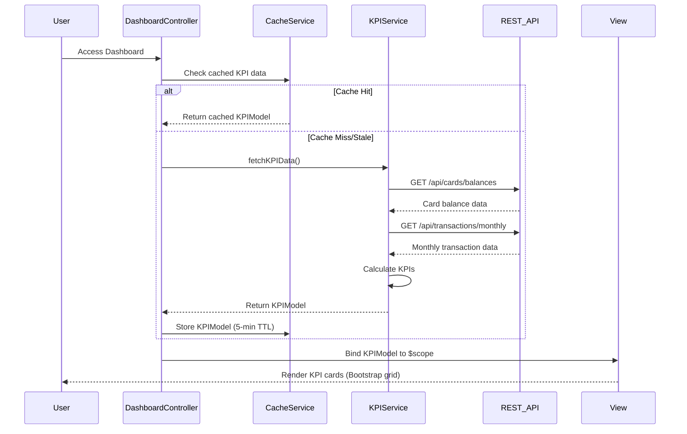

# Low-Level Design: Dashboard and KPI Management
**Epic ID:** QE-10000  
**Tech Stack:** AngularJS 1.x, JavaScript ES6, HTML5, CSS3, Bootstrap, REST APIs, MVC Architecture

---

## a. Architecture Mapping

- **Dashboard Module** (`app.dashboard`) → AngularJS Module containing all dashboard-related components
- **DashboardController** → Controller managing KPI display logic and user interactions
- **KPIService** → Service for fetching and calculating KPI metrics via REST APIs
- **CacheService** → Factory for client-side caching with 5-minute TTL
- **kpiCard Directive** → Reusable directive for rendering individual KPI widgets

**Folder Structure:**
```
/app
  /dashboard
    dashboard.module.js
    dashboard.controller.js
    dashboard.html
  /services
    kpi.service.js
    cache.service.js
  /directives
    kpi-card.directive.js
  /models
    kpi.model.js
```

---

## b. Component Specifications

| Component Name | Artifact Type | Responsibility | Key Dependencies |
|----------------|---------------|----------------|------------------|
| DashboardModule | Module | Registers dashboard components and routing | ngRoute, app.services |
| DashboardController | Controller | Orchestrates KPI data fetching and view updates | KPIService, CacheService, $scope |
| KPIService | Service | Fetches card balances and transaction data from REST APIs | $http, $q, CacheService |
| CacheService | Factory | Implements client-side caching with TTL management | $cacheFactory, $timeout |
| kpiCard | Directive | Renders individual KPI metric cards with responsive layout | None |
| KPIModel | Model | Defines KPI data structure (monthlySpend, totalLimit, availableCredit, outstanding) | None |

---

## c. Data Model

**KPIModel (JavaScript ES6 Class):**
```javascript
class KPIModel {
  constructor() {
    this.monthlySpend = 0;        // Number (currency)
    this.totalCreditLimit = 0;    // Number (currency)
    this.availableCredit = 0;     // Number (currency)
    this.outstandingAmount = 0;   // Number (currency)
    this.lastUpdated = null;      // Date
  }
}
```

**CardBalance Object:**
```javascript
{
  cardId: String,
  limit: Number,
  balance: Number,
  outstanding: Number
}
```

---

## d. Data Flow

User accesses dashboard → DashboardController initializes and checks CacheService for recent KPI data → If cache miss/stale, KPIService calls REST endpoints (`/api/cards/balances`, `/api/transactions/monthly`) → Service aggregates responses into KPIModel → CacheService stores result with 5-min TTL → Controller binds KPIModel to $scope → View renders kpiCard directives for each metric using Bootstrap grid → Cache auto-refreshes every 5 minutes via $timeout, triggering UI update.

---

## e. Primary Sequence Diagram



---

## f. Implementation Notes

- Use AngularJS Dependency Injection for all services and controllers; register via `angular.module().controller/service/factory`
- Implement ES6 Promises ($q) for async REST API calls; chain with `.then()` for sequential data aggregation
- Bootstrap responsive grid (`col-md-3 col-sm-6`) for KPI cards to ensure mobile/desktop compatibility
- CacheService uses `$cacheFactory` with custom TTL logic via `$timeout` for 5-minute auto-refresh
- REST API integration via `$http` service with interceptors for auth token injection

---

## g. Error Handling

HTTP interceptor captures API errors; displays Bootstrap alert modals with user-friendly messages; logs errors to console for debugging.

---

## h. Security Notes

Requires token-based auth via existing SSO; auth token injected in HTTP headers by interceptor for all API calls.