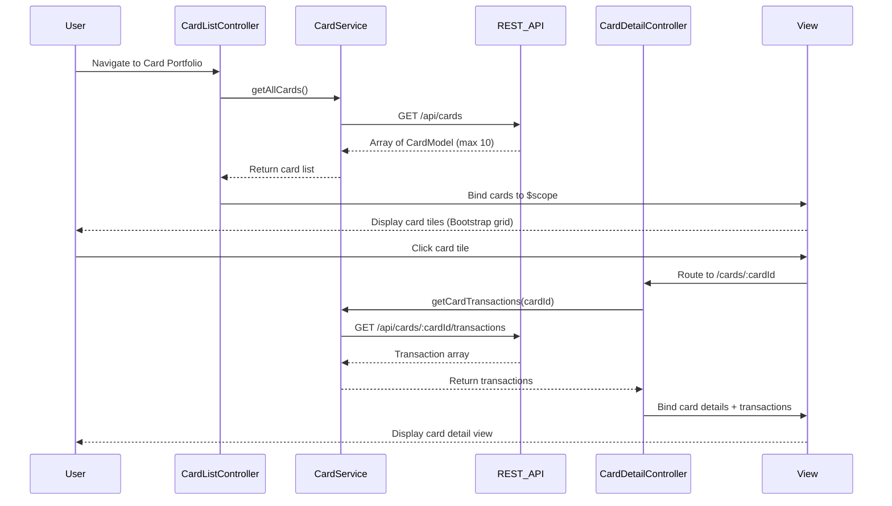

# Low-Level Design: Multiple Credit Card Management
**Epic ID:** QE-10001  
**Tech Stack:** AngularJS 1.x, JavaScript ES6, HTML5, CSS3, Bootstrap, REST APIs, MVC Architecture

---

## a. Architecture Mapping

- **CardManagement Module** (`app.cardManagement`) → AngularJS Module for card portfolio features
- **CardListController** → Controller managing card list display and selection
- **CardDetailController** → Controller for individual card detail view with transactions
- **CardService** → Service for fetching card data and transaction history via REST APIs
- **cardTile Directive** → Directive rendering individual card summary tiles

**Folder Structure:**
```
/app
  /card-management
    card-management.module.js
    card-list.controller.js
    card-detail.controller.js
    card-list.html
    card-detail.html
  /services
    card.service.js
  /directives
    card-tile.directive.js
  /models
    card.model.js
```

---

## b. Component Specifications

| Component Name | Artifact Type | Responsibility | Key Dependencies |
|----------------|---------------|----------------|------------------|
| CardManagementModule | Module | Registers card management components and routes | ngRoute, app.services |
| CardListController | Controller | Fetches and displays list of up to 10 cards per user | CardService, $scope |
| CardDetailController | Controller | Displays selected card details and transaction history | CardService, $routeParams, $scope |
| CardService | Service | Fetches card details, balances, and transactions from REST APIs | $http, $q |
| cardTile | Directive | Renders card summary tile with utilization bar and quick stats | None |
| CardModel | Model | Defines card data structure (cardId, name, limit, balance, outstanding, transactions) | None |

---

## c. Data Model

**CardModel (JavaScript ES6 Class):**
```javascript
class CardModel {
  constructor() {
    this.cardId = '';              // String
    this.cardName = '';            // String
    this.cardNumber = '';          // String (masked)
    this.creditLimit = 0;          // Number
    this.currentBalance = 0;       // Number
    this.outstandingAmount = 0;    // Number
    this.availableCredit = 0;      // Number (calculated)
    this.utilizationPercent = 0;   // Number (calculated)
    this.transactions = [];        // Array<TransactionModel>
  }
}
```

**TransactionModel:**
```javascript
{
  transactionId: String,
  date: Date,
  merchant: String,
  amount: Number,
  category: String
}
```

---

## d. Data Flow

User authenticates and navigates to card portfolio → CardListController calls CardService.getAllCards() → Service invokes GET `/api/cards` with user token → API returns array of CardModel objects (up to 10) → Controller binds cards to $scope → View renders cardTile directives in Bootstrap grid → User clicks a card → Route changes to `/cards/:cardId` → CardDetailController extracts cardId from $routeParams → Calls CardService.getCardTransactions(cardId) → Service fetches GET `/api/cards/:cardId/transactions` → Controller binds card details and transactions to $scope → View displays detailed card info with transaction list → Card switching responds within 500ms via optimized REST calls.

---

## e. Primary Sequence Diagram



---

## f. Implementation Notes

- Use AngularJS routing (`ngRoute`) with route parameters for card selection (`:cardId`)
- Implement lazy loading for transaction history; fetch only when card detail view is accessed
- Bootstrap card components (`card`, `card-body`) for responsive card tiles with utilization progress bars
- CardService uses $http with Promise chaining; implements retry logic for failed API calls (max 2 retries)
- Filter and sort transactions client-side using AngularJS filters for sub-500ms response time

---

## g. Error Handling

HTTP interceptor with try/catch blocks in service methods; display Bootstrap toast notifications for API failures; fallback to cached data if available.

---

## h. Security Notes

Standard input validation and secure API calls assumed; user token validated server-side for card ownership.