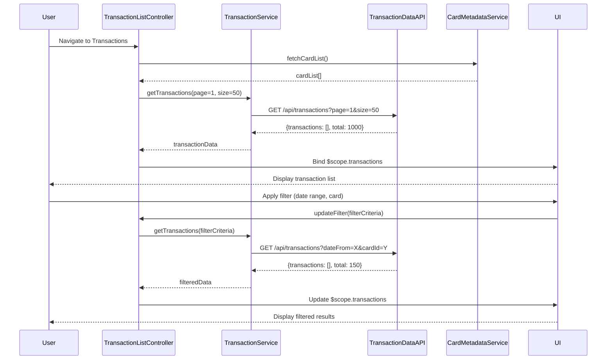

# Low-Level Design: Transaction Management and Monitoring
**Epic ID:** QE-10032

## a. Architecture Mapping

- **TransactionModule** (ng-app module) - Root module for transaction management feature
- **TransactionListController** - Manages transaction list view, pagination, and user interactions
- **TransactionFilterController** - Handles search and filter operations
- **TransactionService** (Factory) - Communicates with Transaction Data Service REST API
- **CardMetadataService** (Factory) - Fetches card-specific metadata from Credit Card Data Service
- **SyncService** (Service) - Handles data synchronization logic
- **transactionList** (Directive) - Renders paginated transaction list with sorting
- **transactionFilter** (Directive) - Provides filter UI component (date range, card selector, amount range)

**Recommended Folder Structure:**
```
/app
  /modules
    /transactions
      /controllers
      /services
      /directives
      /views
      /models
```

## b. Component Specifications

| Name | Artifact Type | Responsibility | Key Dependencies |
|------|---------------|----------------|------------------|
| TransactionModule | Module | Registers all transaction-related components and configures routing | ngRoute, ngResource |
| TransactionListController | Controller | Fetches and displays paginated transaction list, handles user navigation | TransactionService, CardMetadataService, $scope |
| TransactionFilterController | Controller | Manages filter state, applies search criteria, triggers filtered queries | TransactionService, $scope, $filter |
| TransactionService | Factory | Executes REST API calls to Transaction Data Service with pagination/filtering parameters | $http, $q |
| CardMetadataService | Factory | Retrieves card details for filter dropdowns and display | $http, $q |
| SyncService | Service | Polls Data Synchronization Service for updates, triggers refresh | $interval, TransactionService |
| transactionList | Directive | Renders transaction table with sorting and pagination controls | TransactionListController |
| transactionFilter | Directive | Provides date picker, card dropdown, and amount range inputs | TransactionFilterController |
| Transaction | Model | JS object representing transaction with id, date, merchant, amount, cardId, status | N/A |

## c. Data Model

**Transaction Object:**
```javascript
{
  id: String,              // Unique transaction ID
  date: Date,              // Transaction date
  merchant: String,        // Merchant name
  amount: Number,          // Transaction amount
  cardId: String,          // Associated credit card ID
  cardName: String,        // Card display name
  status: String,          // e.g., "posted", "pending"
  category: String         // Optional category
}
```

**FilterCriteria Object:**
```javascript
{
  dateFrom: Date,
  dateTo: Date,
  cardIds: Array<String>,
  minAmount: Number,
  maxAmount: Number
}
```

## d. Data Flow

User navigates to transaction view → TransactionListController initializes and calls TransactionService.getTransactions() with pagination params → TransactionService sends GET request to Transaction Data Service API → Service returns JSON array of transactions → Controller binds data to $scope.transactions → transactionList directive renders table → User applies filters via transactionFilter directive → TransactionFilterController updates FilterCriteria model and calls TransactionService.getTransactions(filterCriteria) → Filtered results returned within 1 second → UI updates with refined transaction list.

## e. Primary Sequence Diagram



## f. Implementation Notes

- Use AngularJS $http service with interceptors for token-based authentication and error handling
- Implement client-side pagination using limitTo filter; server-side pagination via query params (page, size, offset)
- Leverage ng-repeat with track by for efficient DOM rendering of large transaction lists
- Use $filter service for client-side date formatting and currency display
- Dependency Injection: Register all services/factories in TransactionModule and inject via constructor pattern

## g. Error Handling

HTTP interceptor captures API errors (4xx/5xx), displays user-friendly notifications via toast/modal, and logs errors to console; try/catch blocks in service methods handle promise rejections.

## h. Security Notes

Requires token-based auth via existing SSO; all API calls include Authorization header with JWT token.