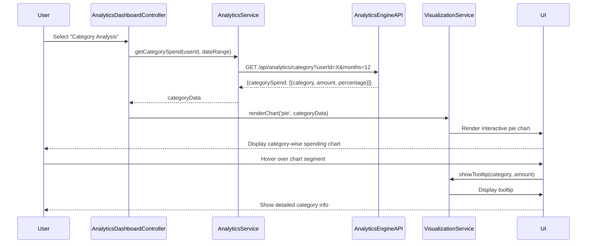

# Low-Level Design: Spending Analytics and Insights
**Epic ID:** QE-10033

## a. Architecture Mapping

- **AnalyticsModule** (ng-app module) - Root module for analytics feature
- **AnalyticsDashboardController** - Manages analytics view selection and data orchestration
- **CategoryAnalyticsController** - Handles category-wise spending display
- **TrendAnalyticsController** - Manages monthly trend visualization
- **AnalyticsService** (Factory) - Communicates with Analytics Engine API
- **TransactionDataService** (Factory) - Fetches raw transaction data
- **VisualizationService** (Service) - Wraps chart library (e.g., Chart.js, D3.js) for rendering
- **categoryChart** (Directive) - Renders category-wise spending pie/bar chart
- **trendChart** (Directive) - Renders monthly trend line chart
- **cardBreakdown** (Directive) - Displays card-wise spend breakdown

**Recommended Folder Structure:**
```
/app
  /modules
    /analytics
      /controllers
      /services
      /directives
      /views
      /models
```

## b. Component Specifications

| Name | Artifact Type | Responsibility | Key Dependencies |
|------|---------------|----------------|------------------|
| AnalyticsModule | Module | Registers analytics components, configures routing and chart library integration | ngRoute, chart.js/D3 |
| AnalyticsDashboardController | Controller | Orchestrates data fetching, manages view state (category/trend/card), coordinates child controllers | AnalyticsService, $scope |
| CategoryAnalyticsController | Controller | Fetches and displays category-wise spending data | AnalyticsService, VisualizationService, $scope |
| TrendAnalyticsController | Controller | Fetches and displays monthly spend trends over 12 months | AnalyticsService, VisualizationService, $scope |
| AnalyticsService | Factory | Calls Analytics Engine API for processed/categorized data | $http, $q |
| TransactionDataService | Factory | Retrieves raw transaction data if needed for client-side processing | $http, $q |
| VisualizationService | Service | Provides abstraction layer for chart rendering, handles chart configuration and updates | Chart.js/D3 library |
| categoryChart | Directive | Renders interactive pie or bar chart for 9 spending categories | VisualizationService |
| trendChart | Directive | Renders line chart showing monthly spend trends | VisualizationService |
| cardBreakdown | Directive | Displays table or chart showing spend breakdown by card | VisualizationService |
| SpendingAnalytics | Model | JS object with categorySpend[], monthlyTrend[], cardSpend[] | N/A |

## c. Data Model

**SpendingAnalytics Object:**
```javascript
{
  categorySpend: [
    { category: String, amount: Number, percentage: Number }
  ],
  monthlyTrend: [
    { month: String, totalSpend: Number }
  ],
  cardSpend: [
    { cardId: String, cardName: String, totalSpend: Number }
  ]
}
```

**ChartConfig Object:**
```javascript
{
  type: String,           // 'pie', 'bar', 'line'
  data: Object,           // Chart.js data structure
  options: Object         // Chart.js options (animations, tooltips, etc.)
}
```

## d. Data Flow

User selects analytics view (category/trend/card) → AnalyticsDashboardController calls AnalyticsService.getCategorySpend() or .getMonthlyTrend() → AnalyticsService sends GET request to Analytics Engine API → Engine returns pre-processed, categorized spending data → Controller binds data to $scope.analyticsData → VisualizationService.renderChart() invoked with data and chart type → Chart rendered via categoryChart/trendChart directive within 2 seconds → User interacts with chart (hover, click) → Directive updates tooltip/detail view without re-fetching data.

## e. Primary Sequence Diagram



## f. Implementation Notes

- Use Chart.js or D3.js via AngularJS directive wrappers for declarative chart rendering
- Implement chart directives with isolated scope and two-way data binding for dynamic updates
- Analytics Engine API returns pre-aggregated data to minimize client-side computation
- Use $q promises for asynchronous data fetching and chaining multiple API calls if needed
- Dependency Injection: Inject AnalyticsService and VisualizationService into controllers; register chart library as Angular constant or service

## g. Error Handling

HTTP interceptor handles API failures, displays error message to user, and provides retry option; chart rendering errors caught in directive link function with fallback to "No data available" message.

## h. Security Notes

Standard input validation and secure API calls assumed; token-based authentication via JWT in Authorization header.