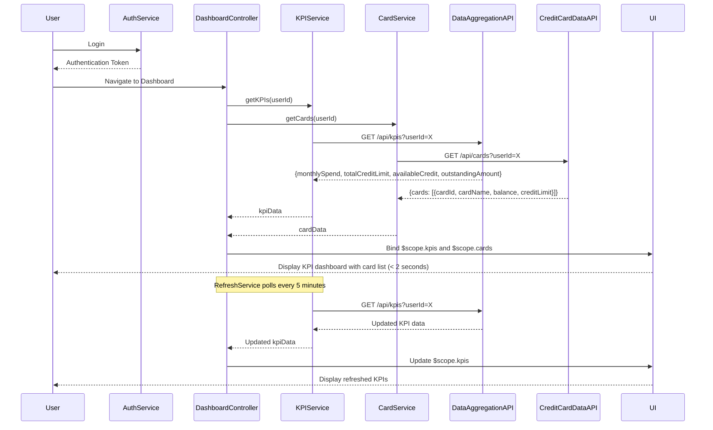

# Low-Level Design: Credit Card Portfolio Management and KPI Dashboard
**Epic ID:** QE-10034

## a. Architecture Mapping

- **DashboardModule** (ng-app module) - Root module for dashboard feature
- **DashboardController** - Manages KPI display, data refresh, and user interactions
- **KPIService** (Factory) - Communicates with Data Aggregation Service API
- **CardService** (Factory) - Fetches card details from Credit Card Data Service
- **AuthService** (Service) - Handles user authentication and session management
- **RefreshService** (Service) - Manages near-real-time data refresh (polling or WebSocket)
- **kpiCard** (Directive) - Renders individual KPI metric card (monthly spend, credit limit, etc.)
- **cardList** (Directive) - Displays list of user's credit cards with summary info
- **dashboardLayout** (Directive) - Provides responsive grid layout for KPI cards

**Recommended Folder Structure:**
```
/app
  /modules
    /dashboard
      /controllers
      /services
      /directives
      /views
      /models
```

## b. Component Specifications

| Name | Artifact Type | Responsibility | Key Dependencies |
|------|---------------|----------------|------------------|
| DashboardModule | Module | Registers dashboard components, configures routing and authentication guards | ngRoute, AuthService |
| DashboardController | Controller | Fetches aggregated KPIs, manages dashboard state, triggers data refresh | KPIService, CardService, RefreshService, $scope |
| KPIService | Factory | Calls Data Aggregation Service API to retrieve consolidated KPIs | $http, $q |
| CardService | Factory | Fetches credit card details and balances from Credit Card Data Service | $http, $q |
| AuthService | Service | Validates user session, provides authentication token for API calls | $http, $window |
| RefreshService | Service | Implements polling mechanism (every 5 minutes) to refresh dashboard data | $interval, KPIService |
| kpiCard | Directive | Renders individual KPI with label, value, and optional trend indicator | $filter |
| cardList | Directive | Displays responsive card grid showing card name, balance, limit, available credit | CardService |
| dashboardLayout | Directive | Provides CSS Grid or Flexbox-based responsive layout for mobile/tablet/desktop | N/A |
| DashboardKPI | Model | JS object with monthlySpend, totalCreditLimit, availableCredit, outstandingAmount | N/A |

## c. Data Model

**DashboardKPI Object:**
```javascript
{
  userId: String,
  monthlySpend: Number,
  totalCreditLimit: Number,
  availableCredit: Number,
  outstandingAmount: Number,
  lastUpdated: Date
}
```

**CreditCard Object:**
```javascript
{
  cardId: String,
  cardName: String,
  cardType: String,       // e.g., "Visa", "MasterCard"
  balance: Number,
  creditLimit: Number,
  availableCredit: Number
}
```

## d. Data Flow

User authenticates via AuthService → DashboardController initializes and calls KPIService.getKPIs(userId) and CardService.getCards(userId) → Services send GET requests to Data Aggregation Service and Credit Card Data Service APIs → APIs return aggregated KPIs and card details → Controller binds data to $scope.kpis and $scope.cards → kpiCard and cardList directives render dashboard within 2 seconds → RefreshService polls KPIService every 5 minutes → Updated data automatically bound to $scope → UI reflects near-real-time changes without page reload.

## e. Primary Sequence Diagram



## f. Implementation Notes

- Use AngularJS $http service with interceptors for authentication token injection and error handling
- Implement responsive layout using CSS Grid or Bootstrap grid system within dashboardLayout directive
- Use $interval service in RefreshService for 5-minute polling; clear interval on $scope.$destroy to prevent memory leaks
- Ensure WCAG 2.1 Level AA compliance: semantic HTML, ARIA labels, keyboard navigation, sufficient color contrast
- Dependency Injection: Inject KPIService, CardService, and RefreshService into DashboardController

## g. Error Handling

HTTP interceptor captures API errors, displays user notification (toast/alert), and provides manual refresh button; network failures trigger retry logic with exponential backoff.

## h. Security Notes

Requires token-based auth via existing SSO; JWT token included in Authorization header for all API requests; session timeout handled by AuthService.