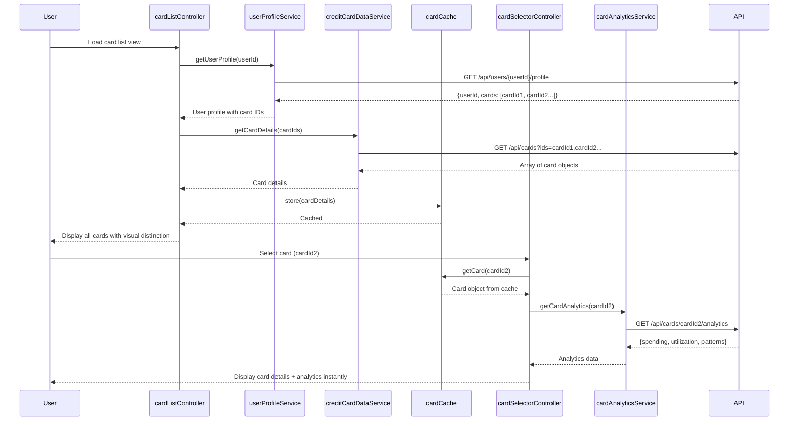

# Low-Level Design: Multiple Credit Card Management
**Epic ID:** QE-10035  
**Tech Stack:** AngularJS 1.x, JavaScript ES6, HTML5, CSS3, Bootstrap, REST APIs, MVC

---

## a. Architecture Mapping

| HLD Component | AngularJS Artifact | Type |
|--------------|-------------------|------|
| User Web/Mobile Client | creditCardApp module + cardListController | Module + Controller |
| Card Management API | cardManagementService | Factory/Service |
| User Profile Service | userProfileService | Factory |
| Credit Card Data Service | creditCardDataService | Factory |
| Card Selection Handler | cardSelectorController + cardCache | Controller + Service |
| Card-Specific Analytics Service | cardAnalyticsService | Factory |

**Folder Structure:**
```
/app
  /modules
    /card-management
      card-management.module.js
      /controllers
        card-list.controller.js
        card-selector.controller.js
      /services
        card-management.service.js
        credit-card-data.service.js
        user-profile.service.js
        card-analytics.service.js
        card-cache.service.js
      /views
        card-list.html
        card-detail.html
      /directives
        card-tile.directive.js
```

---

## b. Component Specifications

| Component Name | Artifact Type | Responsibility | Key Dependencies |
|---------------|--------------|----------------|------------------|
| creditCardApp | Module | Root module; bootstraps card management feature | ngRoute, ngResource |
| cardListController | Controller | Displays all user cards; handles card selection | userProfileService, creditCardDataService, cardCache |
| cardSelectorController | Controller | Manages card switching logic; updates active card state | cardCache, $scope, cardAnalyticsService |
| cardManagementService | Factory | Orchestrates API calls for card CRUD operations | $http, API_CONFIG |
| creditCardDataService | Factory | Fetches card details (limits, balances, spending) from REST API | $resource, API_ENDPOINTS |
| userProfileService | Factory | Retrieves user-card associations and profile data | $http, authService |
| cardAnalyticsService | Factory | Provides card-specific spending patterns and utilization metrics | $http, creditCardDataService |
| cardCache | Service | Client-side cache for card data; enables instant switching | $cacheFactory |
| cardTileDirective | Directive | Renders individual card UI with visual distinction | None |

---

## c. Data Model

**CreditCard Object:**
```javascript
{
  cardId: String,           // Unique card identifier
  userId: String,           // Associated user ID
  cardNumber: String,       // Masked card number (e.g., "**** 1234")
  cardType: String,         // "Visa", "MasterCard", "Amex"
  cardName: String,         // User-defined card nickname
  creditLimit: Number,      // Total credit limit
  availableCredit: Number,  // Remaining available credit
  outstandingBalance: Number, // Current outstanding amount
  expiryDate: String,       // MM/YY format
  isActive: Boolean         // Card active status
}
```

**UserProfile Object:**
```javascript
{
  userId: String,
  cards: Array<String>      // Array of cardId references (max 10+)
}
```

---

## d. Data Flow

User authenticates and lands on card list view → cardListController calls userProfileService to fetch user's card IDs → creditCardDataService retrieves full card details for all IDs via REST API (GET /api/cards) → cardCache stores card data client-side → UI renders card tiles using cardTileDirective with visual distinction → User clicks a card → cardSelectorController updates active card state in cardCache → cardAnalyticsService fetches card-specific analytics (GET /api/cards/{cardId}/analytics) → Card detail view updates instantly with spending patterns, limits, and utilization.

---

## e. Primary Sequence Diagram



---

## f. Implementation Notes

- Use AngularJS $cacheFactory for client-side card data caching to achieve instantaneous card switching with no server round-trips.
- Implement cardTileDirective with isolated scope and two-way binding for card selection state; use Bootstrap grid for responsive card layout.
- Leverage $resource for RESTful API interactions with creditCardDataService; configure base URL via API_CONFIG constant.
- Apply AngularJS Dependency Injection for all services/factories; use ES6 classes wrapped in IIFE for controller definitions.
- Ensure data isolation by filtering card data by userId at API level; implement UI-level visual distinction using ng-class with card-type-specific CSS classes.

---

## g. Error Handling

HTTP interceptor captures API errors (401, 403, 500); displays user-friendly notifications via toastr; retries failed card data fetches once before showing error.

---

## h. Security Notes

Requires token-based auth via existing SSO; card numbers masked on client; data isolation enforced by userId filtering at API and database layers.