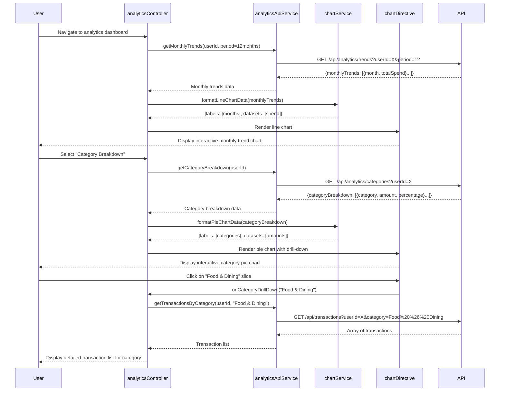

# Low-Level Design: Spending Analytics and Insights
**Epic ID:** QE-10036  
**Tech Stack:** AngularJS 1.x, JavaScript ES6, HTML5, CSS3, Bootstrap, REST APIs, MVC

---

## a. Architecture Mapping

| HLD Component | AngularJS Artifact | Type |
|--------------|-------------------|------|
| User Web/Mobile Client | analyticsApp module + analyticsController | Module + Controller |
| Analytics API Gateway | analyticsApiService | Factory |
| Analytics Engine | (Backend service; client calls via analyticsApiService) | N/A |
| Transaction Data Service | transactionDataService | Factory |
| Category Classification Service | (Backend service; pre-classified data consumed) | N/A |
| Visualization Rendering Service | chartDirective + chartService | Directive + Service |

**Folder Structure:**
```
/app
  /modules
    /analytics
      analytics.module.js
      /controllers
        analytics.controller.js
      /services
        analytics-api.service.js
        transaction-data.service.js
        chart.service.js
      /directives
        chart.directive.js
      /views
        analytics-dashboard.html
        category-breakdown.html
```

---

## b. Component Specifications

| Component Name | Artifact Type | Responsibility | Key Dependencies |
|---------------|--------------|----------------|------------------|
| analyticsApp | Module | Root module for analytics feature | ngRoute, chart.js (via angular-chart.js) |
| analyticsController | Controller | Manages analytics view state; fetches and prepares data for charts | analyticsApiService, chartService, $scope |
| analyticsApiService | Factory | Orchestrates API calls to analytics gateway (trends, category breakdowns) | $http, API_CONFIG |
| transactionDataService | Factory | Fetches raw transaction records for specified time periods | $resource, API_ENDPOINTS |
| chartService | Service | Transforms analytics data into chart-compatible formats (labels, datasets) | None |
| chartDirective | Directive | Renders interactive charts (line, bar, pie) using Chart.js; supports drill-down | chartService, $timeout |

---

## c. Data Model

**Transaction Object:**
```javascript
{
  transactionId: String,
  cardId: String,
  userId: String,
  amount: Number,
  category: String,         // One of 9 categories
  date: String,             // ISO 8601 format
  description: String,
  merchantName: String
}
```

**AnalyticsSummary Object:**
```javascript
{
  monthlyTrends: Array<{month: String, totalSpend: Number}>,  // 12 months
  categoryBreakdown: Array<{category: String, amount: Number, percentage: Number}>,  // 9 categories
  totalSpend: Number,
  period: String            // e.g., "Last 12 months"
}
```

**Categories Enum:**
```javascript
["Food & Dining", "Fuel", "Shopping", "Travel", "Entertainment", "Utilities", "Healthcare", "Education", "Miscellaneous"]
```

---

## d. Data Flow

User navigates to analytics dashboard → analyticsController calls analyticsApiService.getMonthlyTrends() → API returns aggregated monthly spend for last 12 months → chartService transforms data into Chart.js format → chartDirective renders interactive line chart → User selects "Category Breakdown" → analyticsController calls analyticsApiService.getCategoryBreakdown() → API returns spending totals per category → chartService prepares pie chart data → chartDirective renders pie chart with drill-down; clicking a category slice triggers transactionDataService to fetch category-specific transactions → Detailed transaction list displayed.

---

## e. Primary Sequence Diagram



---

## f. Implementation Notes

- Use angular-chart.js wrapper for Chart.js integration; configure responsive: true and maintainAspectRatio: false for mobile compatibility.
- Implement chartDirective with isolated scope accepting data and chartType attributes; use $timeout for digest cycle synchronization after chart rendering.
- Cache analytics data in analyticsController scope for 5 minutes to reduce API calls; use $interval for auto-refresh if user stays on dashboard.
- Apply ES6 arrow functions in chartService for data transformation; use Array.map() and Array.reduce() for aggregations.
- Ensure 3-second query execution by implementing server-side indexing on userId, date, and category fields; paginate transaction drill-down results (50 per page).

---

## g. Error Handling

HTTP interceptor captures analytics API errors; displays toast notification on failure; falls back to cached data if available; logs errors to console for debugging.

---

## h. Security Notes

Standard input validation and secure API calls assumed; userId validated server-side; transaction data filtered by authenticated user's ID.