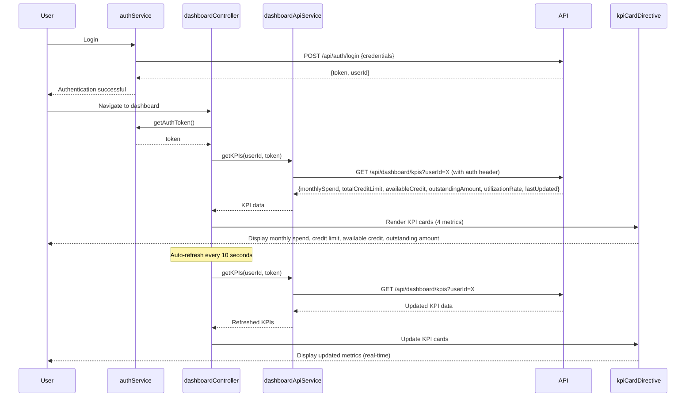

# Low-Level Design: Dashboard KPIs and Credit Card Overview
**Epic ID:** QE-10037  
**Tech Stack:** AngularJS 1.x, JavaScript ES6, HTML5, CSS3, Bootstrap, REST APIs, MVC

---

## a. Architecture Mapping

| HLD Component | AngularJS Artifact | Type |
|--------------|-------------------|------|
| User Web/Mobile Client | dashboardApp module + dashboardController | Module + Controller |
| Authentication Service | authService | Factory |
| Dashboard API Gateway | dashboardApiService | Factory |
| Data Aggregation Service | (Backend service; client calls via dashboardApiService) | N/A |
| Credit Card Data Service | creditCardDataService | Factory |
| KPI Calculation Engine | (Backend service; KPIs computed server-side) | N/A |

**Folder Structure:**
```
/app
  /modules
    /dashboard
      dashboard.module.js
      /controllers
        dashboard.controller.js
      /services
        dashboard-api.service.js
        credit-card-data.service.js
        auth.service.js
      /views
        dashboard.html
      /directives
        kpi-card.directive.js
```

---

## b. Component Specifications

| Component Name | Artifact Type | Responsibility | Key Dependencies |
|---------------|--------------|----------------|------------------|
| dashboardApp | Module | Root module for dashboard feature | ngRoute, ngAnimate |
| dashboardController | Controller | Fetches and displays consolidated KPIs; manages refresh logic | dashboardApiService, authService, $scope, $interval |
| dashboardApiService | Factory | Calls dashboard API gateway for aggregated KPIs | $http, API_CONFIG |
| creditCardDataService | Factory | Fetches individual card details if needed for drill-down | $resource, API_ENDPOINTS |
| authService | Factory | Handles user authentication and token management | $http, $window (localStorage) |
| kpiCardDirective | Directive | Renders individual KPI metric card (e.g., monthly spend, credit limit) | None |

---

## c. Data Model

**DashboardKPI Object:**
```javascript
{
  userId: String,
  monthlySpend: Number,       // Total spend across all cards this month
  totalCreditLimit: Number,   // Sum of credit limits across all cards
  availableCredit: Number,    // Total available credit
  outstandingAmount: Number,  // Total outstanding balance
  utilizationRate: Number,    // Percentage (outstandingAmount / totalCreditLimit * 100)
  lastUpdated: String         // ISO 8601 timestamp
}
```

**CreditCardSummary Object (for multi-card view):**
```javascript
{
  cardId: String,
  cardName: String,
  cardType: String,
  spend: Number,
  limit: Number,
  available: Number,
  outstanding: Number
}
```

---

## d. Data Flow

User authenticates via authService → dashboardController calls dashboardApiService.getKPIs(userId) → API gateway invokes data aggregation service to consolidate data from all user cards → KPI calculation engine computes monthly spend, total credit limit, available credit, outstanding amount, and utilization rate → Aggregated KPIs returned to dashboardController → kpiCardDirective renders each KPI in responsive Bootstrap grid → $interval triggers auto-refresh every 10 seconds for real-time updates → Updated KPIs re-rendered without full page reload.

---

## e. Primary Sequence Diagram



---

## f. Implementation Notes

- Use $interval in dashboardController for 10-second auto-refresh; cancel interval on $scope.$on('$destroy') to prevent memory leaks.
- Implement kpiCardDirective with isolated scope accepting kpiLabel, kpiValue, and kpiIcon attributes; use Bootstrap col-md-3 for 4-column responsive layout.
- Apply ng-animate for smooth KPI value transitions during refresh; use CSS3 transitions for fade-in effect.
- Store auth token in localStorage via authService; attach token to all API requests using $http interceptor.
- Ensure 2-second load time by implementing server-side caching (Redis) for aggregated KPIs with 5-second TTL; use HTTP ETag for conditional requests.

---

## g. Error Handling

HTTP interceptor catches 401 (redirect to login), 500 (show error toast); retry failed KPI fetch once after 2 seconds before displaying error message.

---

## h. Security Notes

Requires token-based auth via existing SSO; token stored securely in localStorage with httpOnly flag consideration; all API calls use HTTPS; userId validated server-side.