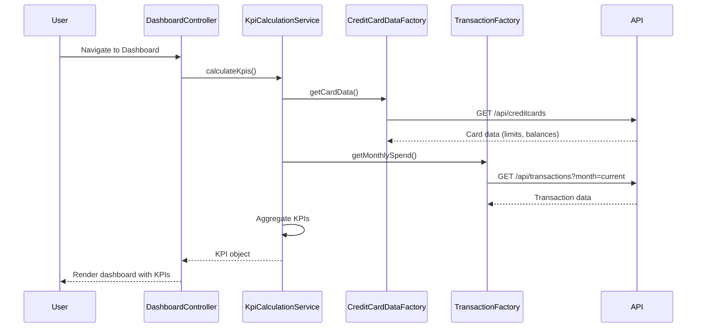

# Low-Level Design: Dashboard and KPI Management
**Epic ID:** QE-10038

## a. Architecture Mapping

- **Dashboard Module** → AngularJS Module (`app.dashboard`)
- **Dashboard Controller** → AngularJS Controller (`DashboardController`)
- **KPI Calculation Service** → AngularJS Service (`KpiCalculationService`)
- **Credit Card Data Service** → AngularJS Factory (`CreditCardDataFactory`)
- **Transaction Service** → AngularJS Factory (`TransactionFactory`)
- **Authentication Interceptor** → AngularJS HTTP Interceptor (`AuthInterceptor`)

**Recommended Folder Structure:**
```
/app
  /dashboard
    dashboard.module.js
    dashboard.controller.js
    dashboard.html
  /services
    kpi-calculation.service.js
    creditcard-data.factory.js
    transaction.factory.js
  /common
    auth.interceptor.js
  /styles
    dashboard.css
```

## b. Component Specifications

| Name | Artifact Type | Responsibility | Key Dependencies |
|------|---------------|----------------|------------------|
| DashboardModule | Module | Registers dashboard components and routes | ui.router, ngAnimate |
| DashboardController | Controller | Manages dashboard state and KPI display logic | KpiCalculationService, $scope, $interval |
| KpiCalculationService | Service | Aggregates and calculates KPIs (total limit, available credit, outstanding) | CreditCardDataFactory, TransactionFactory |
| CreditCardDataFactory | Factory | Fetches card balances and limits via REST API | $http, $q |
| TransactionFactory | Factory | Retrieves monthly spend data via REST API | $http, $q |
| AuthInterceptor | HTTP Interceptor | Injects authentication tokens into API requests | $window, $q |
| KpiWidgetDirective | Directive | Renders individual KPI visualization widgets | None |

## c. Data Model

**DashboardKpi (JavaScript Object):**
```javascript
{
  monthlySpend: Number,        // Current month total spend
  totalCreditLimit: Number,    // Sum of all card limits
  availableCredit: Number,     // Total limit - outstanding
  outstandingAmount: Number,   // Total balance across cards
  lastUpdated: Date            // Timestamp of last refresh
}
```

**CreditCard (JavaScript Object):**
```javascript
{
  cardId: String,
  balance: Number,
  creditLimit: Number
}
```

## d. Data Flow

User navigates to dashboard → DashboardController initializes and calls KpiCalculationService → Service invokes CreditCardDataFactory and TransactionFactory in parallel to fetch card data and monthly transactions → Factories make REST API calls with authentication tokens injected by AuthInterceptor → KpiCalculationService aggregates responses to compute totalCreditLimit, availableCredit, outstandingAmount, and monthlySpend → Calculated KPIs are bound to $scope → View updates with KPI widgets displaying metrics → $interval triggers periodic refresh every 30 seconds for real-time updates.

## e. Primary Sequence Diagram



## f. Implementation Notes

- Use AngularJS Dependency Injection to inject services into controllers; follow `$inject` annotation for minification safety.
- Implement ES6 Promises via `$q` service for handling asynchronous REST API calls with proper error chaining.
- Use `$http` service with interceptors for centralized authentication token injection and error handling.
- Leverage `$interval` service for periodic dashboard refresh (30-second intervals) with proper cleanup on scope destruction.
- Apply Bootstrap grid system (col-md-3) for responsive KPI widget layout across devices.

## g. Error Handling

HTTP interceptor captures API errors and displays user-friendly notifications via toaster service; controller-level try/catch for calculation errors.

## h. Security Notes

Requires token-based auth via existing SSO; AuthInterceptor injects JWT tokens into all API requests.