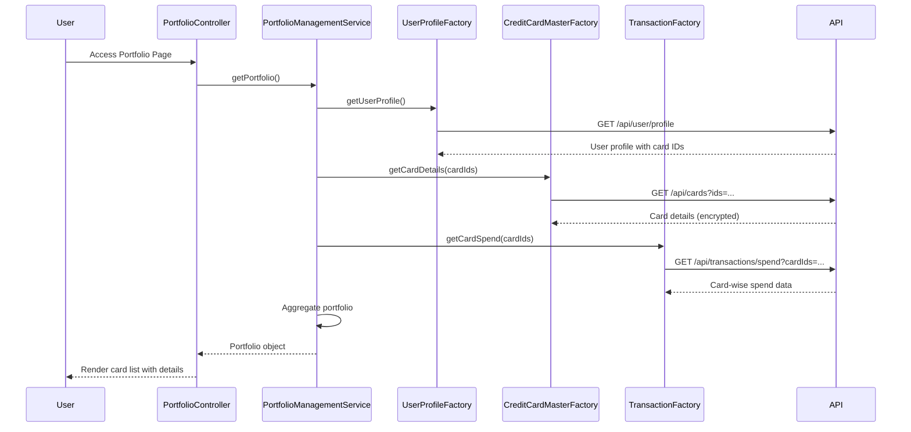

# Low-Level Design: Credit Card Portfolio Management
**Epic ID:** QE-10039

## a. Architecture Mapping

- **Portfolio Module** → AngularJS Module (`app.portfolio`)
- **Portfolio Controller** → AngularJS Controller (`PortfolioController`)
- **Portfolio Management Service** → AngularJS Service (`PortfolioManagementService`)
- **Credit Card Master Data Factory** → AngularJS Factory (`CreditCardMasterFactory`)
- **User Profile Factory** → AngularJS Factory (`UserProfileFactory`)
- **Transaction Service** → AngularJS Factory (`TransactionFactory`)
- **Card Masking Filter** → AngularJS Filter (`cardMaskFilter`)

**Recommended Folder Structure:**
```
/app
  /portfolio
    portfolio.module.js
    portfolio.controller.js
    portfolio.html
  /services
    portfolio-management.service.js
    creditcard-master.factory.js
    user-profile.factory.js
    transaction.factory.js
  /filters
    card-mask.filter.js
  /styles
    portfolio.css
```

## b. Component Specifications

| Name | Artifact Type | Responsibility | Key Dependencies |
|------|---------------|----------------|------------------|
| PortfolioModule | Module | Registers portfolio components and routes | ui.router, ngAnimate |
| PortfolioController | Controller | Manages portfolio view state, card selection, and filtering | PortfolioManagementService, $scope, $filter |
| PortfolioManagementService | Service | Orchestrates data retrieval and aggregation for portfolio view | CreditCardMasterFactory, UserProfileFactory, TransactionFactory |
| CreditCardMasterFactory | Factory | Fetches card details (type, limits, balances) via REST API | $http, $q |
| UserProfileFactory | Factory | Retrieves user profile and linked card IDs via REST API | $http, $q |
| TransactionFactory | Factory | Fetches card-specific transaction data for spend analysis | $http, $q |
| cardMaskFilter | Filter | Masks card numbers to show only last 4 digits | None |

## c. Data Model

**CreditCardPortfolio (JavaScript Object):**
```javascript
{
  userId: String,
  cards: Array<CreditCard>
}
```

**CreditCard (JavaScript Object):**
```javascript
{
  cardId: String,
  cardNumber: String,          // Full number (encrypted in transit)
  maskedCardNumber: String,    // e.g., "**** **** **** 1234"
  cardType: String,            // e.g., "Visa", "Mastercard"
  creditLimit: Number,
  currentBalance: Number,
  availableCredit: Number,
  monthlySpend: Number
}
```

## d. Data Flow

User accesses portfolio page → PortfolioController calls PortfolioManagementService.getPortfolio() → Service retrieves userId from UserProfileFactory → CreditCardMasterFactory fetches all card details for user → TransactionFactory fetches card-specific spending data → Service aggregates card details with spend analysis → cardMaskFilter applied to mask card numbers in view → PortfolioController binds portfolio data to $scope → View renders card list with filtering/selection controls → User applies filters (by card type or spend range) → Controller updates filtered card list in real-time.

## e. Primary Sequence Diagram



## f. Implementation Notes

- Use AngularJS `$filter` service to implement card number masking (show last 4 digits) in views and controllers.
- Implement ES6 `Promise.all()` pattern via `$q.all()` to fetch card details and transaction data in parallel for performance.
- Apply Bootstrap cards/panels for responsive card display; use ng-repeat with track by cardId for efficient rendering.
- Store encrypted card data in memory only; never persist full card numbers in browser storage.
- Use ng-show/ng-hide for card filtering UI; implement client-side filtering via AngularJS filter expressions.

## g. Error Handling

HTTP interceptor handles API failures with retry logic; controller displays error messages via toaster for failed card data retrieval.

## h. Security Notes

PCI-DSS compliant card masking; TLS 1.2+ for API calls; card numbers encrypted at rest and in transit; token-based authentication required.