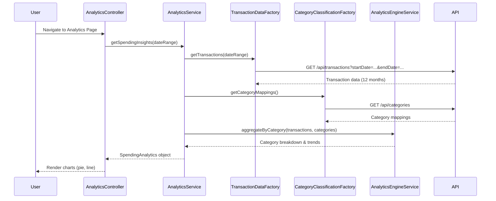

# Low-Level Design: Analytics and Spending Insights
**Epic ID:** QE-10040

## a. Architecture Mapping

- **Analytics Module** → AngularJS Module (`app.analytics`)
- **Analytics Controller** → AngularJS Controller (`AnalyticsController`)
- **Analytics Service** → AngularJS Service (`AnalyticsService`)
- **Transaction Data Factory** → AngularJS Factory (`TransactionDataFactory`)
- **Category Classification Factory** → AngularJS Factory (`CategoryClassificationFactory`)
- **Analytics Engine Service** → AngularJS Service (`AnalyticsEngineService`)
- **Chart Directive** → AngularJS Directive (`spendingChartDirective`)

**Recommended Folder Structure:**
```
/app
  /analytics
    analytics.module.js
    analytics.controller.js
    analytics.html
  /services
    analytics.service.js
    analytics-engine.service.js
    transaction-data.factory.js
    category-classification.factory.js
  /directives
    spending-chart.directive.js
  /styles
    analytics.css
```

## b. Component Specifications

| Name | Artifact Type | Responsibility | Key Dependencies |
|------|---------------|----------------|------------------|
| AnalyticsModule | Module | Registers analytics components, routes, and chart libraries | ui.router, chart.js, angular-chart.js |
| AnalyticsController | Controller | Manages analytics view state, date range selection, and chart rendering | AnalyticsService, $scope, $filter |
| AnalyticsService | Service | Orchestrates data retrieval and processing for analytics | TransactionDataFactory, CategoryClassificationFactory, AnalyticsEngineService |
| TransactionDataFactory | Factory | Fetches historical transaction data (12 months) via REST API | $http, $q |
| CategoryClassificationFactory | Factory | Retrieves category mappings for transactions | $http, $q |
| AnalyticsEngineService | Service | Aggregates transactions by category and calculates monthly trends | None |
| spendingChartDirective | Directive | Renders interactive pie/bar charts using Chart.js | chart.js |

## c. Data Model

**SpendingAnalytics (JavaScript Object):**
```javascript
{
  categoryBreakdown: Array<CategorySpend>,
  monthlyTrends: Array<MonthlySpend>,
  dateRange: { startDate: Date, endDate: Date }
}
```

**CategorySpend (JavaScript Object):**
```javascript
{
  category: String,  // e.g., "Food & Dining", "Fuel", "Shopping"
  amount: Number,
  percentage: Number,
  transactionCount: Number
}
```

**MonthlySpend (JavaScript Object):**
```javascript
{
  month: String,     // e.g., "2024-01"
  totalSpend: Number,
  categoryBreakdown: Array<CategorySpend>
}
```

## d. Data Flow

User navigates to analytics page → AnalyticsController initializes with default 12-month date range → Controller calls AnalyticsService.getSpendingInsights(dateRange) → Service invokes TransactionDataFactory to fetch historical transactions and CategoryClassificationFactory for category mappings → AnalyticsEngineService processes transactions to compute category-wise breakdown and monthly trends → Processed analytics data returned to controller → Controller binds data to $scope → spendingChartDirective renders interactive pie chart (category breakdown) and line chart (monthly trends) → User interacts with date range filter → Controller re-fetches and updates charts dynamically.

## e. Primary Sequence Diagram



## f. Implementation Notes

- Integrate Chart.js via angular-chart.js wrapper for declarative chart rendering in AngularJS templates.
- Use ES6 array methods (map, reduce, filter) in AnalyticsEngineService for efficient transaction aggregation and trend calculation.
- Implement responsive chart sizing using Chart.js responsive configuration and Bootstrap grid for mobile optimization.
- Cache category mappings in AnalyticsService to avoid redundant API calls; use $cacheFactory for transaction data caching.
- Apply AngularJS date filter for formatting month labels in charts and date range pickers.

## g. Error Handling

HTTP interceptor captures API errors; AnalyticsController displays fallback message if data unavailable; chart rendering errors caught via directive error callbacks.

## h. Security Notes

Standard input validation and secure API calls assumed; token-based authentication enforced via existing interceptor.