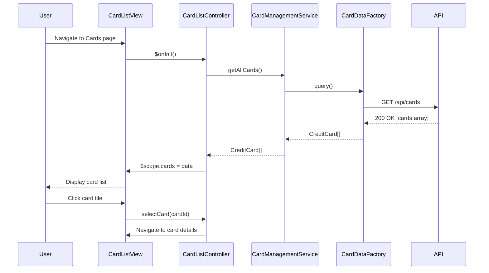

# Low-Level Design: Multiple Credit Card Management
**Epic ID:** QE-10041  
**Project:** Credit Card Analysis Dashboard  
**Technology Stack:** AngularJS 1.x, JavaScript ES6, HTML5, CSS3, Bootstrap, REST APIs, MVC Architecture

---

## a. Architecture Mapping

- **User Interface** → AngularJS Module (`creditCardModule`) + Controller (`CardListController`, `CardDetailsController`)
- **Card Management Controller** → AngularJS Service (`CardManagementService`)
- **Credit Card Data Repository** → REST API integration via AngularJS Factory (`CardDataFactory`)
- **Transaction Service** → REST API integration via AngularJS Service (`TransactionService`)
- **Card Comparison Engine** → AngularJS Service (`CardComparisonService`)

**Recommended Folder Structure:**
```
/app
  /modules
    /creditCard
      /controllers
        cardListController.js
        cardDetailsController.js
      /services
        cardManagementService.js
        cardComparisonService.js
        transactionService.js
      /factories
        cardDataFactory.js
      /views
        cardList.html
        cardDetails.html
      /directives
        cardTile.directive.js
      creditCardModule.js
```

---

## b. Component Specifications

| Component Name | Artifact Type | Responsibility | Key Dependencies |
|----------------|---------------|----------------|------------------|
| creditCardModule | Module | Root module for credit card management features | angular, ngRoute, ngResource |
| CardListController | Controller | Manages card list view, filtering, and selection | CardManagementService, CardComparisonService |
| CardDetailsController | Controller | Displays individual card details and card-wise spend analysis | CardManagementService, TransactionService |
| CardManagementService | Service | Orchestrates card data retrieval and state management | CardDataFactory, $q |
| CardDataFactory | Factory | Handles REST API calls to credit card data repository | $resource, API_CONFIG |
| TransactionService | Service | Retrieves card-specific spending data from transaction API | $http, $q |
| CardComparisonService | Service | Performs cross-card comparison logic and aggregations | CardManagementService |
| cardTile.directive | Directive | Reusable card display component with click handler | None |

---

## c. Data Model

**CreditCard Object:**
```javascript
{
  cardId: String,           // Unique card identifier
  cardNumber: String,       // Masked card number (e.g., "**** **** **** 1234")
  cardType: String,         // Card type (Visa, Mastercard, Amex, etc.)
  bankName: String,         // Issuing bank name
  creditLimit: Number,      // Total credit limit
  availableCredit: Number,  // Available credit
  outstandingAmount: Number,// Outstanding balance
  dueDate: Date,            // Payment due date
  status: String            // Active, Inactive, Blocked
}
```

**CardSpendSummary Object:**
```javascript
{
  cardId: String,
  monthlySpend: Number,
  categoryBreakdown: Array, // Array of {category: String, amount: Number}
  transactionCount: Number
}
```

---

## d. Data Flow

User selects "View All Cards" → CardListController invokes CardManagementService.getAllCards() → CardDataFactory makes GET /api/cards REST call → Response mapped to CreditCard objects → Controller updates $scope.cards → View renders card list using ng-repeat and cardTile directive → User clicks a card → CardDetailsController loads → TransactionService.getCardSpend(cardId) fetches spending data → UI displays card details and spend analysis with Bootstrap-styled panels.

---

## e. Primary Sequence Diagram



---

## f. Implementation Notes

- Use AngularJS Dependency Injection to inject services into controllers; register all components via `.module()` pattern.
- Implement CardDataFactory using `$resource` for RESTful CRUD operations with automatic retry on 5xx errors.
- Apply ES6 classes for services and controllers where possible; transpile using Babel if needed.
- Use Bootstrap grid system (col-md-4) for responsive card tiles; implement ng-if for conditional rendering based on card status.
- Implement client-side filtering using AngularJS filters (e.g., `| filter:searchText`) for card search functionality.

---

## g. Error Handling

HTTP interceptor captures API errors; display user-friendly messages via Bootstrap alerts; log errors to console for debugging.

---

## h. Security Notes

Requires token-based auth via existing SSO; card data transmitted over HTTPS; mask sensitive card numbers in UI.

---