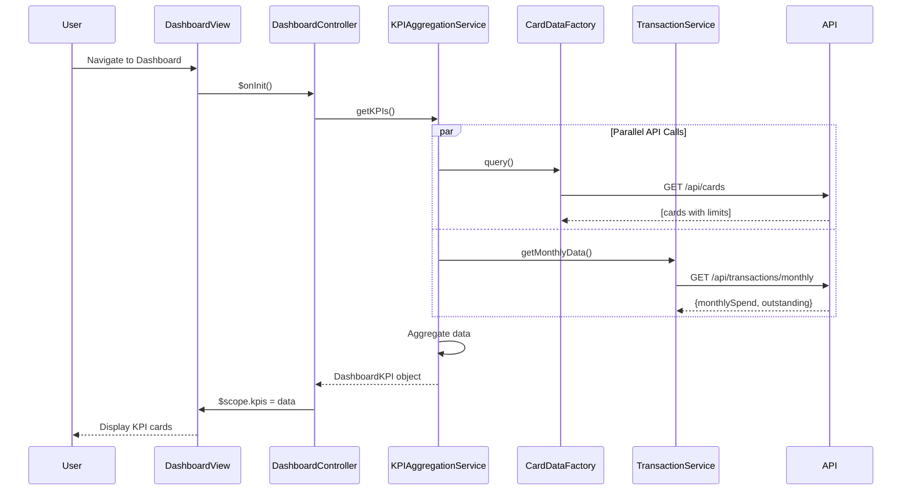

# Low-Level Design: Dashboard and KPI Management
**Epic ID:** QE-10042  
**Project:** Credit Card Analysis Dashboard  
**Technology Stack:** AngularJS 1.x, JavaScript ES6, HTML5, CSS3, Bootstrap, REST APIs, MVC Architecture

---

## a. Architecture Mapping

- **Dashboard UI** → AngularJS Module (`dashboardModule`) + Controller (`DashboardController`)
- **KPI Aggregation Service** → AngularJS Service (`KPIAggregationService`)
- **Credit Card Data Service** → REST API integration via AngularJS Factory (`CardDataFactory`)
- **Transaction Service** → REST API integration via AngularJS Service (`TransactionService`)
- **Data Refresh Controller** → AngularJS Service (`DataRefreshService`) with $interval

**Recommended Folder Structure:**
```
/app
  /modules
    /dashboard
      /controllers
        dashboardController.js
      /services
        kpiAggregationService.js
        dataRefreshService.js
        transactionService.js
      /factories
        cardDataFactory.js
      /views
        dashboard.html
      /directives
        kpiCard.directive.js
      dashboardModule.js
```

---

## b. Component Specifications

| Component Name | Artifact Type | Responsibility | Key Dependencies |
|----------------|---------------|----------------|------------------|
| dashboardModule | Module | Root module for dashboard and KPI features | angular, ngRoute |
| DashboardController | Controller | Manages dashboard view and KPI display | KPIAggregationService, DataRefreshService |
| KPIAggregationService | Service | Aggregates KPI data from multiple sources | CardDataFactory, TransactionService, $q |
| DataRefreshService | Service | Manages periodic data refresh using $interval | KPIAggregationService, $interval |
| CardDataFactory | Factory | Handles REST API calls for card balances and limits | $resource, API_CONFIG |
| TransactionService | Service | Retrieves monthly spend and outstanding amounts | $http, $q |
| kpiCard.directive | Directive | Reusable KPI display card component | None |

---

## c. Data Model

**DashboardKPI Object:**
```javascript
{
  monthlySpend: Number,        // Total spend for current month
  totalCreditLimit: Number,    // Sum of credit limits across all cards
  availableCredit: Number,     // Sum of available credit across all cards
  outstandingAmount: Number,   // Total outstanding balance
  lastUpdated: Date            // Timestamp of last data refresh
}
```

**KPIConfig Object:**
```javascript
{
  refreshInterval: Number,     // Refresh interval in milliseconds (default: 60000)
  enableAutoRefresh: Boolean   // Enable/disable auto-refresh
}
```

---

## d. Data Flow

User navigates to Dashboard → DashboardController.$onInit() triggers KPIAggregationService.getKPIs() → Service makes parallel API calls via CardDataFactory.query() and TransactionService.getMonthlyData() → Responses aggregated using $q.all() → DashboardKPI object constructed → Controller updates $scope.kpis → View renders KPI cards using kpiCard directive with Bootstrap styling → DataRefreshService polls every 60 seconds → Updated KPIs re-rendered automatically via two-way binding.

---

## e. Primary Sequence Diagram



---

## f. Implementation Notes

- Use $q.all() to parallelize API calls for faster dashboard load; target < 2 seconds total load time.
- Implement DataRefreshService with $interval set to 60000ms; cancel interval on $scope.$on('$destroy') to prevent memory leaks.
- Apply Bootstrap grid (col-md-3) for responsive KPI card layout; use CSS3 animations for smooth KPI value updates.
- Cache aggregated KPI data in KPIAggregationService to avoid redundant calculations during refresh cycles.
- Use AngularJS filters (e.g., `| currency`) for formatting monetary values in the view.

---

## g. Error Handling

HTTP interceptor-based error handling; display Bootstrap alert on API failure; retry failed requests once before showing error.

---

## h. Security Notes

Standard input validation and secure API calls assumed; token-based authentication required for all API endpoints.

---