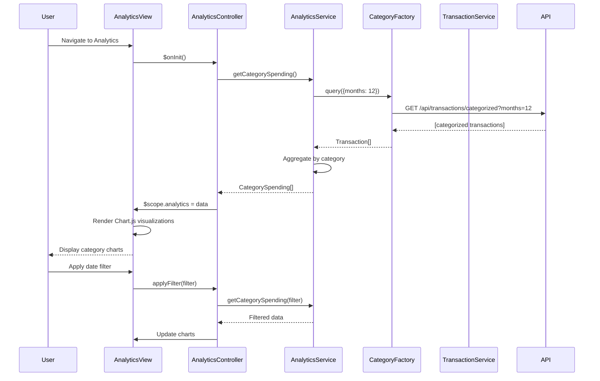

# Low-Level Design: Analytics and Spending Insights
**Epic ID:** QE-10043  
**Project:** Credit Card Analysis Dashboard  
**Technology Stack:** AngularJS 1.x, JavaScript ES6, HTML5, CSS3, Bootstrap, REST APIs, MVC Architecture

---

## a. Architecture Mapping

- **User Interface** → AngularJS Module (`analyticsModule`) + Controller (`AnalyticsController`)
- **Analytics Engine** → AngularJS Service (`AnalyticsService`)
- **Transaction Categorization Service** → REST API integration via AngularJS Factory (`CategoryFactory`)
- **Transaction Data Store** → REST API integration via AngularJS Service (`TransactionService`)
- **Visualization Renderer** → AngularJS Directive (`spendingChart.directive`) using Chart.js

**Recommended Folder Structure:**
```
/app
  /modules
    /analytics
      /controllers
        analyticsController.js
      /services
        analyticsService.js
        transactionService.js
      /factories
        categoryFactory.js
      /views
        analytics.html
      /directives
        spendingChart.directive.js
      analyticsModule.js
```

---

## b. Component Specifications

| Component Name | Artifact Type | Responsibility | Key Dependencies |
|----------------|---------------|----------------|------------------|
| analyticsModule | Module | Root module for analytics and insights features | angular, ngRoute, chart.js |
| AnalyticsController | Controller | Manages analytics view, filtering, and drill-down | AnalyticsService, TransactionService |
| AnalyticsService | Service | Performs trend calculations and category aggregations | CategoryFactory, TransactionService, $q |
| TransactionService | Service | Retrieves transaction data from data store | $http, $q |
| CategoryFactory | Factory | Handles REST API calls for categorized transactions | $resource, API_CONFIG |
| spendingChart.directive | Directive | Renders interactive charts using Chart.js library | chart.js |

---

## c. Data Model

**CategorySpending Object:**
```javascript
{
  category: String,          // Category name (Food & Dining, Fuel, Shopping, etc.)
  amount: Number,            // Total spend in category
  transactionCount: Number,  // Number of transactions
  percentage: Number         // Percentage of total spend
}
```

**MonthlyTrend Object:**
```javascript
{
  month: String,             // Month-Year (e.g., "Jan 2024")
  totalSpend: Number,        // Total spend for the month
  categoryBreakdown: Array   // Array of CategorySpending objects
}
```

**AnalyticsFilter Object:**
```javascript
{
  startDate: Date,
  endDate: Date,
  selectedCategories: Array  // Array of category names to filter
}
```

---

## d. Data Flow

User navigates to Analytics page → AnalyticsController.$onInit() calls AnalyticsService.getCategorySpending() → Service invokes CategoryFactory.query() to fetch categorized transactions → TransactionService.getHistoricalData() retrieves 12 months of data → AnalyticsService aggregates data into CategorySpending and MonthlyTrend objects → Controller updates $scope.analytics → spendingChart directive renders interactive Chart.js pie chart and line chart → User applies filter → Controller re-invokes AnalyticsService with filter parameters → Charts update dynamically.

---

## e. Primary Sequence Diagram



---

## f. Implementation Notes

- Integrate Chart.js via spendingChart directive; use isolated scope with two-way binding for chart data updates.
- Implement AnalyticsService aggregation logic using ES6 Array methods (map, reduce, filter) for efficient data processing.
- Cache 12-month historical data in AnalyticsService; only refetch when user explicitly refreshes or filter exceeds cached range.
- Use AngularJS $watch in directive to detect data changes and trigger Chart.js update() method for smooth transitions.
- Apply Bootstrap responsive utilities (hidden-xs, visible-md) to optimize chart display across devices; target < 2 second render time.

---

## g. Error Handling

Try/catch blocks in aggregation logic; HTTP interceptor for API errors; display user-friendly error message via Bootstrap modal.

---

## h. Security Notes

Standard input validation and secure API calls assumed; ensure date filter inputs are sanitized to prevent injection attacks.

---