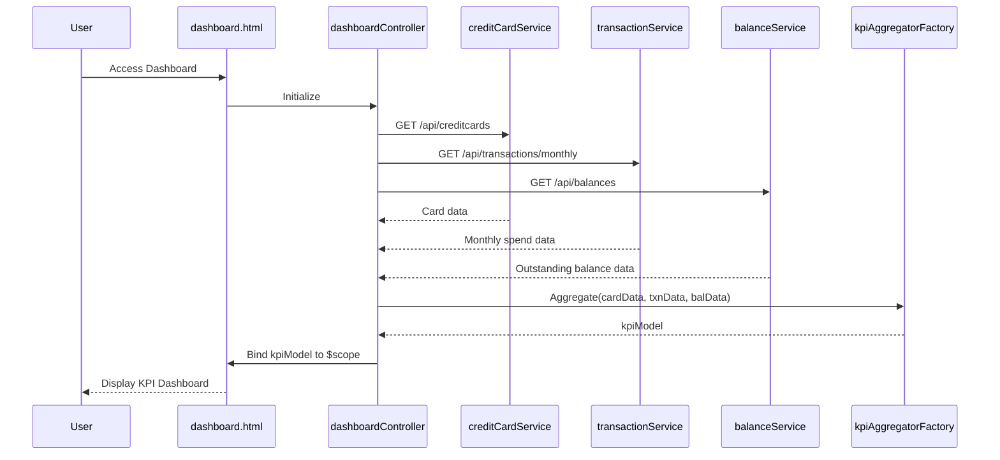

# Low-Level Design: Dashboard and KPI Management
**Epic ID:** QE-10044

---

## a. Architecture Mapping

- **User Interface** → AngularJS View (HTML5 template with Bootstrap components)
- **Dashboard Controller** → AngularJS Controller (`dashboardController.js`)
- **Credit Card Data Service** → AngularJS Service (`creditCardService.js`)
- **Transaction Processing Service** → AngularJS Service (`transactionService.js`)
- **Balance Calculation Service** → AngularJS Service (`balanceService.js`)
- **KPI Aggregation Module** → AngularJS Factory (`kpiAggregatorFactory.js`)

**Recommended Folder Structure:**
```
app/
├── modules/
│   └── dashboard/
│       ├── controllers/
│       │   └── dashboardController.js
│       ├── services/
│       │   ├── creditCardService.js
│       │   ├── transactionService.js
│       │   └── balanceService.js
│       ├── factories/
│       │   └── kpiAggregatorFactory.js
│       ├── views/
│       │   └── dashboard.html
│       └── dashboard.module.js
├── assets/
│   ├── css/
│   └── js/
└── app.js
```

---

## b. Component Specifications

| Component Name | Artifact Type | Responsibility | Key Dependencies |
|---|---|---|---|
| dashboardController | Controller | Orchestrates dashboard view, initiates parallel service calls, binds KPI data to view | creditCardService, transactionService, balanceService, kpiAggregatorFactory, $scope, $q |
| creditCardService | Service | Fetches credit card information via REST API | $http, $q |
| transactionService | Service | Retrieves and calculates monthly spend data via REST API | $http, $q |
| balanceService | Service | Computes outstanding amounts via REST API | $http, $q |
| kpiAggregatorFactory | Factory | Aggregates data from multiple services into consolidated KPI model | None |
| dashboard.html | View | Renders KPI cards (Monthly Spend, Total Credit Limit, Available Credit, Outstanding Amount) with responsive Bootstrap grid | dashboardController, Bootstrap CSS |

---

## c. Data Model

**KPI Model (JavaScript Object):**
```javascript
const kpiModel = {
  monthlySpend: Number,        // Total spend for current month
  totalCreditLimit: Number,    // Sum of all card credit limits
  availableCredit: Number,     // Total available credit across cards
  outstandingAmount: Number,   // Total outstanding balance
  lastUpdated: Date            // Timestamp of last data refresh
};
```

**Credit Card Model:**
```javascript
const creditCard = {
  cardId: String,
  cardNumber: String,          // Masked format
  creditLimit: Number,
  availableCredit: Number,
  outstandingBalance: Number
};
```

---

## d. Data Flow

User accesses the dashboard view → `dashboardController` initializes and uses `$q.all()` to trigger parallel REST API calls via `creditCardService`, `transactionService`, and `balanceService` → Each service returns a promise with respective data (card info, monthly transactions, balance) → `kpiAggregatorFactory` consolidates the responses into a single `kpiModel` object → Controller binds the aggregated KPI data to `$scope` → View updates reactively, rendering KPI cards in a responsive Bootstrap grid optimized for the user's viewport → Real-time refresh is supported via periodic controller re-initialization or manual refresh trigger.

---

## e. Primary Sequence Diagram



---

## f. Implementation Notes

- Use AngularJS Dependency Injection for all services, factories, and controllers to ensure testability and modularity.
- Leverage `$q.all()` for parallel API calls to meet 2-second load time NFR.
- REST API integration via `$http` service with promise-based handling; use ES6 arrow functions for cleaner callback syntax.
- Apply Bootstrap responsive grid (`col-xs-*`, `col-sm-*`, `col-md-*`, `col-lg-*`) for mobile/tablet/desktop viewport optimization.
- Implement WCAG 2.1 accessibility: semantic HTML5, ARIA labels, keyboard navigation support, sufficient color contrast.

---

## g. Error Handling

Interceptor-based error handling via `$httpProvider.interceptors` for global API error capture, with user-friendly notifications displayed using a toast/alert directive.

---

## h. Security Notes

Standard input validation and secure API calls assumed; card numbers displayed in masked format; HTTPS enforced for all REST API communication.