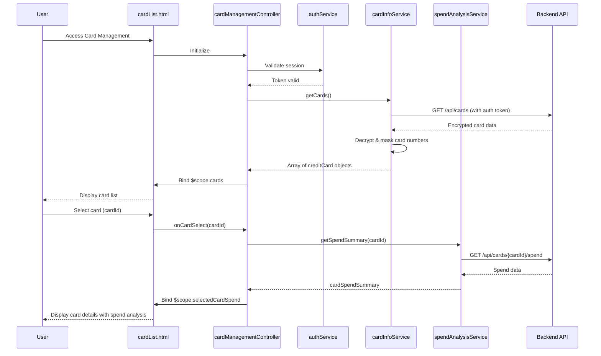

# Low-Level Design: Multiple Credit Card Management
**Epic ID:** QE-10045

---

## a. Architecture Mapping

- **User Interface** → AngularJS View (HTML5 template with Bootstrap card components)
- **Card Management Controller** → AngularJS Controller (`cardManagementController.js`)
- **User Authentication Service** → AngularJS Service (`authService.js`)
- **Card Information API** → AngularJS Service (`cardInfoService.js`)
- **Credit Card Data Repository** → Backend REST API (accessed via `cardInfoService`)
- **Spend Analysis Module** → AngularJS Service (`spendAnalysisService.js`)

**Recommended Folder Structure:**
```
app/
├── modules/
│   └── cardManagement/
│       ├── controllers/
│       │   └── cardManagementController.js
│       ├── services/
│       │   ├── authService.js
│       │   ├── cardInfoService.js
│       │   └── spendAnalysisService.js
│       ├── views/
│       │   ├── cardList.html
│       │   └── cardDetail.html
│       ├── directives/
│       │   └── cardCard.directive.js
│       └── cardManagement.module.js
├── assets/
│   ├── css/
│   └── js/
└── app.js
```

---

## b. Component Specifications

| Component Name | Artifact Type | Responsibility | Key Dependencies |
|---|---|---|---|
| cardManagementController | Controller | Manages card list display, card selection, filtering, and coordinates data retrieval | authService, cardInfoService, spendAnalysisService, $scope, $filter |
| authService | Service | Handles user authentication and secure session management | $http, $window (for token storage) |
| cardInfoService | Service | Retrieves encrypted card data from backend API, handles decryption and masking logic | $http, $q |
| spendAnalysisService | Service | Fetches and processes card-specific transaction data for spend analysis | $http, $q |
| cardCard.directive | Directive | Reusable card component displaying individual card status (limit, available credit, outstanding balance) | None |
| cardList.html | View | Displays consolidated multi-card view with filtering and selection options | cardManagementController, Bootstrap CSS |
| cardDetail.html | View | Displays detailed view for a selected card with spend analysis | cardManagementController, Bootstrap CSS |

---

## c. Data Model

**Credit Card Model:**
```javascript
const creditCard = {
  cardId: String,
  cardNumber: String,          // Masked (e.g., "****-****-****-1234")
  cardHolderName: String,
  cardType: String,            // e.g., "Visa", "MasterCard"
  creditLimit: Number,
  availableCredit: Number,
  outstandingBalance: Number,
  status: String,              // e.g., "Active", "Blocked"
  expiryDate: String,          // Format: "MM/YY"
  lastUpdated: Date
};
```

**Card Spend Summary Model:**
```javascript
const cardSpendSummary = {
  cardId: String,
  monthlySpend: Number,
  yearlySpend: Number,
  lastTransactionDate: Date,
  transactionCount: Number
};
```

---

## d. Data Flow

User authenticates via `authService` which stores a secure token → `cardManagementController` initializes and calls `cardInfoService.getCards()` → Service sends authenticated GET request to `/api/cards` with token in header → Backend returns encrypted card data → `cardInfoService` decrypts data and applies masking to card numbers → Controller receives array of `creditCard` objects and binds to `$scope.cards` → View renders card list using `ng-repeat` and `cardCard` directive → User selects a specific card → Controller calls `spendAnalysisService.getSpendSummary(cardId)` → Service fetches card-specific transaction data → Controller binds spend summary to `$scope.selectedCardSpend` → Detailed card view displays status indicators and spend analysis.

---

## e. Primary Sequence Diagram



---

## f. Implementation Notes

- Use AngularJS DI to inject `authService` into all services requiring authenticated API calls.
- Store authentication token in `$window.sessionStorage` for secure, session-scoped persistence.
- Implement card masking using ES6 string template literals and `substring()` method in `cardInfoService`.
- Use `$filter` service for client-side card filtering (by card type, status) to enhance responsiveness.
- Ensure all REST API calls include `Authorization: Bearer <token>` header and enforce HTTPS.

---

## g. Error Handling

HTTP interceptor captures 401/403 errors and redirects to login; service-level try/catch blocks handle decryption failures with user notification via toast directive.

---

## h. Security Notes

Requires token-based authentication via existing SSO; card data encrypted at rest and in transit; card numbers masked in UI; all API calls over HTTPS.