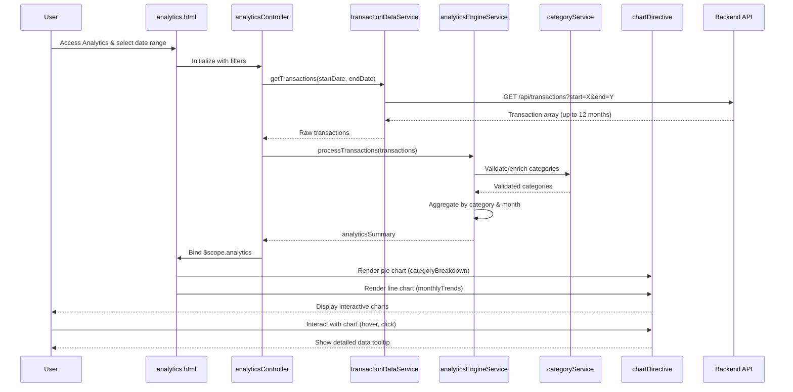

# Low-Level Design: Transaction Analytics and Spending Insights
**Epic ID:** QE-10046

---

## a. Architecture Mapping

- **User Interface** → AngularJS View (HTML5 template with Bootstrap and chart directives)
- **Analytics Controller** → AngularJS Controller (`analyticsController.js`)
- **Transaction Data Service** → AngularJS Service (`transactionDataService.js`)
- **Data Analytics Engine** → AngularJS Service (`analyticsEngineService.js`)
- **Category Classification Service** → AngularJS Service (`categoryService.js`)
- **Visualization Library** → AngularJS Directive wrapping Chart.js (`chartDirective.js`)
- **Transaction Database** → Backend REST API (accessed via `transactionDataService`)

**Recommended Folder Structure:**
```
app/
├── modules/
│   └── analytics/
│       ├── controllers/
│       │   └── analyticsController.js
│       ├── services/
│       │   ├── transactionDataService.js
│       │   ├── analyticsEngineService.js
│       │   └── categoryService.js
│       ├── directives/
│       │   └── chartDirective.js
│       ├── views/
│       │   ├── analytics.html
│       │   └── transactionHistory.html
│       └── analytics.module.js
├── assets/
│   ├── css/
│   ├── js/
│   └── libs/
│       └── chart.js
└── app.js
```

---

## b. Component Specifications

| Component Name | Artifact Type | Responsibility | Key Dependencies |
|---|---|---|---|
| analyticsController | Controller | Orchestrates analytics view, fetches transaction data, triggers analytics processing, manages filters | transactionDataService, analyticsEngineService, categoryService, $scope, $filter |
| transactionDataService | Service | Retrieves raw transaction data from backend API for specified date range | $http, $q |
| analyticsEngineService | Service | Processes and aggregates transactions by category and time period, calculates trends | categoryService |
| categoryService | Service | Provides category classification and validation (Food & Dining, Fuel, Shopping, Travel, Entertainment, Utilities, Healthcare, Education, Miscellaneous) | None |
| chartDirective | Directive | Wraps Chart.js library to render interactive charts (pie, bar, line) for spending visualization | Chart.js library |
| analytics.html | View | Displays category-wise spending charts, monthly trends, and filtering controls | analyticsController, Bootstrap CSS, chartDirective |
| transactionHistory.html | View | Displays paginated transaction history table with search and filtering | analyticsController, Bootstrap CSS |

---

## c. Data Model

**Transaction Model:**
```javascript
const transaction = {
  transactionId: String,
  cardId: String,
  amount: Number,              // Transaction amount (2 decimal precision)
  category: String,            // One of 9 categories
  merchantName: String,
  transactionDate: Date,
  description: String,
  status: String               // e.g., "Posted", "Pending"
};
```

**Analytics Summary Model:**
```javascript
const analyticsSummary = {
  categoryBreakdown: Array,    // [{category: String, totalSpend: Number, percentage: Number}]
  monthlyTrends: Array,        // [{month: String, totalSpend: Number}]
  totalTransactions: Number,
  totalSpend: Number,
  dateRange: {startDate: Date, endDate: Date}
};
```

**Category Breakdown Item:**
```javascript
const categoryBreakdownItem = {
  category: String,            // e.g., "Food & Dining"
  totalSpend: Number,
  transactionCount: Number,
  percentage: Number           // % of total spend
};
```

---

## d. Data Flow

User accesses analytics view and selects date range filter → `analyticsController` calls `transactionDataService.getTransactions(startDate, endDate)` → Service sends GET request to `/api/transactions?start=X&end=Y` → Backend returns up to 12 months of transaction data → Controller passes raw transactions to `analyticsEngineService.processTransactions(transactions)` → Analytics engine iterates through transactions, validates/enriches categories via `categoryService`, aggregates by category and month with 2-decimal precision → Engine returns `analyticsSummary` object → Controller binds summary to `$scope.analytics` → View uses `chartDirective` to render interactive pie chart (category breakdown) and line chart (monthly trends) → User interacts with charts or applies filters → Controller updates data binding and charts re-render → Transaction history view displays paginated table with search/filter capabilities.

---

## e. Primary Sequence Diagram



---

## f. Implementation Notes

- Use AngularJS DI to inject all services into `analyticsController` for modularity and testability.
- Implement `analyticsEngineService` using ES6 `Array.reduce()` and `Map` for efficient aggregation of large transaction datasets (1000+ records).
- Integrate Chart.js via custom AngularJS directive (`chartDirective`) that watches scope data changes and updates charts reactively.
- Use `$filter('date')` and `$filter('currency')` for consistent date and currency formatting in views.
- Implement client-side pagination and search using `ng-repeat` with `limitTo` and custom filter functions to handle 1000+ transactions efficiently.

---

## g. Error Handling

HTTP interceptor-based error handling for API failures; service-level try/catch for aggregation errors; user notifications via toast directive for processing timeouts or data issues.

---

## h. Security Notes

Standard input validation and secure API calls assumed; date range inputs sanitized to prevent injection; all API calls over HTTPS with authentication token.