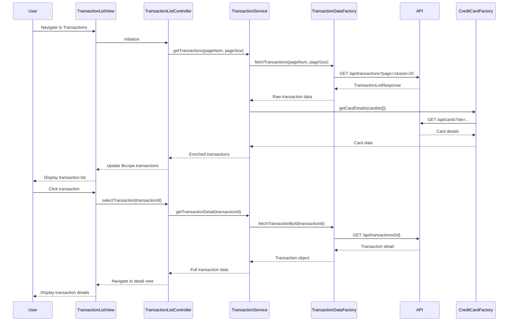

# Low-Level Design: Transaction Management and Viewing
**Epic ID:** QE-10047

## a. Architecture Mapping

- **User Interface** → AngularJS Module (`transactionModule`) + Controller (`TransactionListController`, `TransactionDetailController`)
- **Transaction Management Service** → AngularJS Service (`TransactionService`)
- **Transaction Data Service** → REST API Integration via AngularJS Factory (`TransactionDataFactory`)
- **Credit Card Service** → REST API Integration via AngularJS Factory (`CreditCardFactory`)
- **User Authentication Service** → AngularJS Service (`AuthService`) + HTTP Interceptor

**Recommended Folder Structure:**
```
/app
  /modules
    /transaction
      /controllers (TransactionListController.js, TransactionDetailController.js)
      /services (TransactionService.js)
      /factories (TransactionDataFactory.js, CreditCardFactory.js)
      /views (transaction-list.html, transaction-detail.html)
      /directives (transaction-card.directive.js)
  /shared
    /services (AuthService.js)
    /interceptors (auth.interceptor.js)
```

## b. Component Specifications

| Name | Artifact Type | Responsibility | Key Dependencies |
|------|---------------|----------------|------------------|
| transactionModule | AngularJS Module | Root module for transaction management features | ui.router, ngResource |
| TransactionListController | Controller | Manages transaction list view, pagination, and filtering | TransactionService, $scope, $state |
| TransactionDetailController | Controller | Displays detailed view of a single transaction | TransactionService, $stateParams, $scope |
| TransactionService | Service | Business logic for transaction operations and data transformation | TransactionDataFactory, CreditCardFactory, $q |
| TransactionDataFactory | Factory | REST API calls to retrieve transaction records | $http, API_ENDPOINTS |
| CreditCardFactory | Factory | REST API calls to link transactions to credit cards | $http, API_ENDPOINTS |
| AuthService | Service | Manages user authentication state and token handling | $http, $window, localStorageService |
| authInterceptor | HTTP Interceptor | Injects auth tokens into outgoing requests | $q, $injector, AuthService |
| transactionCard | Directive | Reusable UI component for displaying transaction summary | None |

## c. Data Model

**Transaction Object:**
```javascript
{
  transactionId: String,
  cardId: String,
  cardName: String,
  date: Date,
  amount: Number,
  merchant: String,
  category: String,
  description: String,
  status: String // 'posted', 'pending'
}
```

**TransactionListResponse Object:**
```javascript
{
  transactions: Array<Transaction>,
  totalCount: Number,
  pageNumber: Number,
  pageSize: Number
}
```

## d. Data Flow

User navigates to transaction list view → TransactionListController initializes and calls TransactionService.getTransactions() → TransactionService invokes TransactionDataFactory to fetch transaction data via REST API → authInterceptor adds authentication token to request → API returns paginated transaction records → TransactionService enriches data by calling CreditCardFactory to link card details → Transformed data is bound to $scope → View renders transaction list with ng-repeat → User clicks transaction for details → TransactionDetailController fetches full transaction details via TransactionService → Detail view displays complete transaction information.

## e. Primary Sequence Diagram



## f. Implementation Notes

- Use AngularJS 1.x with ES6 classes via Babel transpilation for controller and service definitions
- Implement dependency injection using $inject annotation for minification safety
- Use ui-router for state management with lazy-loaded transaction module
- Implement pagination using server-side paging with query parameters; cache results in TransactionService using $cacheFactory
- REST API integration via $http with promise-based error handling; use $q for chaining multiple API calls

## g. Error Handling

HTTP interceptor-based error handling with centralized error notification service; try/catch blocks in controllers with user-friendly toast messages for API failures.

## h. Security Notes

Requires token-based auth via existing SSO; authInterceptor injects JWT tokens into all API requests; secure storage of tokens in sessionStorage.