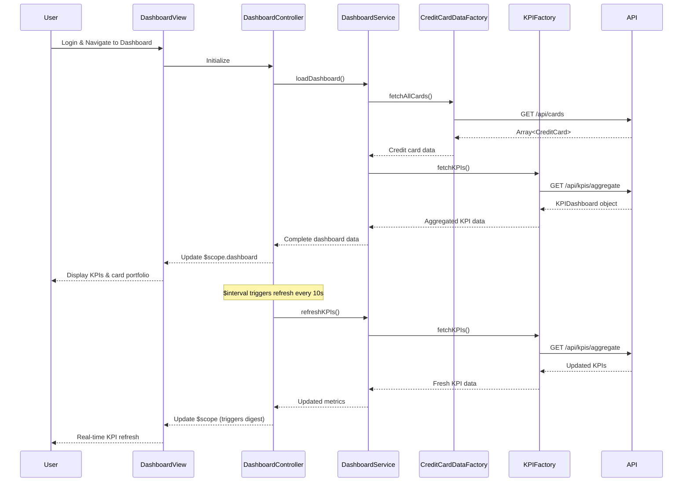

# Low-Level Design: Credit Card Portfolio Management and KPI Dashboard
**Epic ID:** QE-10048

## a. Architecture Mapping

- **User Interface** → AngularJS Module (`dashboardModule`) + Controller (`DashboardController`)
- **Dashboard Service** → AngularJS Service (`DashboardService`)
- **Credit Card Data Service** → REST API Integration via AngularJS Factory (`CreditCardDataFactory`)
- **User Authentication Service** → AngularJS Service (`AuthService`) + HTTP Interceptor
- **KPI Aggregation Engine** → Backend API (consumed via `KPIFactory`)

**Recommended Folder Structure:**
```
/app
  /modules
    /dashboard
      /controllers (DashboardController.js)
      /services (DashboardService.js)
      /factories (CreditCardDataFactory.js, KPIFactory.js)
      /views (dashboard.html)
      /directives (kpi-card.directive.js, credit-card-summary.directive.js)
  /shared
    /services (AuthService.js)
    /interceptors (auth.interceptor.js)
```

## b. Component Specifications

| Name | Artifact Type | Responsibility | Key Dependencies |
|------|---------------|----------------|------------------|
| dashboardModule | AngularJS Module | Root module for dashboard and KPI features | ui.router, ngAnimate |
| DashboardController | Controller | Manages dashboard state, KPI display, and real-time refresh | DashboardService, $scope, $interval |
| DashboardService | Service | Business logic for KPI aggregation and credit card portfolio management | CreditCardDataFactory, KPIFactory, $q |
| CreditCardDataFactory | Factory | REST API calls to retrieve credit card details and balances | $http, API_ENDPOINTS |
| KPIFactory | Factory | REST API calls to fetch aggregated KPI data | $http, API_ENDPOINTS |
| AuthService | Service | Manages authentication and secure access | $http, $window, localStorageService |
| authInterceptor | HTTP Interceptor | Injects authentication tokens into API requests | $q, $injector, AuthService |
| kpiCard | Directive | Reusable UI component for displaying individual KPI metrics | None |
| creditCardSummary | Directive | Reusable UI component for displaying credit card summary | None |

## c. Data Model

**CreditCard Object:**
```javascript
{
  cardId: String,
  cardName: String,
  cardNumber: String, // masked
  creditLimit: Number,
  outstandingAmount: Number,
  availableCredit: Number,
  monthlySpend: Number,
  cardType: String // 'Visa', 'Mastercard', etc.
}
```

**KPIDashboard Object:**
```javascript
{
  totalCreditLimit: Number,
  totalOutstandingAmount: Number,
  totalAvailableCredit: Number,
  totalMonthlySpend: Number,
  cards: Array<CreditCard>
}
```

## d. Data Flow

User logs in and navigates to dashboard → DashboardController initializes and calls DashboardService.loadDashboard() → DashboardService invokes CreditCardDataFactory to fetch all credit cards via REST API → authInterceptor adds authentication token → API returns credit card details → DashboardService calls KPIFactory to fetch aggregated KPIs → KPI data (Monthly Spend, Total Credit Limit, Available Credit, Outstanding Amount) is returned → DashboardService calculates derived metrics and binds to $scope → Dashboard view renders KPI cards and credit card summaries using directives → $interval triggers auto-refresh every 10 seconds to update KPIs in near real-time.

## e. Primary Sequence Diagram



## f. Implementation Notes

- Use AngularJS 1.x with ES6 modules; controllers and services defined as ES6 classes with Babel transpilation
- Implement $interval service for near real-time KPI refresh (10-second polling); cancel interval on $scope.$on('$destroy')
- Use Bootstrap grid system for responsive layout; CSS3 media queries for mobile/tablet/desktop breakpoints
- Cache credit card data in DashboardService using $cacheFactory with 5-minute TTL; KPIs fetched fresh on each refresh cycle
- REST API integration via $http with promise chaining; use $q.all() for parallel API calls to optimize load time

## g. Error Handling

Centralized HTTP interceptor captures API errors; DashboardService uses try/catch with fallback to cached data; user notifications via toast service for critical failures.

## h. Security Notes

Requires token-based auth via existing SSO; all API calls include JWT token in Authorization header; sensitive card data masked on client side.