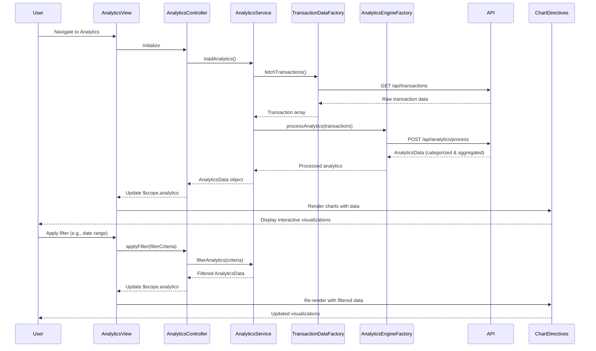

# Low-Level Design: Spending Analytics and Insights
**Epic ID:** QE-10049

## a. Architecture Mapping

- **User Interface** → AngularJS Module (`analyticsModule`) + Controller (`AnalyticsController`)
- **Analytics Service** → AngularJS Service (`AnalyticsService`)
- **Transaction Data Service** → REST API Integration via AngularJS Factory (`TransactionDataFactory`)
- **Analytics Engine** → Backend API (consumed via `AnalyticsEngineFactory`)
- **Dashboard Rendering** → AngularJS Directives (`categoryChart`, `trendChart`, `cardWiseChart`) + Chart.js integration

**Recommended Folder Structure:**
```
/app
  /modules
    /analytics
      /controllers (AnalyticsController.js)
      /services (AnalyticsService.js)
      /factories (TransactionDataFactory.js, AnalyticsEngineFactory.js)
      /views (analytics.html)
      /directives (category-chart.directive.js, trend-chart.directive.js, card-wise-chart.directive.js)
  /shared
    /services (AuthService.js)
    /interceptors (auth.interceptor.js)
```

## b. Component Specifications

| Name | Artifact Type | Responsibility | Key Dependencies |
|------|---------------|----------------|------------------|
| analyticsModule | AngularJS Module | Root module for spending analytics features | ui.router, chart.js, angular-chart.js |
| AnalyticsController | Controller | Manages analytics view, filtering, and chart interactions | AnalyticsService, $scope, $filter |
| AnalyticsService | Service | Business logic for processing analytics data and applying filters | TransactionDataFactory, AnalyticsEngineFactory, $q |
| TransactionDataFactory | Factory | REST API calls to retrieve raw transaction data | $http, API_ENDPOINTS |
| AnalyticsEngineFactory | Factory | REST API calls to fetch categorized and aggregated analytics | $http, API_ENDPOINTS |
| categoryChart | Directive | Renders category-wise spending visualization using Chart.js | chart.js |
| trendChart | Directive | Renders monthly spend trends line chart | chart.js |
| cardWiseChart | Directive | Renders card-wise spend analysis bar chart | chart.js |

## c. Data Model

**CategorySpending Object:**
```javascript
{
  category: String, // 'Food & Dining', 'Fuel', 'Shopping', etc.
  amount: Number,
  percentage: Number,
  transactionCount: Number
}
```

**MonthlyTrend Object:**
```javascript
{
  month: String, // 'Jan 2026', 'Feb 2026', etc.
  totalSpend: Number,
  categoryBreakdown: Array<{category: String, amount: Number}>
}
```

**CardWiseSpending Object:**
```javascript
{
  cardId: String,
  cardName: String,
  totalSpend: Number,
  categoryBreakdown: Array<CategorySpending>
}
```

**AnalyticsData Object:**
```javascript
{
  categorySpending: Array<CategorySpending>,
  monthlyTrends: Array<MonthlyTrend>,
  cardWiseSpending: Array<CardWiseSpending>
}
```

## d. Data Flow

User navigates to analytics view → AnalyticsController initializes and calls AnalyticsService.loadAnalytics() → AnalyticsService invokes TransactionDataFactory to fetch raw transaction data → Data is sent to AnalyticsEngineFactory which calls backend analytics API for categorization and aggregation → Analytics Engine processes transactions using predefined rules, categorizes into 9 categories, calculates monthly trends and card-wise breakdowns → Processed AnalyticsData object is returned → AnalyticsService transforms data for chart consumption → AnalyticsController binds data to $scope → Directives (categoryChart, trendChart, cardWiseChart) render interactive visualizations using Chart.js → User applies filters (date range, category, card) → AnalyticsController updates $scope with filtered data → Charts re-render with drill-down capability.

## e. Primary Sequence Diagram



## f. Implementation Notes

- Use AngularJS 1.x with angular-chart.js wrapper for Chart.js integration; directives isolate scope for reusability
- Implement client-side filtering using $filter service for date ranges and categories; server-side filtering for large datasets
- Use ES6 arrow functions and template literals for data transformation in AnalyticsService
- Chart.js configured with responsive: true and maintainAspectRatio: false for cross-device rendering
- REST API integration via $http with promise-based data flow; use $q.all() for parallel API calls when fetching multiple analytics endpoints

## g. Error Handling

HTTP interceptor-based error handling with retry logic for transient failures; AnalyticsService uses try/catch with user notification for processing errors.

## h. Security Notes

Standard input validation and secure API calls assumed; authentication token required for all analytics API endpoints via authInterceptor.