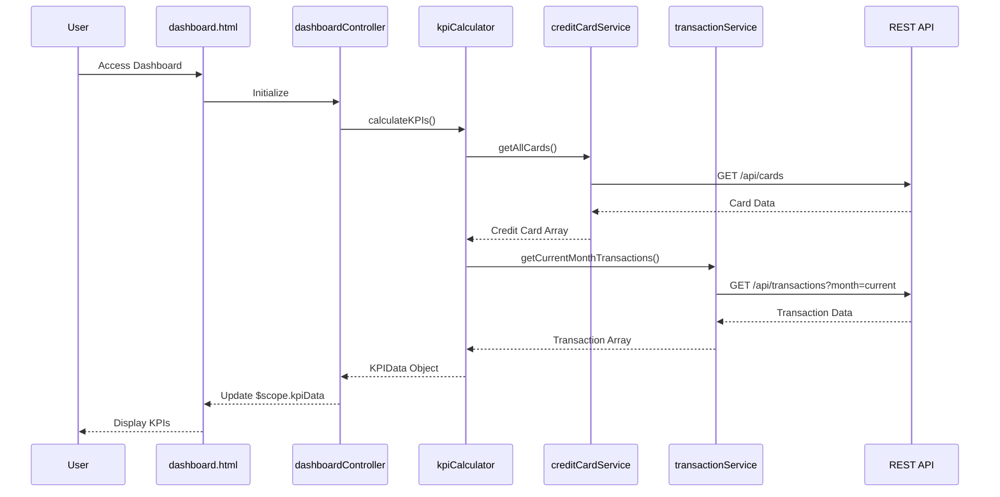

# Low-Level Design: QE-10050 - Credit Card Dashboard and KPI Overview

## a. Architecture Mapping

- **Dashboard Controller** → AngularJS Controller (`dashboardController.js`) - Orchestrates KPI display and user interactions
- **Credit Card Data Service** → AngularJS Service (`creditCardService.js`) - Retrieves credit card information via REST API
- **Transaction Data Service** → AngularJS Service (`transactionService.js`) - Fetches transaction data for spend calculations
- **KPI Calculation Engine** → AngularJS Factory (`kpiCalculator.js`) - Computes monthly spend, available credit, outstanding amounts
- **User Interface** → AngularJS View (`dashboard.html`) with Bootstrap responsive grid

**Folder Structure:**
```
app/
├── modules/
│   └── dashboard/
│       ├── controllers/
│       │   └── dashboardController.js
│       ├── services/
│       │   ├── creditCardService.js
│       │   ├── transactionService.js
│       │   └── kpiCalculator.js
│       └── views/
│           └── dashboard.html
```

## b. Component Specifications

| Name | Artifact Type | Responsibility | Key Dependencies |
|------|---------------|----------------|------------------|
| dashboardController | Controller | Manages dashboard state, fetches KPI data, handles user interactions | $scope, kpiCalculator, creditCardService, transactionService |
| creditCardService | Service | Retrieves credit card details from REST API endpoint | $http, $q |
| transactionService | Service | Fetches transaction data for KPI calculations | $http, $q |
| kpiCalculator | Factory | Aggregates card data to compute monthly spend, total limit, available credit, outstanding | creditCardService, transactionService |
| dashboard.html | View | Displays KPI cards in responsive Bootstrap grid layout | dashboardController |

## c. Data Model

**CreditCard:**
```javascript
{
  cardId: String,
  cardNumber: String,
  issuer: String,
  creditLimit: Number,
  availableCredit: Number,
  outstandingAmount: Number
}
```

**KPIData:**
```javascript
{
  monthlySpend: Number,
  totalCreditLimit: Number,
  totalAvailableCredit: Number,
  totalOutstanding: Number,
  lastUpdated: Date
}
```

## d. Data Flow

User accesses the dashboard view, triggering `dashboardController` initialization. The controller invokes `kpiCalculator.calculateKPIs()`, which calls `creditCardService.getAllCards()` and `transactionService.getCurrentMonthTransactions()` to fetch data via REST APIs. The factory aggregates card limits, balances, and transaction amounts to compute KPIs. Calculated KPI data is bound to `$scope.kpiData`, automatically updating the view through Angular's two-way data binding. Bootstrap responsive classes ensure proper rendering across devices.

## e. Primary Sequence Diagram



## f. Implementation Notes

- Use AngularJS module pattern with dependency injection for all services and controllers
- Implement $http interceptors for authentication token injection and error handling
- Leverage $q promises for asynchronous REST API calls with proper chaining
- Apply Bootstrap grid system (col-xs/sm/md/lg) for responsive KPI card layout
- Use Angular's $watch or controller-as syntax for efficient data binding

## g. Error Handling

HTTP interceptor captures API errors; user-friendly notifications displayed via Angular toast/alert service on failure.

## h. Security Notes

Requires token-based auth via existing SSO; authentication service injects bearer tokens into all API requests.