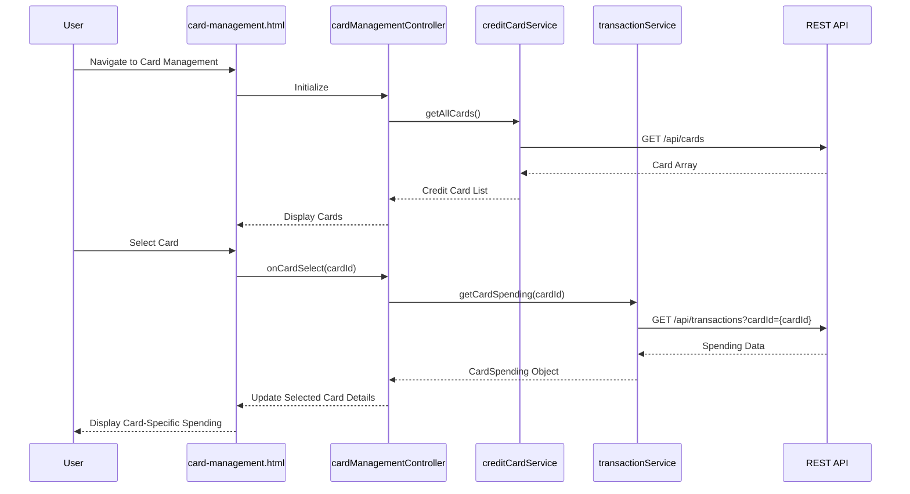

# Low-Level Design: QE-10051 - Multiple Credit Card Management and Tracking

## a. Architecture Mapping

- **Card Management Controller** → AngularJS Controller (`cardManagementController.js`) - Manages card list display and selection
- **Credit Card Data Repository** → AngularJS Service (`creditCardService.js`) - Retrieves and caches card information
- **Transaction Service** → AngularJS Service (`transactionService.js`) - Fetches card-specific spending data
- **Card Selection Filter** → AngularJS Filter (`cardFilterFilter.js`) - Filters cards based on user selection criteria
- **User Interface** → AngularJS View (`card-management.html`) with Bootstrap card components

**Folder Structure:**
```
app/
├── modules/
│   └── cardManagement/
│       ├── controllers/
│       │   └── cardManagementController.js
│       ├── services/
│       │   ├── creditCardService.js
│       │   └── transactionService.js
│       ├── filters/
│       │   └── cardFilterFilter.js
│       └── views/
│           └── card-management.html
```

## b. Component Specifications

| Name | Artifact Type | Responsibility | Key Dependencies |
|------|---------------|----------------|------------------|
| cardManagementController | Controller | Loads card list, handles card selection, displays card-specific details | $scope, creditCardService, transactionService |
| creditCardService | Service | Retrieves all user credit cards from REST API with caching | $http, $q, $cacheFactory |
| transactionService | Service | Fetches spending data filtered by card ID | $http, $q |
| cardFilterFilter | Filter | Filters card array by issuer, status, or search term | None |
| card-management.html | View | Displays card list with individual card details in Bootstrap cards | cardManagementController, cardFilterFilter |

## c. Data Model

**CreditCard:**
```javascript
{
  cardId: String,
  cardNumber: String,
  issuer: String,
  cardType: String,
  creditLimit: Number,
  availableCredit: Number,
  outstandingBalance: Number,
  status: String
}
```

**CardSpending:**
```javascript
{
  cardId: String,
  monthlySpend: Number,
  transactionCount: Number,
  lastTransactionDate: Date
}
```

## d. Data Flow

User navigates to card management view, triggering `cardManagementController` to invoke `creditCardService.getAllCards()`, which retrieves card data via REST API (with caching for performance). Cards are displayed in a Bootstrap grid. When user selects a card, controller calls `transactionService.getCardSpending(cardId)` to fetch card-specific spending. The service returns spending data, which is bound to `$scope.selectedCardSpending` and rendered in the view. User can apply filters via `cardFilterFilter` to narrow the card list.

## e. Primary Sequence Diagram



## f. Implementation Notes

- Use AngularJS $cacheFactory to cache card data and reduce API calls (2-second retrieval requirement)
- Implement pagination or virtual scrolling if card count exceeds 10 for scalability
- Apply ng-repeat with track by cardId for efficient DOM rendering
- Use Bootstrap card component with responsive columns for card display
- Leverage Angular's ng-click for card selection and detail expansion

## g. Error Handling

$http interceptor handles API failures; controller displays error message via Angular alert directive on data retrieval failure.

## h. Security Notes

Standard input validation and secure API calls assumed; authentication tokens managed by existing SSO service.