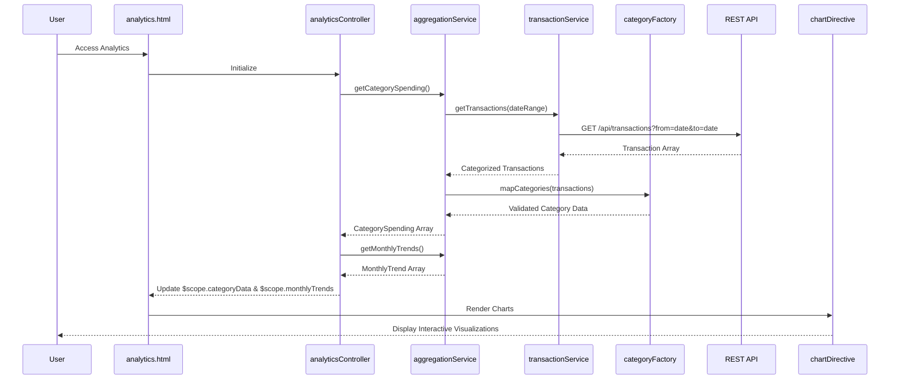

# Low-Level Design: QE-10052 - Spending Analytics and Category Insights

## a. Architecture Mapping

- **Analytics Controller** → AngularJS Controller (`analyticsController.js`) - Manages analytics view and user interactions
- **Transaction Data Service** → AngularJS Service (`transactionService.js`) - Retrieves categorized transaction data
- **Data Aggregation Service** → AngularJS Service (`aggregationService.js`) - Aggregates transactions by category and month
- **Charting Library** → AngularJS Directive (`chartDirective.js`) wrapping Chart.js or D3.js - Renders interactive charts
- **Category Engine** → AngularJS Factory (`categoryFactory.js`) - Maps transactions to predefined categories
- **User Interface** → AngularJS View (`analytics.html`) with Bootstrap layout and chart containers

**Folder Structure:**
```
app/
├── modules/
│   └── analytics/
│       ├── controllers/
│       │   └── analyticsController.js
│       ├── services/
│       │   ├── transactionService.js
│       │   └── aggregationService.js
│       ├── factories/
│       │   └── categoryFactory.js
│       ├── directives/
│       │   └── chartDirective.js
│       └── views/
│           └── analytics.html
```

## b. Component Specifications

| Name | Artifact Type | Responsibility | Key Dependencies |
|------|---------------|----------------|------------------|
| analyticsController | Controller | Loads analytics data, manages chart display, handles time period selection | $scope, aggregationService, transactionService |
| transactionService | Service | Fetches categorized transaction data for specified time range | $http, $q |
| aggregationService | Service | Aggregates transactions by category and month for visualization | transactionService, categoryFactory |
| categoryFactory | Factory | Provides category mapping and validation for 9 predefined categories | None |
| chartDirective | Directive | Wraps Chart.js/D3.js to render interactive bar/pie/line charts | Chart.js or D3.js library |
| analytics.html | View | Displays category breakdown and monthly trend charts in responsive layout | analyticsController, chartDirective |

## c. Data Model

**Transaction:**
```javascript
{
  transactionId: String,
  cardId: String,
  amount: Number,
  category: String,
  date: Date,
  description: String
}
```

**CategorySpending:**
```javascript
{
  category: String,
  totalAmount: Number,
  transactionCount: Number,
  percentage: Number
}
```

**MonthlyTrend:**
```javascript
{
  month: String,
  totalSpend: Number,
  categoryBreakdown: Array<CategorySpending>
}
```

## d. Data Flow

User accesses analytics view, triggering `analyticsController` to call `aggregationService.getCategorySpending()` and `aggregationService.getMonthlyTrends()`. The aggregation service invokes `transactionService.getTransactions()` to fetch categorized transaction data via REST API. `categoryFactory` validates and maps transactions to the 9 predefined categories. Aggregated data is returned to the controller and bound to `$scope.categoryData` and `$scope.monthlyTrends`. The `chartDirective` consumes this data to render interactive charts using Chart.js/D3.js. User interactions (e.g., time period selection) trigger controller methods to refresh data and update charts.

## e. Primary Sequence Diagram



## f. Implementation Notes

- Use AngularJS directive to encapsulate Chart.js/D3.js for reusable chart components with isolated scope
- Implement server-side aggregation via REST API to meet 3-second load time requirement
- Leverage Angular's $filter for date range filtering and sorting in the view
- Apply Bootstrap responsive grid for side-by-side chart display on larger screens
- Use ng-options or ng-repeat for time period selection dropdown

## g. Error Handling

$http interceptor captures API errors; controller displays fallback message if chart data fails to load.

## h. Security Notes

Standard input validation and secure API calls assumed; date range parameters sanitized to prevent injection attacks.