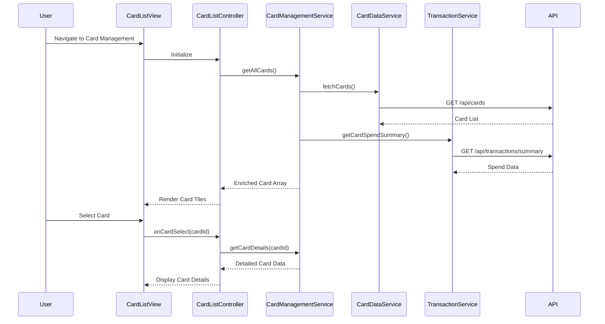

# Low-Level Design: QE-10053 - Multiple Credit Card Management

## a. Architecture Mapping

- **AngularJS Module**: `creditCardApp.cardManagement` - Main module for card management features
- **Controller**: `CardListController` - Manages card list display and user interactions
- **Controller**: `CardDetailsController` - Handles individual card detail views
- **Service**: `CardManagementService` - Business logic for card operations and data aggregation
- **Service**: `CardDataService` - REST API integration for credit card data repository
- **Service**: `TransactionService` - REST API integration for card-specific transaction data
- **Directive**: `cardTile` - Reusable card display component
- **Directive**: `cardFilter` - Card filtering and selection UI component
- **Factory**: `CardModel` - Card data model and validation

**Recommended Folder Structure**:
```
/app
  /modules
    /card-management
      /controllers
      /services
      /directives
      /models
      /views
      card-management.module.js
```

## b. Component Specifications

| Component Name | Artifact Type | Responsibility | Key Dependencies |
|---|---|---|---|
| CardListController | Controller | Orchestrates card list display, filtering, and selection | CardManagementService, $scope, $filter |
| CardDetailsController | Controller | Manages single card detail view and card-specific spend analysis | CardManagementService, CardDataService, TransactionService, $routeParams |
| CardManagementService | Service | Aggregates card data, calculates card-wise metrics, manages state | CardDataService, TransactionService, $q |
| CardDataService | Service | REST API calls to credit card data repository for card info | $http, API_CONFIG |
| TransactionService | Service | REST API calls for card-specific transaction and spending data | $http, API_CONFIG |
| cardTile | Directive | Renders individual card tile with limit, balance, and spend summary | CardModel |
| cardFilter | Directive | Provides filtering UI (by card type, status, issuer) | $filter |
| CardModel | Factory | Defines card object structure and utility methods | None |

## c. Data Model

**CardModel** (JavaScript ES6 Class):
```javascript
{
  cardId: String,
  cardNumber: String (masked),
  cardHolderName: String,
  cardType: String, // 'Visa', 'MasterCard', 'Amex'
  issuer: String,
  creditLimit: Number,
  currentBalance: Number,
  availableCredit: Number,
  status: String, // 'Active', 'Inactive', 'Blocked'
  expiryDate: Date,
  monthlySpend: Number,
  lastUpdated: Date
}
```

**CardSpendSummary** (for card-wise analysis):
```javascript
{
  cardId: String,
  currentMonthSpend: Number,
  transactionCount: Number,
  topCategory: String,
  utilizationPercentage: Number
}
```

## d. Data Flow

User navigates to the card management view, triggering CardListController initialization. The controller invokes CardManagementService.getAllCards(), which calls CardDataService to fetch card details from the REST API (/api/cards). Simultaneously, TransactionService retrieves current month spending per card (/api/transactions/summary). CardManagementService aggregates this data, calculates utilization percentages, and returns enriched card objects to the controller. The view renders card tiles using the cardTile directive. When a user selects a card or applies filters via cardFilter directive, CardDetailsController loads detailed card-specific data and spending patterns, updating the UI with card-wise analysis. All API responses are cached in CardManagementService to support concurrent viewing within the 1-second NFR.

## e. Primary Sequence Diagram



## f. Implementation Notes

- Use AngularJS dependency injection for all services and controllers; register module as `angular.module('creditCardApp.cardManagement', [])`
- Implement CardManagementService as singleton with in-memory cache (ES6 Map) to meet 1-second retrieval NFR and support concurrent viewing
- Use $http interceptor for API authentication token injection and centralized error handling
- Leverage ng-repeat with track by cardId for efficient card tile rendering; apply one-time binding (::) for static card properties
- Implement cardFilter directive with two-way binding to parent scope for real-time filter application without full data reload

## g. Error Handling

HTTP interceptor-based error handling with user-friendly toast notifications for API failures; fallback to cached data when available.

## h. Security Notes

Requires token-based auth via existing SSO; card numbers masked (last 4 digits only) at API level before client rendering.