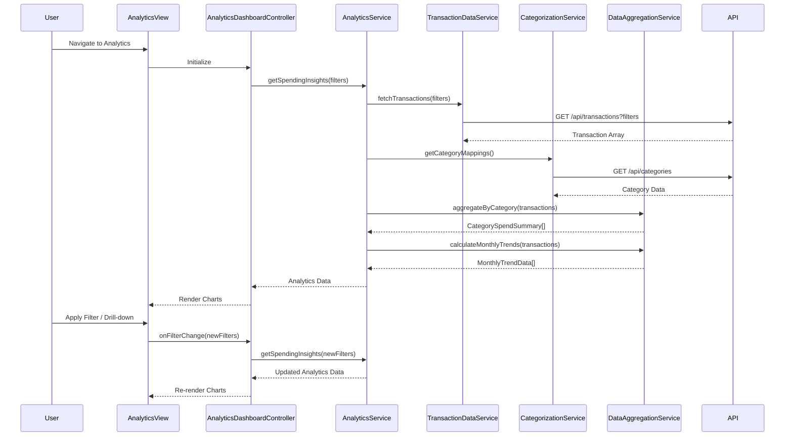

# Low-Level Design: QE-10054 - Analytics and Spending Insights

## a. Architecture Mapping

- **AngularJS Module**: `creditCardApp.analytics` - Main module for analytics and insights features
- **Controller**: `AnalyticsDashboardController` - Manages analytics view, filters, and user interactions
- **Service**: `AnalyticsService` - Business logic for data aggregation and analytics calculations
- **Service**: `TransactionDataService` - REST API integration for raw transaction data
- **Service**: `CategorizationService` - REST API integration for transaction categorization
- **Service**: `DataAggregationService` - Client-side aggregation and trend calculation logic
- **Directive**: `categoryChart` - Reusable directive for category-wise spending pie/bar chart
- **Directive**: `trendChart` - Reusable directive for monthly spend trend line chart
- **Factory**: `TransactionModel` - Transaction data model
- **Factory**: `ChartConfigFactory` - Chart.js/D3.js configuration builder

**Recommended Folder Structure**:
```
/app
  /modules
    /analytics
      /controllers
      /services
      /directives
      /models
      /views
      analytics.module.js
```

## b. Component Specifications

| Component Name | Artifact Type | Responsibility | Key Dependencies |
|---|---|---|---|
| AnalyticsDashboardController | Controller | Orchestrates analytics view, manages filters (date, category, card), triggers data refresh | AnalyticsService, $scope, $filter |
| AnalyticsService | Service | Coordinates data retrieval, aggregation, and analytics computation | TransactionDataService, CategorizationService, DataAggregationService, $q |
| TransactionDataService | Service | REST API calls to retrieve raw transaction data | $http, API_CONFIG |
| CategorizationService | Service | REST API calls to fetch categorized transactions or apply categorization rules | $http, API_CONFIG |
| DataAggregationService | Service | Client-side aggregation for category totals, monthly trends, and statistical calculations | None |
| categoryChart | Directive | Renders interactive category-wise spending chart with drill-down capability | ChartConfigFactory, $timeout |
| trendChart | Directive | Renders monthly spend trend line chart with interactive tooltips | ChartConfigFactory, $timeout |
| TransactionModel | Factory | Defines transaction object structure and utility methods | None |
| ChartConfigFactory | Factory | Generates Chart.js/D3.js configuration objects for consistent visualization styling | None |

## c. Data Model

**TransactionModel** (JavaScript ES6 Class):
```javascript
{
  transactionId: String,
  cardId: String,
  amount: Number,
  currency: String,
  transactionDate: Date,
  merchantName: String,
  category: String, // One of 9 predefined categories
  description: String,
  status: String // 'Posted', 'Pending'
}
```

**CategorySpendSummary**:
```javascript
{
  category: String,
  totalSpend: Number,
  transactionCount: Number,
  percentageOfTotal: Number
}
```

**MonthlyTrendData**:
```javascript
{
  month: String, // 'YYYY-MM'
  totalSpend: Number,
  categoryBreakdown: Array<CategorySpendSummary>
}
```

## d. Data Flow

User navigates to the analytics dashboard, triggering AnalyticsDashboardController initialization. The controller invokes AnalyticsService.getSpendingInsights(filters), which calls TransactionDataService to fetch raw transactions from REST API (/api/transactions) and CategorizationService to retrieve category mappings (/api/categories). DataAggregationService processes the transaction array, grouping by category and month, calculating totals and percentages. Aggregated data (CategorySpendSummary array and MonthlyTrendData array) is returned to the controller. The view renders categoryChart and trendChart directives, passing aggregated data as scope bindings. User interactions (filter changes, chart drill-down) trigger controller methods that update filters and re-invoke AnalyticsService, resulting in incremental data fetch and re-rendering of charts within the 3-second NFR.

## e. Primary Sequence Diagram



## f. Implementation Notes

- Use AngularJS dependency injection; register module as `angular.module('creditCardApp.analytics', ['chart.js'])` with Chart.js library integration
- Implement DataAggregationService with ES6 Array methods (map, reduce, filter) for efficient client-side aggregation of up to 1000+ transactions
- Use $http interceptor for API token injection; implement response caching in TransactionDataService to avoid redundant API calls on filter changes
- Leverage AngularJS $watch on filter object in controller to trigger automatic chart updates; debounce filter changes (300ms) to prevent excessive API calls
- Implement categoryChart and trendChart directives with isolated scope and two-way data binding; use Chart.js for rendering with responsive configuration

## g. Error Handling

HTTP interceptor-based error handling with try/catch blocks in aggregation logic; display user-friendly error messages via toast notifications on API or rendering failures.

## h. Security Notes

Standard input validation and secure API calls assumed; transaction data filtered by authenticated user context at API level.