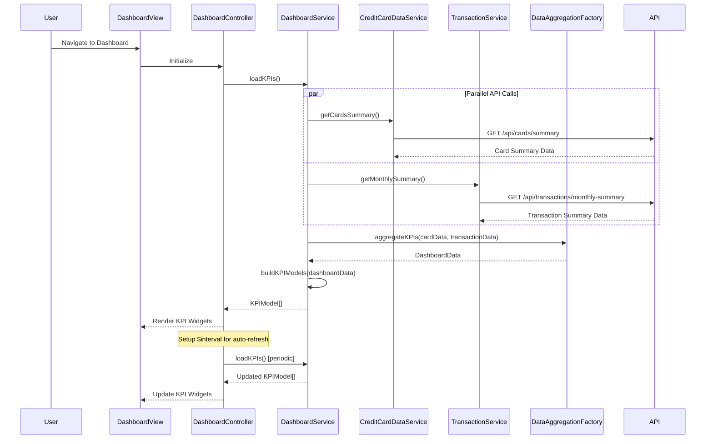

# Low-Level Design: QE-10055 - Dashboard and KPI Management

## a. Architecture Mapping

- **AngularJS Module**: `creditCardApp.dashboard` - Main module for dashboard and KPI features
- **Controller**: `DashboardController` - Manages dashboard view, KPI display, and data refresh
- **Service**: `DashboardService` - Business logic for KPI calculation and data aggregation
- **Service**: `CreditCardDataService` - REST API integration for card balances and credit limits
- **Service**: `TransactionService` - REST API integration for monthly spend and outstanding amounts
- **Directive**: `kpiWidget` - Reusable KPI display widget component
- **Factory**: `KPIModel` - KPI data model and formatting utilities
- **Factory**: `DataAggregationFactory` - Aggregation logic for multi-card KPI calculations

**Recommended Folder Structure**:
```
/app
  /modules
    /dashboard
      /controllers
      /services
      /directives
      /models
      /views
      dashboard.module.js
```

## b. Component Specifications

| Component Name | Artifact Type | Responsibility | Key Dependencies |
|---|---|---|---|
| DashboardController | Controller | Orchestrates dashboard initialization, KPI data loading, and periodic refresh | DashboardService, $scope, $interval |
| DashboardService | Service | Coordinates data retrieval from multiple sources and KPI calculation | CreditCardDataService, TransactionService, DataAggregationFactory, $q |
| CreditCardDataService | Service | REST API calls to retrieve card balances and credit limits | $http, API_CONFIG |
| TransactionService | Service | REST API calls to fetch monthly spend and outstanding amounts | $http, API_CONFIG |
| kpiWidget | Directive | Renders individual KPI tile with value, label, trend indicator, and responsive layout | KPIModel, $filter |
| KPIModel | Factory | Defines KPI object structure, formatting methods (currency, percentage), and validation | None |
| DataAggregationFactory | Factory | Aggregates multi-card data to calculate total credit limit, available credit, and total outstanding | None |

## c. Data Model

**KPIModel** (JavaScript ES6 Class):
```javascript
{
  kpiId: String,
  label: String, // 'Monthly Spend', 'Total Credit Limit', 'Available Credit', 'Outstanding Amount'
  value: Number,
  formattedValue: String, // Currency formatted
  unit: String, // 'currency', 'percentage'
  trend: String, // 'up', 'down', 'neutral'
  trendPercentage: Number,
  lastUpdated: Date
}
```

**DashboardData**:
```javascript
{
  monthlySpend: Number,
  totalCreditLimit: Number,
  availableCredit: Number,
  outstandingAmount: Number,
  creditUtilization: Number, // Percentage
  cardCount: Number,
  lastRefreshed: Date
}
```

## d. Data Flow

User navigates to the dashboard, triggering DashboardController initialization. The controller invokes DashboardService.loadKPIs(), which makes parallel REST API calls via CreditCardDataService (/api/cards/summary) to retrieve total credit limits and balances, and TransactionService (/api/transactions/monthly-summary) to fetch current month spending and outstanding amounts. DataAggregationFactory processes the responses, summing credit limits across all active cards, calculating available credit (total limit - outstanding), and computing credit utilization percentage. DashboardService constructs KPIModel objects for each of the four KPIs and returns them to the controller. The view renders kpiWidget directives for each KPI in a responsive grid layout. DashboardController sets up $interval to refresh KPIs at configurable intervals (default 60 seconds), ensuring real-time data updates within the 2-second load NFR.

## e. Primary Sequence Diagram



## f. Implementation Notes

- Use AngularJS dependency injection; register module as `angular.module('creditCardApp.dashboard', [])`
- Implement DashboardService with $q.all() for parallel API calls to meet 2-second load time NFR
- Use $http interceptor for API authentication and centralized error handling; implement response caching with TTL (60 seconds) to reduce API load
- Leverage Bootstrap grid system (col-xs-12, col-sm-6, col-md-3) in kpiWidget directive template for responsive layout across mobile and desktop
- Implement $interval in DashboardController for periodic refresh; ensure proper cleanup on $scope.$destroy to prevent memory leaks

## g. Error Handling

HTTP interceptor-based error handling with graceful degradation; display cached data with stale indicator if API calls fail during refresh.

## h. Security Notes

Requires token-based auth via existing SSO; all API endpoints secured with user context validation at backend.