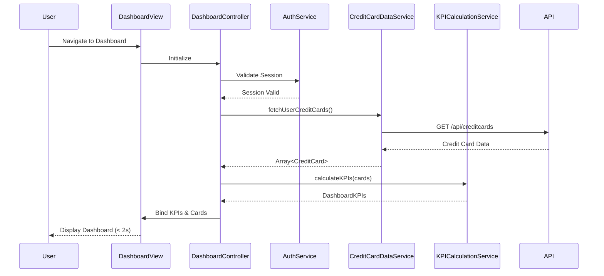

# Low-Level Design: QE-10056 - Dashboard KPIs and Credit Card Overview

## a. Architecture Mapping

- **Module**: `creditCardDashboard` - Main application module for dashboard functionality
- **Controller**: `DashboardController` - Manages dashboard state, KPI display, and user interactions
- **Service**: `CreditCardDataService` - Handles API calls to retrieve credit card data and balances
- **Service**: `KPICalculationService` - Computes aggregated metrics (monthly spend, total limits, available credit, outstanding)
- **Service**: `AuthService` - Manages user authentication and session validation
- **Factory**: `DashboardRefreshFactory` - Implements periodic polling mechanism for real-time data updates

**Recommended Folder Structure:**
```
/app
  /modules
    /dashboard
      dashboard.module.js
      dashboard.controller.js
      dashboard.html
  /services
    creditCardData.service.js
    kpiCalculation.service.js
    auth.service.js
  /factories
    dashboardRefresh.factory.js
  /models
    creditCard.model.js
```

## b. Component Specifications

| Name | Artifact Type | Responsibility | Key Dependencies |
|------|--------------|----------------|------------------|
| creditCardDashboard | Module | Root module for dashboard feature, registers all components | angular, ui.router, ngAnimate |
| DashboardController | Controller | Orchestrates dashboard view, manages KPI display and refresh logic | CreditCardDataService, KPICalculationService, AuthService, DashboardRefreshFactory |
| CreditCardDataService | Service | Fetches credit card details, balances, and transaction summaries via REST API | $http, $q, AuthService |
| KPICalculationService | Service | Aggregates metrics across multiple cards (total spend, limits, available credit, outstanding) | CreditCardDataService |
| AuthService | Service | Validates user session and manages authentication tokens | $http, $window |
| DashboardRefreshFactory | Factory | Implements 30-60 second polling for real-time balance updates | $interval, CreditCardDataService |
| creditCard | Model | Represents credit card entity with properties (cardId, limit, outstanding, monthlySpend, availableCredit) | None |

## c. Data Model

**CreditCard Model:**
```javascript
{
  cardId: String,
  cardNumber: String (masked),
  cardType: String,
  creditLimit: Number,
  outstandingAmount: Number,
  availableCredit: Number,
  monthlySpend: Number,
  lastUpdated: Date
}
```

**DashboardKPIs Model:**
```javascript
{
  totalCreditLimit: Number,
  totalOutstanding: Number,
  totalAvailableCredit: Number,
  totalMonthlySpend: Number,
  cardCount: Number,
  cards: Array<CreditCard>
}
```

## d. Data Flow

User authenticates and navigates to dashboard → DashboardController initializes and calls AuthService to validate session → Controller invokes CreditCardDataService to fetch all user credit cards via REST API → KPICalculationService receives card data and computes aggregated KPIs (sum of limits, outstanding, available credit, monthly spend) → Controller binds computed KPIs and card list to view → Dashboard HTML renders consolidated KPIs with individual card breakdowns → DashboardRefreshFactory initiates 30-60 second polling to refresh data → On each interval, updated data flows through the same pipeline, updating UI reactively via Angular's two-way binding.

## e. Primary Sequence Diagram



## f. Implementation Notes

- Use AngularJS 1.x module pattern with dependency injection for all services and controllers
- Implement ES6 classes for services and use arrow functions for callbacks to maintain `this` context
- Leverage $http interceptors for adding authentication tokens to all API requests
- Use $interval for polling mechanism with proper cleanup in controller $destroy event
- Apply Bootstrap grid system (col-md-*, col-sm-*) for responsive dashboard layout across devices

## g. Error Handling

HTTP interceptor captures API errors (401, 403, 500), displays user-friendly notifications via toastr/alert service, and redirects to login on authentication failures.

## h. Security Notes

Requires token-based auth via existing SSO; all API calls include Bearer token in Authorization header.