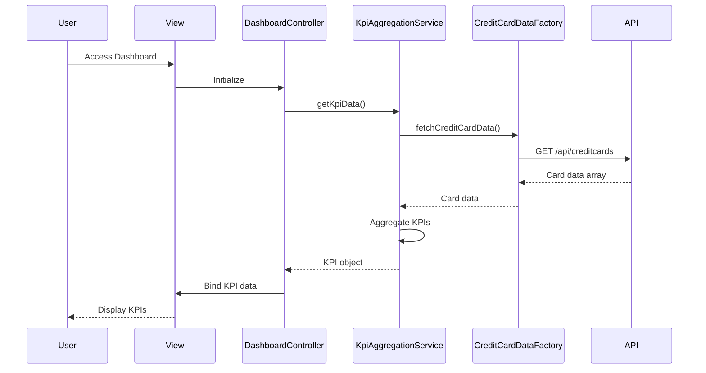

# Low-Level Design: Credit Card Dashboard and KPI Management
**Epic ID:** QE-10057

## a. Architecture Mapping

- **Dashboard UI Layer** → AngularJS Module (`ccDashboardModule`) + Controller (`DashboardController`) + HTML5 View
- **KPI Aggregation Service** → AngularJS Service (`KpiAggregationService`) using $http for REST API calls
- **Real-time Data Refresh** → AngularJS Service (`DataRefreshService`) with $interval for polling mechanism
- **Credit Card Data Source Integration** → REST API endpoints consumed via Factory (`CreditCardDataFactory`)

**Recommended Folder Structure:**
```
app/
├── modules/dashboard/
│   ├── controllers/dashboard.controller.js
│   ├── services/kpi-aggregation.service.js
│   ├── services/data-refresh.service.js
│   ├── factories/credit-card-data.factory.js
│   ├── views/dashboard.html
│   └── dashboard.module.js
├── shared/
│   └── styles/dashboard.css
└── app.js
```

## b. Component Specifications

| Component Name | Artifact Type | Responsibility | Key Dependencies |
|----------------|---------------|----------------|------------------|
| ccDashboardModule | Module | Root module for dashboard feature | angular, ngRoute, ngResource |
| DashboardController | Controller | Manages dashboard view state and KPI data binding | KpiAggregationService, DataRefreshService, $scope |
| KpiAggregationService | Service | Fetches and aggregates KPI data from API | CreditCardDataFactory, $q |
| DataRefreshService | Service | Polls backend every 30s for real-time KPI updates | $interval, KpiAggregationService |
| CreditCardDataFactory | Factory | Handles REST API calls for credit card data | $http, API_CONFIG |
| dashboard.html | View | Displays KPIs in responsive Bootstrap grid layout | Bootstrap CSS, AngularJS directives |

## c. Data Model

```javascript
// KPI Data Model
const KpiModel = {
  monthlySpend: Number,        // Total spend for current month
  totalCreditLimit: Number,    // Sum of all card limits
  availableCredit: Number,     // Total available credit across cards
  outstandingAmount: Number,   // Total outstanding balance
  lastUpdated: Date            // Timestamp of last data refresh
};

// Credit Card Model
const CreditCardModel = {
  cardId: String,              // Unique card identifier
  cardNumber: String,          // Masked card number (last 4 digits)
  creditLimit: Number,         // Card credit limit
  availableCredit: Number,     // Available credit on card
  outstandingBalance: Number,  // Current outstanding amount
  monthlySpend: Number         // Spend for current month
};
```

## d. Data Flow

User accesses the dashboard view which triggers DashboardController initialization. The controller invokes KpiAggregationService to fetch KPI data via CreditCardDataFactory, which makes REST API calls to retrieve credit card balances and transaction summaries. The aggregated KPI data (monthly spend, credit limit, available credit, outstanding amount) is bound to the view using two-way data binding. DataRefreshService polls the backend every 30 seconds using $interval, updates the KPI data, and triggers view refresh automatically via $scope.$apply, ensuring real-time visibility without page reload.

## e. Primary Sequence Diagram



## f. Implementation Notes

- Use AngularJS 1.x module pattern with dependency injection for all services and controllers
- Implement responsive layout using Bootstrap grid system (col-xs, col-sm, col-md) for mobile-first design
- Use $http interceptor for centralized API error handling and loading state management
- Leverage $interval service for 30-second polling; cancel interval on $scope.$destroy to prevent memory leaks
- Apply ES6 arrow functions and const/let for cleaner service implementations

## g. Error Handling

HTTP interceptor captures API errors, displays user-friendly notifications via toast/alert, and logs errors to console; service layer uses $q.reject for promise-based error propagation.

## h. Security Notes

Requires token-based authentication via existing SSO; all API calls include Authorization header with JWT token.