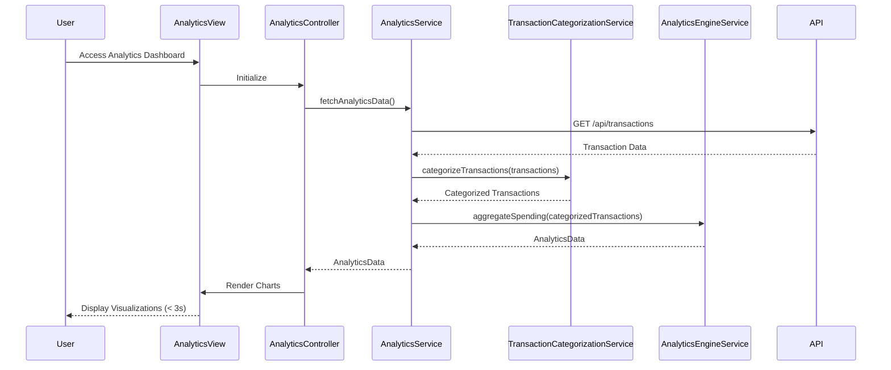

# Low-Level Design: QE-10058 - Spending Analytics and Insights

## a. Architecture Mapping

- **Module**: `spendingAnalytics` - Main module for analytics and visualization features
- **Controller**: `AnalyticsController` - Manages analytics view state, filter interactions, and chart rendering
- **Service**: `AnalyticsService` - Orchestrates data retrieval and aggregation for analytics
- **Service**: `TransactionCategorizationService` - Classifies transactions into 9 predefined categories
- **Service**: `AnalyticsEngineService` - Processes spending data and generates aggregated insights
- **Directive**: `spendingChart` - Custom directive for rendering interactive charts using Chart.js or D3.js
- **Factory**: `ChartConfigFactory` - Provides chart configuration templates for different visualization types

**Recommended Folder Structure:**
```
/app
  /modules
    /analytics
      analytics.module.js
      analytics.controller.js
      analytics.html
  /services
    analytics.service.js
    transactionCategorization.service.js
    analyticsEngine.service.js
  /directives
    spendingChart.directive.js
  /factories
    chartConfig.factory.js
  /models
    spendingAnalytics.model.js
```

## b. Component Specifications

| Name | Artifact Type | Responsibility | Key Dependencies |
|------|--------------|----------------|------------------|
| spendingAnalytics | Module | Root module for analytics feature, integrates charting libraries | angular, ui.router, chart.js |
| AnalyticsController | Controller | Manages analytics view, handles filter interactions, triggers chart updates | AnalyticsService, AnalyticsEngineService, ChartConfigFactory |
| AnalyticsService | Service | Fetches transaction data and coordinates categorization and aggregation | $http, TransactionCategorizationService, AnalyticsEngineService |
| TransactionCategorizationService | Service | Classifies transactions into 9 categories (Food, Fuel, Shopping, Travel, Entertainment, Utilities, Healthcare, Education, Misc) | None |
| AnalyticsEngineService | Service | Aggregates spending by category, card, and time period; generates trend data | TransactionCategorizationService |
| spendingChart | Directive | Renders interactive charts (pie, bar, line) with drill-down capability | ChartConfigFactory, Chart.js |
| ChartConfigFactory | Factory | Provides reusable chart configuration objects for different visualization types | None |

## c. Data Model

**Transaction Model:**
```javascript
{
  transactionId: String,
  cardId: String,
  amount: Number,
  category: String,
  date: Date,
  description: String
}
```

**CategorySpending Model:**
```javascript
{
  category: String,
  totalAmount: Number,
  transactionCount: Number,
  percentage: Number
}
```

**MonthlyTrend Model:**
```javascript
{
  month: String,
  totalSpend: Number,
  categoryBreakdown: Array<CategorySpending>
}
```

**AnalyticsData Model:**
```javascript
{
  categorySpending: Array<CategorySpending>,
  monthlyTrends: Array<MonthlyTrend>,
  cardWiseSpending: Array<{cardId: String, totalSpend: Number}>,
  totalSpend: Number
}
```

## d. Data Flow

User navigates to analytics dashboard → AnalyticsController initializes and calls AnalyticsService to fetch transaction data → AnalyticsService retrieves transactions via REST API → TransactionCategorizationService classifies each transaction into one of 9 categories → AnalyticsEngineService aggregates spending by category, card, and month → Controller receives AnalyticsData object → spendingChart directive renders category-wise pie/bar chart, monthly trend line chart, and card-wise breakdown → User interacts with filters (date range, category, card) → Controller updates filter parameters and re-triggers aggregation → Charts re-render with filtered data within 3 seconds, maintaining responsive layout.

## e. Primary Sequence Diagram



## f. Implementation Notes

- Use AngularJS directive with isolated scope for reusable chart components, binding data via two-way binding
- Implement ES6 Map for efficient category aggregation in AnalyticsEngineService
- Integrate Chart.js library for responsive, interactive charts with drill-down via click event handlers
- Use $q promises for asynchronous data processing pipeline (fetch → categorize → aggregate → render)
- Apply lazy loading for chart library to optimize initial page load performance

## g. Error Handling

Service-level try/catch blocks with $exceptionHandler for logging; user-facing errors displayed via notification service with retry option.

## h. Security Notes

Standard input validation and secure API calls assumed; authentication token validated via HTTP interceptor.