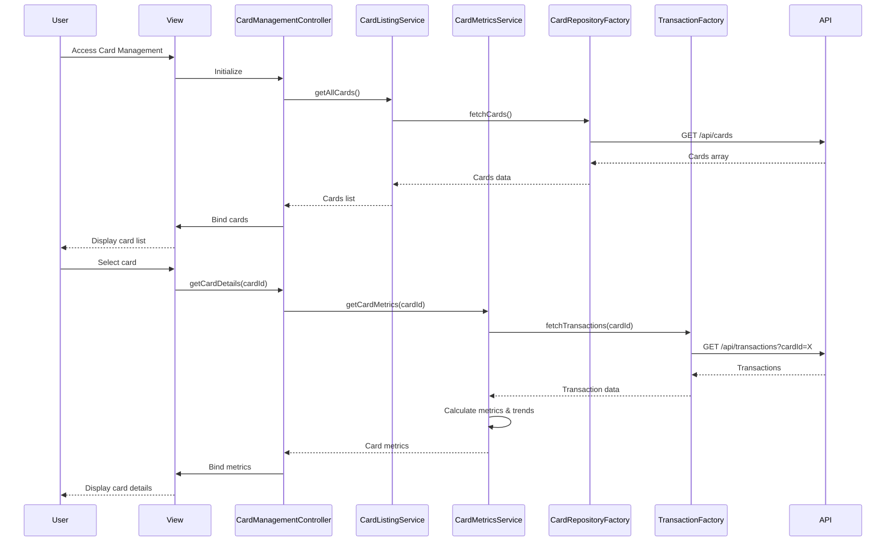

# Low-Level Design: Multiple Credit Card Management
**Epic ID:** QE-10059

## a. Architecture Mapping

- **Card Management Module** → AngularJS Module (`ccCardManagementModule`) + Controller (`CardManagementController`) + HTML5 View
- **Card Listing Service** → AngularJS Service (`CardListingService`) for fetching and managing card list
- **Card Metrics Service** → AngularJS Service (`CardMetricsService`) for calculating card-specific metrics
- **Credit Card Data Repository Integration** → REST API endpoints consumed via Factory (`CardRepositoryFactory`)
- **Transaction Processing System Integration** → REST API endpoints consumed via Factory (`TransactionFactory`)

**Recommended Folder Structure:**
```
app/
├── modules/card-management/
│   ├── controllers/card-management.controller.js
│   ├── services/card-listing.service.js
│   ├── services/card-metrics.service.js
│   ├── factories/card-repository.factory.js
│   ├── factories/transaction.factory.js
│   ├── views/card-list.html
│   ├── views/card-detail.html
│   └── card-management.module.js
├── shared/
│   └── styles/card-management.css
└── app.js
```

## b. Component Specifications

| Component Name | Artifact Type | Responsibility | Key Dependencies |
|----------------|---------------|----------------|------------------|
| ccCardManagementModule | Module | Root module for card management feature | angular, ngRoute |
| CardManagementController | Controller | Manages card list view, selection, and navigation to card details | CardListingService, CardMetricsService, $scope, $location |
| CardListingService | Service | Retrieves and caches list of user's credit cards | CardRepositoryFactory, $q |
| CardMetricsService | Service | Calculates card-specific metrics including monthly spend trends | TransactionFactory, $filter |
| CardRepositoryFactory | Factory | Handles REST API calls for credit card CRUD operations | $http, API_CONFIG |
| TransactionFactory | Factory | Fetches transaction data filtered by card ID | $http, API_CONFIG |
| card-list.html | View | Displays all cards in responsive grid with summary metrics | Bootstrap, ng-repeat |
| card-detail.html | View | Shows detailed view of single card with metrics and trends | Bootstrap, Chart.js directive |

## c. Data Model

```javascript
// Credit Card Model
const CreditCard = {
  cardId: String,              // Unique card identifier
  cardHolderName: String,      // Name on card
  cardNumber: String,          // Masked card number (e.g., **** **** **** 1234)
  cardType: String,            // Visa, MasterCard, Amex, etc.
  creditLimit: Number,         // Maximum credit limit
  availableCredit: Number,     // Current available credit
  outstandingBalance: Number,  // Current outstanding amount
  expiryDate: String,          // MM/YY format
  status: String               // Active, Blocked, Expired
};

// Card Metrics Model
const CardMetrics = {
  cardId: String,              // Reference to card
  currentMonthSpend: Number,   // Spend for current month
  previousMonthSpend: Number,  // Spend for previous month
  utilizationRate: Number,     // (outstandingBalance / creditLimit) * 100
  monthlyTrends: Array         // Array of {month: String, spend: Number}
};
```

## d. Data Flow

User navigates to the card management view, triggering CardManagementController to invoke CardListingService, which fetches all user credit cards via CardRepositoryFactory REST API call. The card list is rendered using ng-repeat in a responsive Bootstrap grid. When user selects a card, the controller calls CardMetricsService to fetch card-specific transaction data via TransactionFactory, calculates monthly spend trends by grouping transactions by month, and computes utilization rate. The detailed card view displays individual card metrics, trends chart, and allows comparison. All data updates flow through two-way binding to the view.

## e. Primary Sequence Diagram



## f. Implementation Notes

- Use AngularJS $routeProvider for navigation between card list and card detail views
- Implement CardListingService with in-memory caching to reduce API calls; cache expires on user logout
- Use AngularJS $filter('date') and custom filters for formatting card numbers and currency values
- Leverage ng-repeat with track by cardId for optimal rendering performance with up to 10 cards
- Integrate Chart.js via angular-chart.js directive for monthly spend trend visualization

## g. Error Handling

HTTP interceptor-based error handling with user-friendly toast notifications; service layer wraps API calls in try/catch and returns rejected promises on failure.

## h. Security Notes

Requires token-based auth via existing SSO; implements data isolation by filtering API responses by authenticated user ID; card numbers are masked on client side.